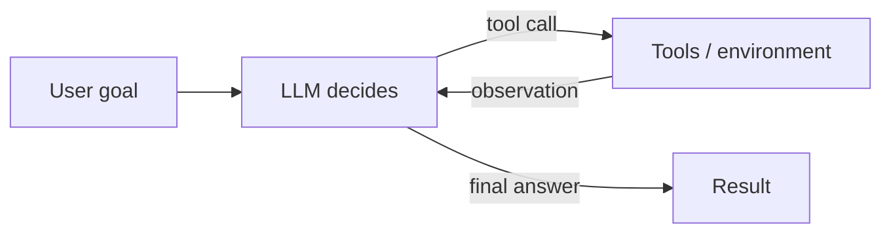
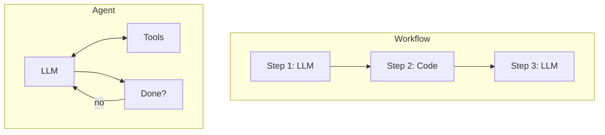
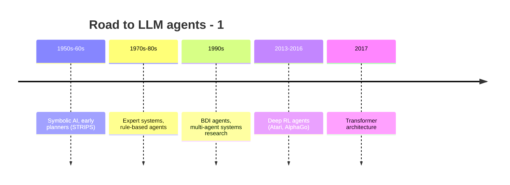
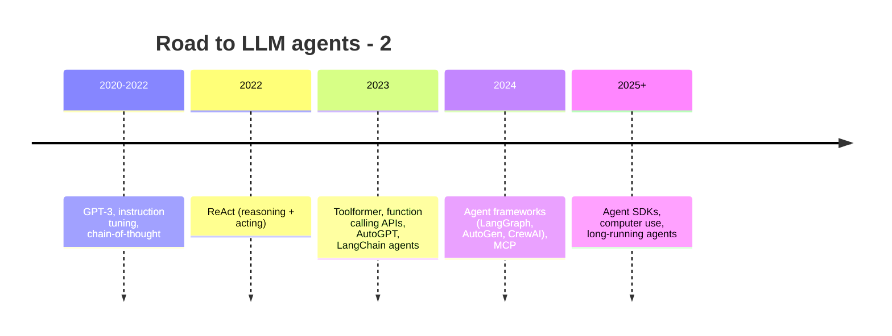
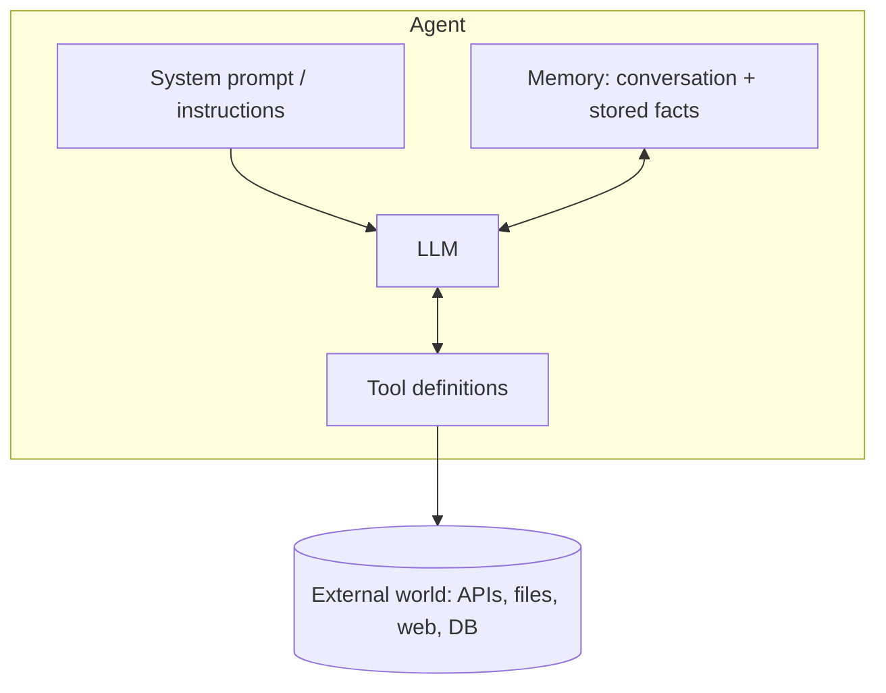

# Module 1: Foundations & History

**Goal:** understand what an LLM agent is, where the idea comes from, and how it differs from a chatbot or a fixed workflow.
**Time:** ~15 min. **Prerequisites:** basic Python or JavaScript.

## 1. What is an agent?

Classic definition (Russell & Norvig): an agent *perceives* its environment and *acts* on it to reach goals.
An **LLM agent** uses a language model as the decision-making core of that loop:

> An LLM agent is a program where an LLM repeatedly decides what to do next (usually which tool to call), observes the result, and continues until the goal is reached or it stops.



## 2. Chatbot vs. workflow vs. agent

| | Chatbot | Workflow | Agent |
|---|---|---|---|
| Control flow | None (one reply per turn) | Fixed in code | Chosen by the LLM at runtime |
| Tools | No | Yes, predefined order | Yes, chosen dynamically |
| Predictability | High | High | Lower |
| Cost / latency | Low | Medium | Higher, variable |
| Best for | Q&A | Well-understood tasks | Open-ended tasks |



**Rule of thumb:** use the least autonomy that solves the problem. Start with a single LLM call, then a workflow, and only then an agent.

## 3. A short history





Key ideas, in plain words:

- **Symbolic / rule-based agents:** hand-written rules; precise but brittle.
- **Reinforcement learning agents:** learn from reward in narrow environments; hard to generalize.
- **Chain-of-thought (2022):** asking a model to "think step by step" improves reasoning.
- **ReAct (2022):** interleave *Thought -> Action -> Observation*, the template for most agents today.
- **Function calling (2023):** the API returns structured tool calls instead of free text, making tool use reliable enough for production.
- **Agent frameworks and protocols (2023-):** graph runtimes, multi-agent libraries, and MCP (Model Context Protocol) for sharing tools.

## 4. Anatomy of an LLM agent



Four ingredients: **model**, **instructions**, **tools**, **memory/state**. The *loop* ties them together.

## 5. The agent loop in pseudocode

```text
messages = [system_prompt, user_goal]
repeat up to MAX_STEPS:
    reply = llm(messages, tools)
    messages.append(reply)
    if reply has no tool calls:
        return reply.text            # done
    for call in reply.tool_calls:
        result = run_tool(call.name, call.arguments)
        messages.append(tool_result(call.id, result))
raise "step limit reached"
```

Always cap the number of steps; otherwise a confused model can loop forever and burn money.

Note what the loop does to `messages`: every pass appends the model's reply, and every tool call appends a result. After one tool call the list is `system`, `user`, `assistant` (asks for the tool), `tool` (the result), `assistant` (the answer). The hands-on section below shows these messages for real.

## 6. Hands-on: your first agent

Set up the backend (README "Quick start" and `.env.example`), then run the minimal agent from the project root: `python examples/python/m01_minimal_agent.py` or `node examples/js/m01_minimal_agent.mjs`. Both import the shared client ([`llm_client.py`](../examples/python/llm_client.py), [`llm_client.mjs`](../examples/js/llm_client.mjs)) automatically. The tool-calling loop below is ~40 lines with no framework.

### Python (`examples/python/m01_minimal_agent.py`)

```python
import json
from llm_client import get_client, show, trace_mode

def get_time(city: str) -> str:
    return f"It is 12:00 in {city}."   # stub; replace with a real API

TOOLS = [{
    "type": "function",
    "function": {
        "name": "get_time",
        "description": "Get the current time in a city.",
        "parameters": {
            "type": "object",
            "properties": {"city": {"type": "string"}},
            "required": ["city"],
        },
    },
}]
REGISTRY = {"get_time": get_time}

def run_agent(goal: str, max_steps: int = 5) -> str:
    client, model = get_client()
    mode = trace_mode(default="compact")  # LLM_TRACE=raw: full JSON; LLM_TRACE=off: silent
    messages = [
        {"role": "system", "content": "You are a helpful assistant. Use tools when needed."},
        {"role": "user", "content": goal},
    ]
    for step in range(1, max_steps + 1):
        msg = client.chat.completions.create(
            model=model, messages=messages, tools=TOOLS
        ).choices[0].message
        messages.append(msg)
        show(msg, step, mode)
        if not msg.tool_calls:  # no tool call = the model has given its final answer
            return msg.content
        for call in msg.tool_calls:
            try:
                args = json.loads(call.function.arguments)
                result = REGISTRY[call.function.name](**args) # call the registered tool function with the provided arguments
            except Exception as exc:  # feed errors back so the model can retry
                result = f"Error: {exc}"
            tool_msg = {"role": "tool", "tool_call_id": call.id, "content": result}
            messages.append(tool_msg)
            show(tool_msg, step, mode)
    raise RuntimeError("Step limit reached")

if __name__ == "__main__":
    print(run_agent("What time is it in Budapest?"))
```

### JavaScript (`examples/js/m01_minimal_agent.mjs`)

```js
import { chat, show, traceMode } from "./llm_client.mjs";

const getTime = ({ city }) => `It is 12:00 in ${city}.`; // stub

const tools = [{
  type: "function",
  function: {
    name: "get_time",
    description: "Get the current time in a city.",
    parameters: { type: "object", properties: { city: { type: "string" } }, required: ["city"] },
  },
}];
const registry = { get_time: getTime };

async function runAgent(goal, maxSteps = 5) {
  const mode = traceMode("compact"); // LLM_TRACE=raw: full JSON; LLM_TRACE=off: silent
  const messages = [
    { role: "system", content: "You are a helpful assistant. Use tools when needed." },
    { role: "user", content: goal },
  ];
  for (let step = 1; step <= maxSteps; step++) {
    const msg = await chat(messages, { tools });
    messages.push(msg);
    show(msg, step, mode);
    if (!msg.tool_calls?.length) return msg.content; // no tool call = the model has given its final answer
    for (const call of msg.tool_calls) {
      let result;
      try {
        result = registry[call.function.name](JSON.parse(call.function.arguments)); // call the registered tool function with the provided arguments
      } catch (err) {
        result = `Error: ${err.message}`; // feed errors back so the model can retry
      }
      const toolMsg = { role: "tool", tool_call_id: call.id, content: result };
      messages.push(toolMsg);
      show(toolMsg, step, mode);
    }
  }
  throw new Error("Step limit reached");
}

console.log(await runAgent("What time is it in Budapest?"));
```

### Reading the messages: tool calls and the final answer

The loop stops when the model's reply has no `tool_calls`. You can *see* this in the conversation itself: `m01` prints every message it adds to the conversation.

#### What you see when you run it

```text
[step 1] assistant -> TOOL CALL get_time({"city":"Budapest"})  id=call_Lx2Eu…
[step 1] tool      <- It is 12:00 in Budapest.  (tool_call_id=call_Lx2Eu…)
[step 2] assistant -> FINAL ANSWER (no tool_calls): It is **12:00** in Budapest.
```

- `assistant -> TOOL CALL`: the model does not answer yet, it asks your code to run a tool.
- `tool <-`: the result your code sends back.
- `assistant -> FINAL ANSWER`: a reply without tool calls. The loop returns it and stops.

The `system` and `user` messages are not printed because you wrote them. How to switch the printing on and off: see [Controlling the trace](#controlling-the-trace-llm_trace) at the end of this section.

#### The conversation behind it

Even this minimal agent builds the conversation, the list `messages`, one message at a time:

| When | Code in `m01` | `messages` afterwards | The next model call receives |
|---|---|---|---|
| Before the loop | `messages = [system, user]` | `system`, `user` (2 messages) | call 1 gets these 2 |
| Pass 1: the model asks for a tool | `messages.append(msg)` | + `assistant` with `tool_calls` (3) | |
| Pass 1: your code runs the tool | `messages.append(tool_msg)` | + `tool` (4) | call 2 gets these 4 |
| Pass 2: the model answers | `messages.append(msg)`, then `return msg.content` | + `assistant` with the final text (5) | none: the loop ends |

(In the JavaScript version `append` is `push`.)

- **Every call sends the whole list.** Call 1 sends 2 messages, call 2 sends 4. The model is stateless: this is how it knows that it asked for a tool and what came back.
- **The `tool` message is written by your code, not by the model.** It is the only message in the list that the LLM did not write (and the `system` and `user` messages are yours too).
- **The final `assistant` message is appended before the `return`.** `m01` does not use it afterwards, but if you kept `messages` you could continue the chat with a follow-up question.

#### The raw messages

With `LLM_TRACE=raw` the examples print the full messages. These are the three messages of the run above, exactly as the API returns them (ids shortened, empty fields removed):

```jsonc
// step 1, assistant: the model ASKS for a tool. It does not run anything, and has no "content".
{ "role": "assistant",
  "tool_calls": [ { "id": "call_Lx2Eu…", "type": "function",
                    "function": { "name": "get_time", "arguments": "{\"city\":\"Budapest\"}" } } ] }

// step 1, tool: YOUR code ran get_time and reports back. tool_call_id must match the call's id.
{ "role": "tool", "tool_call_id": "call_Lx2Eu…", "content": "It is 12:00 in Budapest." }

// step 2, assistant: text and NO "tool_calls" key at all = the final answer; the loop returns.
{ "role": "assistant", "content": "It is **12:00** in Budapest." }
```

What to notice:

- **`arguments` is a JSON string**, not an object: you must parse it (`json.loads` / `JSON.parse`). Small models sometimes produce broken JSON here, which is why the loop has a `try/except` that returns the error as the tool result.
- **`id` ties request to result.** One reply can contain several tool calls; each result message carries the `tool_call_id` of its call.
- **The tool-call message has no `content`** (it is empty or missing), and the final answer has no `tool_calls`.

#### How the loop decides

| What the assistant message contains | Meaning | What the loop does |
|---|---|---|
| `tool_calls` | The model wants tools run | Run them, append `tool` messages, call the model again |
| Text in `content`, no `tool_calls` | Final answer | Return it |
| Neither (empty reply) | Gave up, or token limit hit (typical for reasoning models) | Treat as an error |
| Still `tool_calls` at the step limit | The model never finished | Stop with an error (`max_steps`) |

The API response also carries a `finish_reason` (for example `tool_calls` or `stop`) next to the message. It is a useful hint when debugging, but the loop only needs the message itself, so the examples check `tool_calls`.

#### Where do these messages come from?

The server answers with JSON over HTTP, and the JSON above is what travels over the wire. The two examples read it differently:

- **JavaScript** (`llm_client.mjs`) calls `fetch` and `res.json()`, so `msg` is a plain object and the trace prints it as it is.
- **Python** uses the official `openai` package, which converts the JSON into typed objects (it is built on the Pydantic library), so you write `msg.tool_calls` instead of `msg["tool_calls"]`. `msg.model_dump()` is a standard Pydantic method that turns such an object back into a plain dict, and `show()` uses it only to print. Nothing OpenAI-specific is hidden in it. The loop appends the object itself to `messages`; the package accepts objects and dicts alike when you send the history back.

#### Controlling the trace (`LLM_TRACE`)

The trace is controlled by the environment variable `LLM_TRACE`:

| Value | Prints |
|---|---|
| `compact` (also `1`, `on`) | one line per message |
| `raw` | each message as full JSON |
| `off` | nothing |

If `LLM_TRACE` is not set, `m01` uses `compact` and the other examples (such as `m02`) use `off`. If it is set, in your shell or in `.env`, that value applies to **every** example. `.env.example` ships with `LLM_TRACE=compact`, so after copying it to `.env`, `m02` prints its trace too; set `off` to silence everything.

How to set it (run the commands from the project root):

| Where | Command | Lasts |
|---|---|---|
| PowerShell | `$env:LLM_TRACE = "raw"` then `python examples/python/m01_minimal_agent.py` | until you run `Remove-Item Env:LLM_TRACE` or close the window |
| bash / zsh / Git Bash | `LLM_TRACE=raw python examples/python/m01_minimal_agent.py` | that one command |
| `.env` file | change or add the line `LLM_TRACE=raw` | every run, until you change the line (a variable set in the shell wins over `.env`) |

The same works for the JavaScript examples, for instance `node examples/js/m01_minimal_agent.mjs`.

> **Reasoning models:** avoid "thinking" models (e.g. Qwen3.x) for these examples: they can spend the whole token budget thinking and return an empty answer, and are very slow locally. Load a non-reasoning, tool-capable instruct model. Variables are read from a `.env` file in the project root or from the environment.
>
> **Small local models:** tool calling depends on the model and its chat template. In LM Studio choose a model with tool-use support, keep tool descriptions short, use few tools (1-5), and expect occasional malformed arguments. Wrap `json.loads` in error handling and feed errors back to the model as a tool result so it can retry.

## 7. Key takeaways

- An agent = LLM + tools + memory + a loop; the LLM controls the flow.
- Prefer the simplest design: single call, then workflow, then agent.
- A reply with `tool_calls` means "run these and call me again"; a reply without them is the final answer.
- ReAct and function calling are the foundation of modern agents.
- Always bound the loop (max steps, timeouts, budgets).

## Exercises

1. Add a second tool (e.g. `add(a, b)`) and ask a question that needs both tools.
2. Run `m01` with `LLM_TRACE=raw`. Which field tells you the loop must continue, and what is different in the last assistant message? Then make `get_time` raise an exception and watch the `tool` message.
3. Break the tool on purpose (raise an exception). Return the error as the tool result and observe how the model reacts.
4. Run the same goal against LM Studio and Azure. Compare tool-call reliability and latency.

## Further reading

- Yao et al., *ReAct: Synergizing Reasoning and Acting in Language Models* (2022)
- Anthropic, *Building Effective Agents* (2024)
- Russell & Norvig, *Artificial Intelligence: A Modern Approach* (agents chapter)

**Next:** [Module 2: Core building blocks](02-building-blocks.md)
