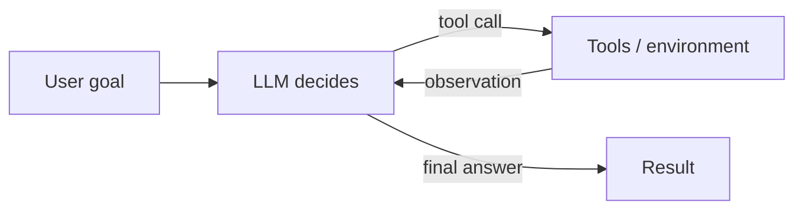
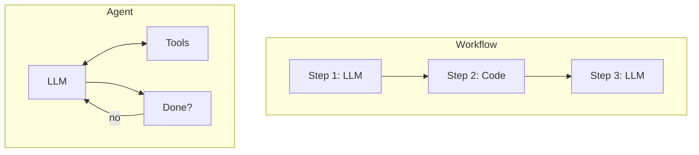
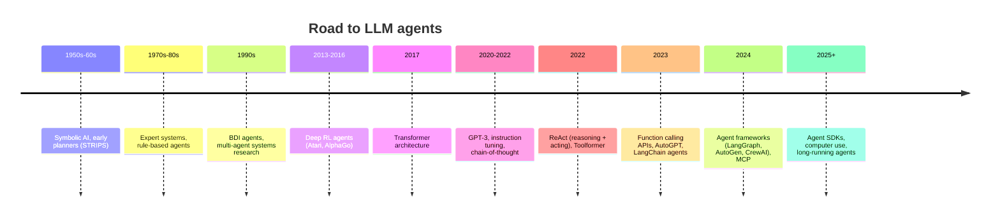
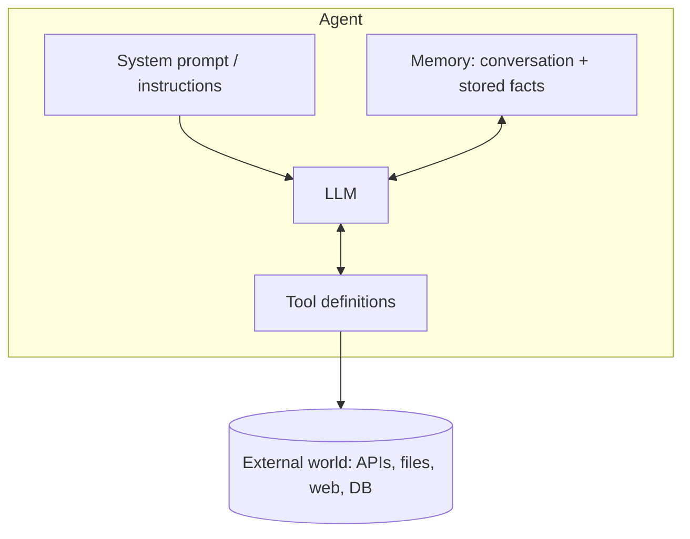

# Module 1: Foundations & History

**Goal:** understand what an LLM agent is, where the idea comes from, and how it differs from a chatbot or a fixed workflow.
**Time:** ~15 min. **Prerequisites:** basic Python or JavaScript.

## 1. What is an agent?

Classic definition (Russell & Norvig): an agent *perceives* its environment and *acts* on it to reach goals.
An **LLM agent** uses a language model as the decision-making core of that loop:

> An LLM agent is a program where an LLM repeatedly decides what to do next (usually which tool to call), observes the result, and continues until the goal is reached or it stops.



## 2. Chatbot vs. workflow vs. agent

| | Chatbot | Workflow | Agent |
|---|---|---|---|
| Control flow | None (one reply per turn) | Fixed in code | Chosen by the LLM at runtime |
| Tools | No | Yes, predefined order | Yes, chosen dynamically |
| Predictability | High | High | Lower |
| Cost / latency | Low | Medium | Higher, variable |
| Best for | Q&A | Well-understood tasks | Open-ended tasks |



**Rule of thumb:** use the least autonomy that solves the problem. Start with a single LLM call, then a workflow, and only then an agent.

## 3. A short history



Key ideas, in plain words:

- **Symbolic / rule-based agents:** hand-written rules; precise but brittle.
- **Reinforcement learning agents:** learn from reward in narrow environments; hard to generalize.
- **Chain-of-thought (2022):** asking a model to "think step by step" improves reasoning.
- **ReAct (2022):** interleave *Thought -> Action -> Observation*, the template for most agents today.
- **Function calling (2023):** the API returns structured tool calls instead of free text, making tool use reliable enough for production.
- **Agent frameworks and protocols (2023-):** graph runtimes, multi-agent libraries, and MCP (Model Context Protocol) for sharing tools.

## 4. Anatomy of an LLM agent



Four ingredients: **model**, **instructions**, **tools**, **memory/state**. The *loop* ties them together.

## 5. The agent loop in pseudocode

```text
messages = [system_prompt, user_goal]
repeat up to MAX_STEPS:
    reply = llm(messages, tools)
    messages.append(reply)
    if reply has no tool calls:
        return reply.text            # done
    for call in reply.tool_calls:
        result = run_tool(call.name, call.arguments)
        messages.append(tool_result(call.id, result))
raise "step limit reached"
```

Always cap the number of steps; otherwise a confused model can loop forever and burn money.

## 6. Hands-on: your first agent

Set up the backend (see `.env.example`), then run the minimal agent. The tool-calling loop below is ~40 lines with no framework.

### Python (`examples/python/m01_minimal_agent.py`)

```python
import json
from llm_client import get_client

def get_time(city: str) -> str:
    return f"It is 12:00 in {city}."   # stub; replace with a real API

TOOLS = [{
    "type": "function",
    "function": {
        "name": "get_time",
        "description": "Get the current time in a city.",
        "parameters": {
            "type": "object",
            "properties": {"city": {"type": "string"}},
            "required": ["city"],
        },
    },
}]
REGISTRY = {"get_time": get_time}

def run_agent(goal: str, max_steps: int = 5) -> str:
    client, model = get_client()
    messages = [
        {"role": "system", "content": "You are a helpful assistant. Use tools when needed."},
        {"role": "user", "content": goal},
    ]
    for _ in range(max_steps):
        msg = client.chat.completions.create(
            model=model, messages=messages, tools=TOOLS
        ).choices[0].message
        messages.append(msg)
        if not msg.tool_calls:
            return msg.content
        for call in msg.tool_calls:
            args = json.loads(call.function.arguments)
            result = REGISTRY[call.function.name](**args)
            messages.append({"role": "tool", "tool_call_id": call.id, "content": result})
    raise RuntimeError("Step limit reached")

if __name__ == "__main__":
    print(run_agent("What time is it in Budapest?"))
```

### JavaScript (`examples/js/m01_minimal_agent.mjs`)

```js
import { chat } from "./llm_client.mjs";

const getTime = ({ city }) => `It is 12:00 in ${city}.`; // stub

const tools = [{
  type: "function",
  function: {
    name: "get_time",
    description: "Get the current time in a city.",
    parameters: { type: "object", properties: { city: { type: "string" } }, required: ["city"] },
  },
}];
const registry = { get_time: getTime };

async function runAgent(goal, maxSteps = 5) {
  const messages = [
    { role: "system", content: "You are a helpful assistant. Use tools when needed." },
    { role: "user", content: goal },
  ];
  for (let i = 0; i < maxSteps; i++) {
    const msg = await chat(messages, { tools });
    messages.push(msg);
    if (!msg.tool_calls?.length) return msg.content;
    for (const call of msg.tool_calls) {
      const args = JSON.parse(call.function.arguments);
      messages.push({ role: "tool", tool_call_id: call.id, content: registry[call.function.name](args) });
    }
  }
  throw new Error("Step limit reached");
}

console.log(await runAgent("What time is it in Budapest?"));
```

> **Small local models:** tool calling depends on the model and its chat template. In LM Studio choose a model with tool-use support, keep tool descriptions short, use few tools (1-5), and expect occasional malformed arguments. Wrap `json.loads` in error handling and feed errors back to the model as a tool result so it can retry.

## 7. Key takeaways

- An agent = LLM + tools + memory + a loop; the LLM controls the flow.
- Prefer the simplest design: single call, then workflow, then agent.
- ReAct and function calling are the foundation of modern agents.
- Always bound the loop (max steps, timeouts, budgets).

## Exercises

1. Add a second tool (e.g. `add(a, b)`) and ask a question that needs both tools.
2. Print every message in the loop. Where does the model "decide"?
3. Break the tool on purpose (raise an exception). Return the error as the tool result and observe how the model reacts.
4. Run the same goal against LM Studio and Azure. Compare tool-call reliability and latency.

## Further reading

- Yao et al., *ReAct: Synergizing Reasoning and Acting in Language Models* (2022)
- Anthropic, *Building Effective Agents* (2024)
- Russell & Norvig, *Artificial Intelligence: A Modern Approach* (agents chapter)

**Next:** [Module 2: Core building blocks](02-building-blocks.md)
