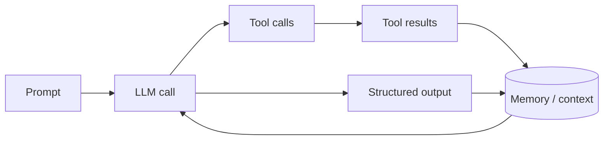
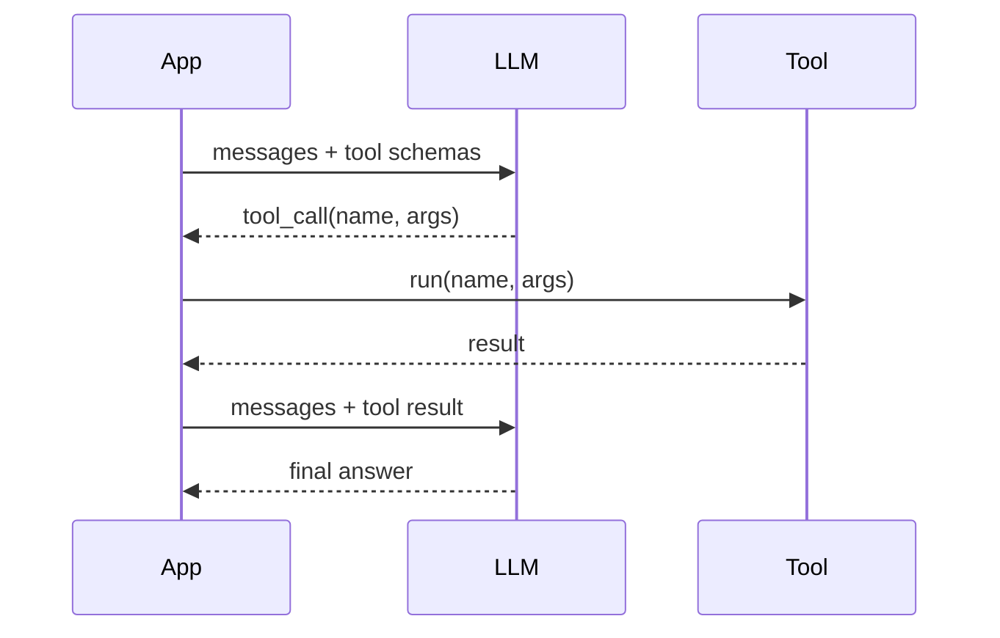
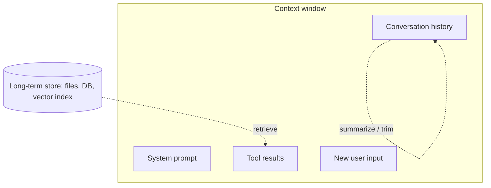

# Module 2: Core Building Blocks

**Goal:** learn the parts every agent is made of and how to implement each one reliably, including with small local models.
**Time:** ~20 min. **Prerequisites:** [Module 1](01-foundations.md).



## 1. The LLM call

A chat completion takes a list of **messages** (roles: `system`, `user`, `assistant`, `tool`) and returns the next assistant message. The model is **stateless**: you resend the whole history every time.

| Parameter | Effect | Agent advice |
|---|---|---|
| `temperature` | Randomness | 0-0.3 for tool use and structured output |
| `max_tokens` | Output cap | Set it; prevents runaway replies |
| `tools` | Callable function schemas | Keep few and well described |
| `response_format` | JSON / schema-constrained output | Use when you need parseable data |
| `stop` | Stop sequences | Useful for text-based ReAct parsing, but not every model accepts it (Azure gpt-5 models return a 400): cutting the text in code is the portable way |

## 2. Prompts

A good agent system prompt has four parts:

1. **Role & goal:** who the agent is and what success looks like.
2. **Rules & constraints:** what it must not do, when to ask or stop.
3. **Tool guidance:** when to use which tool (tool descriptions carry most of this).
4. **Output format:** how to present the final answer.

```text
You are a support assistant for ACME.
Goal: resolve the user's order question using the tools.
Rules: never guess an order status; if a tool fails twice, say so and stop.
Answer: 1-3 short sentences, no markdown.
```

Tips: be explicit, give 1-2 short examples for tricky formats, put stable instructions first, and keep prompts short for small models.

## 3. Tool calling

Tools are functions described by a JSON Schema. The model **does not run** them: it emits a request (`name` + `arguments`), your code runs it and returns the result.



Good tool design:

- **Clear name and description:** say what it does *and when to use it*.
- **Simple parameters:** few arguments, flat types, enums where possible.
- **Return short, useful text:** not huge JSON dumps.
- **Return errors as text** so the model can recover.
- **Validate arguments** in code; never trust model output.

### Reliability with small local models

- Use a model/template that supports tool calling; test it first.
- Limit to ~1-5 tools per call; route to sub-sets if you have more.
- Expect wrong or missing arguments: validate, return a clear error, retry.
- Fallback: ask for JSON in plain text and parse it (see next section).

## 4. Structured output

When you need data rather than prose (routing decisions, extraction), force a shape.

| Approach | Strength | Weakness |
|---|---|---|
| Prompt "reply as JSON" + parse | Works everywhere | May return extra text or invalid JSON |
| `response_format: json_object` | Valid JSON | Shape not guaranteed |
| `response_format: json_schema` | Shape enforced | Not supported by every local model/server |
| Tool call as output | Reliable on tool-capable models | Slightly indirect |

Robust pattern: **parse, validate, retry with the error message**.

```text
for attempt in 1..3:
    text = llm(messages)
    try: data = validate(parse_json(text))
    except err:
        messages += [text, "Invalid: " + err + ". Reply with valid JSON only."]
        continue
    return data
raise "could not get valid output"
```

Runnable example: [`examples/python/m02_structured_output.py`](../examples/python/m02_structured_output.py) or [`examples/js/m02_structured_output.mjs`](../examples/js/m02_structured_output.mjs), run with `python examples/python/m02_structured_output.py` or `node examples/js/m02_structured_output.mjs`.

## 5. Memory and context

The model only "remembers" what is in the context window.



| Memory type | Where | Technique |
|---|---|---|
| Short-term | Message list | Keep recent turns; trim or summarize old ones |
| Working state | Variables / scratchpad | Plans, to-do lists, intermediate results |
| Long-term | Files / DB / vector store | Save facts, retrieve when relevant ([Module 5](05-rag.md) for retrieval, [Module 6](06-knowledge-bases.md) for keeping it current, Module 9 for memory) |

Context management rules:

- Small local models have small effective context (often 4-8k tokens): trim aggressively.
- Truncate large tool outputs before returning them.
- Always keep the system prompt and the latest turns; summarize the middle.

```text
if tokens(messages) > BUDGET:
    old = messages[1:-N]
    summary = llm("Summarize key facts:\n" + old)
    messages = [system, "Summary so far: " + summary] + messages[-N:]
```

## 6. The agent loop, made reusable

Module 1 hard-coded one tool. The reusable loop adds a tool registry, error feedback, a step limit, trimmed tool output and an optional conversation history. It lives in a shared file, `agent`, that later modules import (the Module 4 supervisor uses it for every worker). The Module 2 lesson file only defines two demo tools and uses it:

| | Python | JavaScript |
|---|---|---|
| The loop (shared building block) | [`agent.py`](../examples/python/agent.py) | [`agent.mjs`](../examples/js/agent.mjs) |
| The lesson: two demo tools and a run | [`m02_agent_loop.py`](../examples/python/m02_agent_loop.py) | [`m02_agent_loop.mjs`](../examples/js/m02_agent_loop.mjs) |

The layers are: `llm_client` (talks to the model), then `agent` (the loop), then the `mNN_` lessons. Files without an `mNN_` prefix are reusable building blocks; files with one are runnable lessons.

Run from the project root: `python examples/python/m02_agent_loop.py` or `node examples/js/m02_agent_loop.mjs`.

To watch the loop, set the environment variable `LLM_TRACE=1` (one line per message) or `LLM_TRACE=raw` (full JSON). Unset, this example prints nothing. How to set it in PowerShell, bash or `.env`: see [Module 1, "Controlling the trace"](01-foundations.md#controlling-the-trace-llm_trace). For the goal "How many words are in 'the quick brown fox'? Then add 10 to that count." the model needs two tool calls in two steps, then answers (output shortened):

```text
[step 1] assistant -> TOOL CALL word_count({"text":"the quick brown fox"})  id=call_5GYSf…
[step 1] tool      <- 4  (tool_call_id=call_5GYSf…)
[step 2] assistant -> TOOL CALL add({"a":4,"b":10})  id=call_3Zr9l…
[step 2] tool      <- 14  (tool_call_id=call_3Zr9l…)
[step 3] assistant -> FINAL ANSWER (no tool_calls): There are **4** words in "the quick brown fox". Adding 10 gives **14**.
```

The second call uses `4`, the result of the first: the model reads earlier tool results from the message history. The loop stops at step 3 because that reply has no `tool_calls`. At the end, `messages` holds 7 entries: `system`, `user`, then `assistant` + `tool` twice, then the final `assistant` (the same growth as in Module 1, with one more round). More on reading these messages: [Module 1, "Reading the messages"](01-foundations.md#reading-the-messages-tool-calls-and-the-final-answer).

Core of the Python version (`agent.py`, without the trace calls):

```python
class Tool:
    def __init__(self, fn, description, parameters, name=None):
        self.fn, self.description, self.parameters = fn, description, parameters
        self.name = name or fn.__name__          # the name the model sees

def run_agent(goal, tools, system="You are a helpful assistant.", max_steps=8, messages=None):
    client, model = get_client()
    registry = {t.name: t for t in tools}
    if messages is None:
        messages = []
    if not messages:                             # new conversation: start with the system prompt
        messages.append({"role": "system", "content": system})
    messages.append({"role": "user", "content": goal})
    for _ in range(max_steps):
        msg = client.chat.completions.create(
            model=model, messages=messages, tools=[t.schema() for t in tools], temperature=0.2
        ).choices[0].message
        messages.append(msg)
        if not msg.tool_calls:
            return msg.content
        for call in msg.tool_calls:
            name = call.function.name
            try:
                if name not in registry:
                    raise ValueError(f"unknown tool '{name}'")
                result = str(registry[name].fn(**json.loads(call.function.arguments)))
            except Exception as exc:
                result = f"Error: {exc}"
            messages.append({"role": "tool", "tool_call_id": call.id, "content": result[:2000]})
    return "Stopped: step limit reached."
```

### Continuing a conversation (`messages=`)

By default every call starts a fresh conversation. To continue one, pass the same list again:

```python
history = []                                                          # the conversation so far
run_agent("My favorite number is 7. Add 3 to it.", TOOLS, messages=history)
run_agent("What was my favorite number?", TOOLS, messages=history)   # -> "Your favorite number was 7."
```

```js
const history = [];
await runAgent("My favorite number is 7. Add 3 to it.", tools, { messages: history });
await runAgent("What was my favorite number?", tools, { messages: history });
```

- The list is **extended in place**, and the system message is added only when the list is empty. After the two calls above it holds `system`, `user`, `assistant` (tool call), `tool`, `assistant`, `user`, `assistant`.
- The model is stateless: it "remembers" the number only because the earlier messages are sent again. The history grows with every turn, so long conversations need the trimming and summarizing from section 5.
- Module 9 (memory) builds on this: saving the list to a file and loading it later. In Python the `assistant` entries are SDK objects, so convert them with `msg.model_dump()` before saving them as JSON.

## 7. Streaming and observability (brief)

- **Streaming** (`stream=True`) shows tokens as they arrive: better UX, same logic.
- **Log every step** (messages, tool calls, results, latency, tokens). Debugging agents without traces is guesswork (see Module 12). The `LLM_TRACE` option of the examples is the first step; exercise 4 takes it further.

## 8. Key takeaways

- The model is stateless; *you* manage messages, memory and context size.
- Tools are schemas + your code; validate inputs, return errors as text, truncate outputs.
- Use structured output with a parse-validate-retry loop.
- Low temperature, few tools and short prompts help small local models.

## Exercises

1. Add a `read_file(path)` tool restricted to one folder. What happens if the model asks for `../secrets.txt`?
2. Add a token/character budget and summarize old messages when exceeded.
3. Make `extract_task` use `response_format` JSON schema; test on LM Studio and Azure.
4. Log each step as a JSON line (timestamp, tool, args, duration).

## Further reading

- Anthropic, [*Writing effective tools for AI agents*](https://www.anthropic.com/research/writing-tools-for-agents) (2025): tool names, descriptions and outputs that models use well
- Anthropic, [*Effective context engineering for AI agents*](https://www.anthropic.com/research/effective-context-engineering-for-ai-agents) (2025): what to keep in the context window, and what to trim or summarize
- Liu et al., [*Lost in the Middle: How Language Models Use Long Contexts*](https://arxiv.org/abs/2307.03172) (2023): why a longer context is not always used well
- Tool calling in your provider's docs: [OpenAI](https://developers.openai.com/api/docs/guides/function-calling), [Azure OpenAI](https://learn.microsoft.com/en-us/azure/foundry/openai/how-to/function-calling), [OpenRouter](https://openrouter.ai/docs/guides/features/tool-calling), [LM Studio](https://lmstudio.ai/docs/developer/openai-compat/tools)
- OpenAI, [*Structured model outputs*](https://developers.openai.com/api/docs/guides/structured-outputs): JSON Schema output, and its limits
- [JSON Schema reference](https://json-schema.org/understanding-json-schema/reference): the format of the tool `parameters`
- Prompting guides: [OpenAI](https://developers.openai.com/api/docs/guides/prompt-engineering) and [Anthropic](https://platform.claude.com/docs/en/build-with-claude/prompt-engineering/overview)
- [Pydantic serialization](https://pydantic.dev/docs/validation/latest/concepts/serialization/): `model_dump`, used by the Python trace helper, and the [`openai-python`](https://github.com/openai/openai-python) SDK source

**Next:** [Module 3: Patterns](03-patterns.md)

