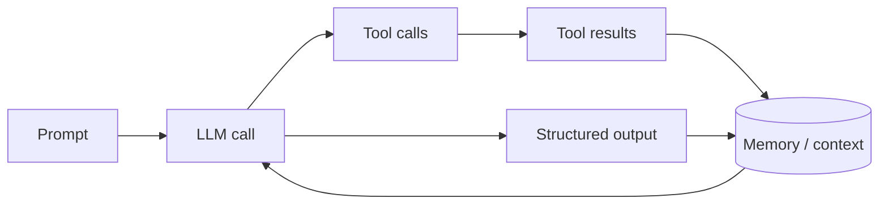
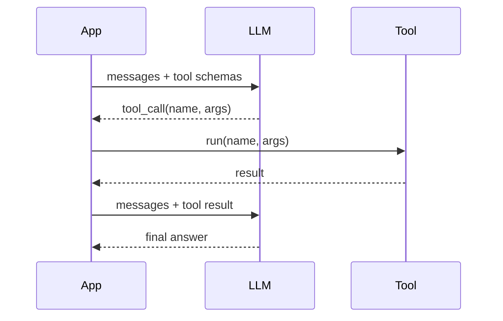
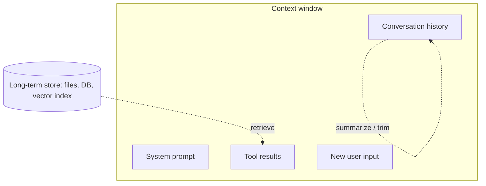

# Module 2: Core Building Blocks

**Goal:** learn the parts every agent is made of and how to implement each one reliably, including with small local models.
**Time:** ~20 min. **Prerequisites:** [Module 1](01-foundations.md).



## 1. The LLM call

A chat completion takes a list of **messages** (roles: `system`, `user`, `assistant`, `tool`) and returns the next assistant message. The model is **stateless**: you resend the whole history every time.

| Parameter | Effect | Agent advice |
|---|---|---|
| `temperature` | Randomness | 0-0.3 for tool use and structured output |
| `max_tokens` | Output cap | Set it; prevents runaway replies |
| `tools` | Callable function schemas | Keep few and well described |
| `response_format` | JSON / schema-constrained output | Use when you need parseable data |
| `stop` | Stop sequences | Useful for text-based ReAct parsing, but not every model accepts it (Azure gpt-5 models return a 400): cutting the text in code is the portable way |

## 2. Prompts

A good agent system prompt has four parts:

1. **Role & goal:** who the agent is and what success looks like.
2. **Rules & constraints:** what it must not do, when to ask or stop.
3. **Tool guidance:** when to use which tool (tool descriptions carry most of this).
4. **Output format:** how to present the final answer.

```text
You are a support assistant for ACME.
Goal: resolve the user's order question using the tools.
Rules: never guess an order status; if a tool fails twice, say so and stop.
Answer: 1-3 short sentences, no markdown.
```

Tips: be explicit, give 1-2 short examples for tricky formats, put stable instructions first, and keep prompts short for small models.

## 3. Tool calling

Tools are functions described by a JSON Schema. The model **does not run** them: it emits a request (`name` + `arguments`), your code runs it and returns the result.



Good tool design:

- **Clear name and description:** say what it does *and when to use it*.
- **Simple parameters:** few arguments, flat types, enums where possible.
- **Return short, useful text:** not huge JSON dumps.
- **Return errors as text** so the model can recover.
- **Validate arguments** in code; never trust model output.

### Reliability with small local models

- Use a model/template that supports tool calling; test it first.
- Limit to ~1-5 tools per call; route to sub-sets if you have more.
- Expect wrong or missing arguments: validate, return a clear error, retry.
- Fallback: ask for JSON in plain text and parse it (see next section).

## 4. Structured output

When you need data rather than prose (routing decisions, extraction), force a shape.

| Approach | Strength | Weakness |
|---|---|---|
| Prompt "reply as JSON" + parse | Works everywhere | May return extra text or invalid JSON |
| `response_format: json_object` | Valid JSON | Shape not guaranteed |
| `response_format: json_schema` | Shape enforced | Not supported by every local model/server |
| Tool call as output | Reliable on tool-capable models | Slightly indirect |

Robust pattern: **parse, validate, retry with the error message**.

```text
for attempt in 1..3:
    text = llm(messages)
    try: data = validate(parse_json(text))
    except err:
        messages += [text, "Invalid: " + err + ". Reply with valid JSON only."]
        continue
    return data
raise "could not get valid output"
```

Runnable example (Python only): [`examples/python/m02_structured_output.py`](../examples/python/m02_structured_output.py), run with `python examples/python/m02_structured_output.py`.

## 5. Memory and context

The model only "remembers" what is in the context window.



| Memory type | Where | Technique |
|---|---|---|
| Short-term | Message list | Keep recent turns; trim or summarize old ones |
| Working state | Variables / scratchpad | Plans, to-do lists, intermediate results |
| Long-term | Files / DB / vector store | Save facts, retrieve when relevant (Module 5) |

Context management rules:

- Small local models have small effective context (often 4-8k tokens): trim aggressively.
- Truncate large tool outputs before returning them.
- Always keep the system prompt and the latest turns; summarize the middle.

```text
if tokens(messages) > BUDGET:
    old = messages[1:-N]
    summary = llm("Summarize key facts:\n" + old)
    messages = [system, "Summary so far: " + summary] + messages[-N:]
```

## 6. The agent loop, made reusable

Module 1 hard-coded one tool. These examples add a tool registry, error feedback, a step limit, and trimmed tool output:

- Python: [`examples/python/m02_agent_loop.py`](../examples/python/m02_agent_loop.py)
- JavaScript: [`examples/js/m02_agent_loop.mjs`](../examples/js/m02_agent_loop.mjs)

Run from the project root: `python examples/python/m02_agent_loop.py` or `node examples/js/m02_agent_loop.mjs`.

Core of the Python version:

```python
def run_agent(goal, tools, system="You are a helpful assistant.", max_steps=8):
    client, model = get_client()
    registry = {t.fn.__name__: t for t in tools}
    messages = [{"role": "system", "content": system}, {"role": "user", "content": goal}]
    for _ in range(max_steps):
        msg = client.chat.completions.create(
            model=model, messages=messages, tools=[t.schema() for t in tools], temperature=0.2
        ).choices[0].message
        messages.append(msg)
        if not msg.tool_calls:
            return msg.content
        for call in msg.tool_calls:
            name = call.function.name
            try:
                if name not in registry:
                    raise ValueError(f"unknown tool '{name}'")
                result = str(registry[name].fn(**json.loads(call.function.arguments)))
            except Exception as exc:
                result = f"Error: {exc}"
            messages.append({"role": "tool", "tool_call_id": call.id, "content": result[:2000]})
    return "Stopped: step limit reached."
```

## 7. Streaming and observability (brief)

- **Streaming** (`stream=True`) shows tokens as they arrive: better UX, same logic.
- **Log every step** (messages, tool calls, results, latency, tokens). Debugging agents without traces is guesswork (see Module 7).

## 8. Key takeaways

- The model is stateless; *you* manage messages, memory and context size.
- Tools are schemas + your code; validate inputs, return errors as text, truncate outputs.
- Use structured output with a parse-validate-retry loop.
- Low temperature, few tools and short prompts help small local models.

## Exercises

1. Add a `read_file(path)` tool restricted to one folder. What happens if the model asks for `../secrets.txt`?
2. Add a token/character budget and summarize old messages when exceeded.
3. Make `extract_task` use `response_format` JSON schema; test on LM Studio and Azure.
4. Log each step as a JSON line (timestamp, tool, args, duration).

**Next:** [Module 3: Patterns](03-patterns.md)

