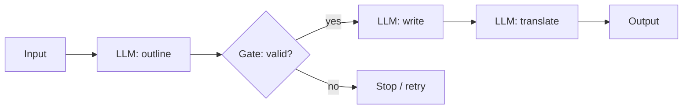
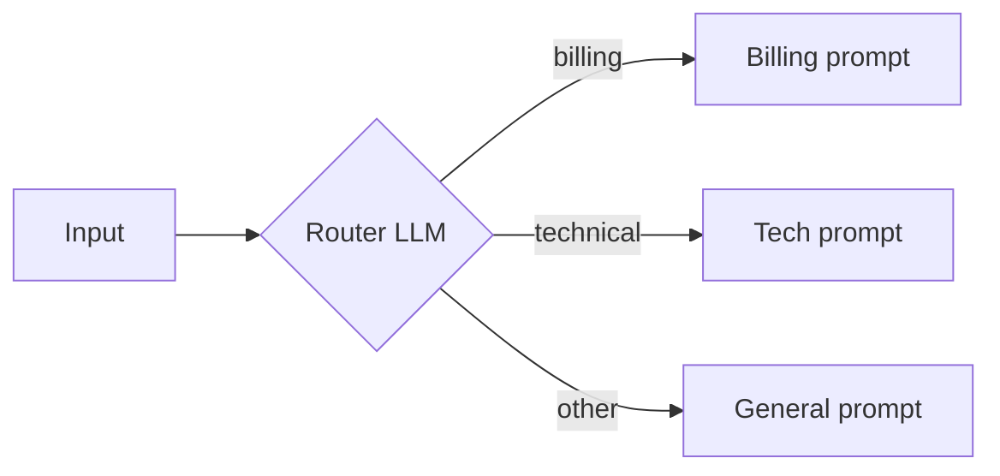
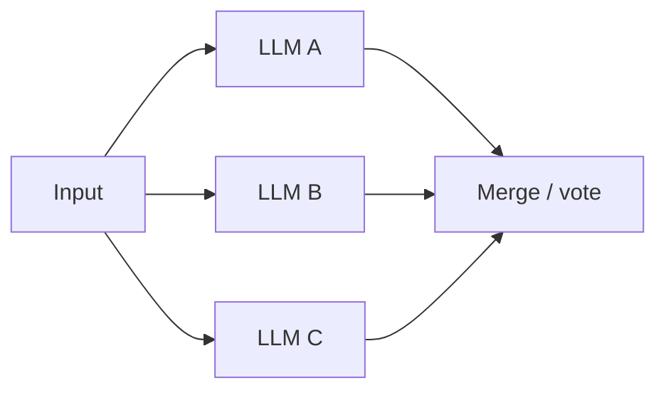
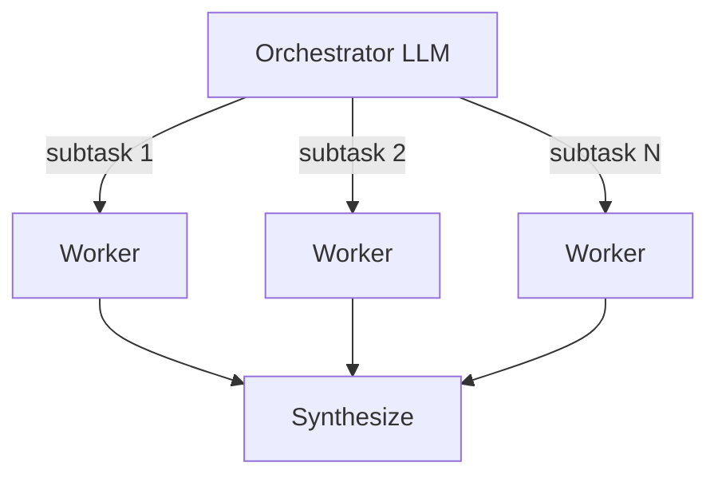
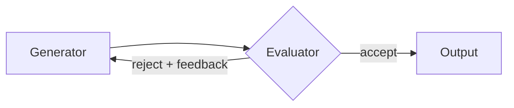
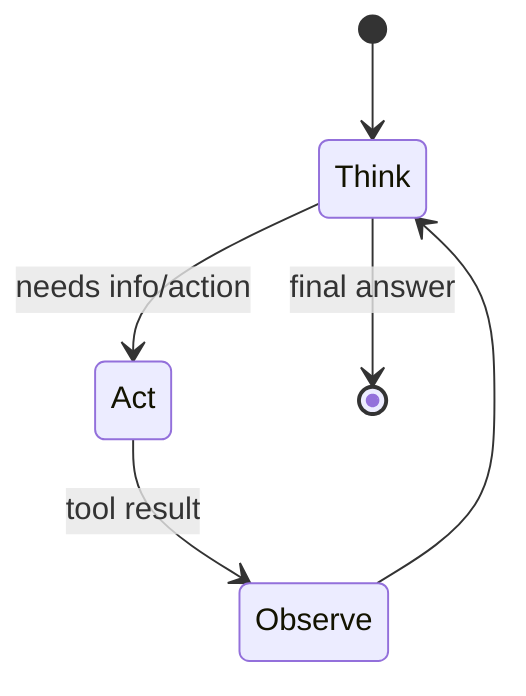
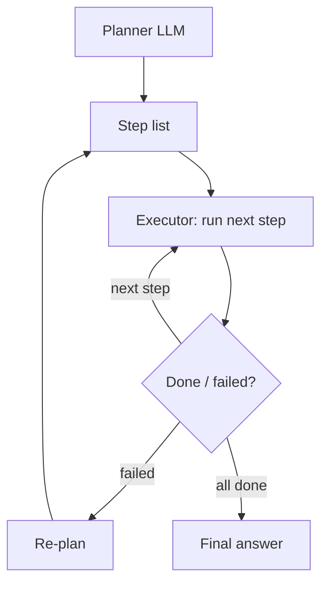
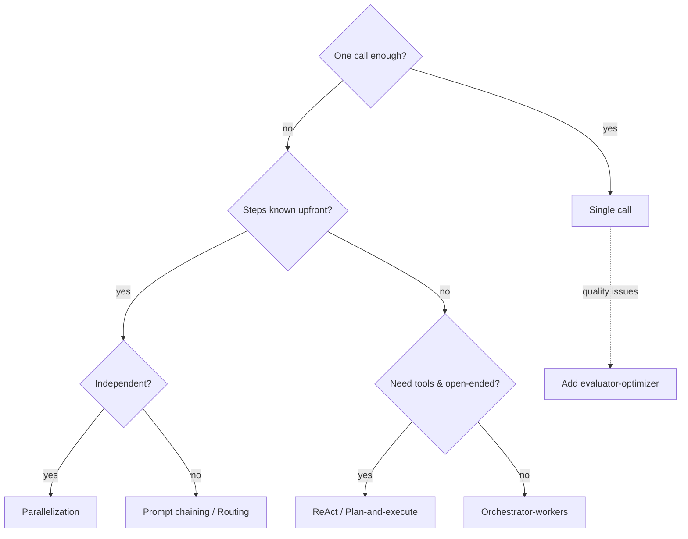

# Module 3: Agent Patterns

**Goal:** know the common building-block patterns, when each fits, and how to implement them without a framework.
**Time:** ~25 min. **Prerequisites:** [Module 2](02-building-blocks.md).

Patterns range from simple, predictable **workflows** (code controls the flow) to autonomous **agents** (the LLM controls the flow). Pick the simplest one that works.

```mermaid
flowchart LR
    A[Single LLM call] --> B[Prompt chaining]
    B --> C[Routing / Parallelization]
    C --> D[Orchestrator-workers]
    D --> E[Evaluator-optimizer]
    E --> F[Autonomous agent: ReAct, plan-and-execute]
    style A fill:#334155
    style F fill:#78350f
```



| Pattern | Control flow | Use when | Main risk |
|---|---|---|---|
| Prompt chaining | Fixed sequence | Task splits into clear steps | Errors propagate |
| Routing | Classifier then branch | Distinct input categories | Misclassification |
| Parallelization | Fan-out / fan-in | Independent subtasks, or voting | Cost |
| Orchestrator-workers | LLM plans subtasks dynamically | Subtasks unknown upfront | Complexity |
| Evaluator-optimizer | A separate judge gives a verdict; loop until accepted | Clear quality criteria | Endless loops |
| ReAct | LLM loop with tools | Open-ended, tool-heavy tasks | Cost, drift |
| Plan-and-execute | Plan first, then run steps | Long tasks needing structure | Stale plans |
| Reflection | The same agent critiques itself once, then revises | Quality matters, no formal criteria | Extra latency |

All examples below use `chat()` from `llm_client` (see [`examples/python/m03_patterns.py`](../examples/python/m03_patterns.py) and [`examples/js/m03_patterns.mjs`](../examples/js/m03_patterns.mjs) for runnable versions of chaining, routing, voting, orchestrator-workers, evaluator-optimizer and reflection; text-based ReAct is in [`examples/python/m03_react_text.py`](../examples/python/m03_react_text.py) and [`examples/js/m03_react_text.mjs`](../examples/js/m03_react_text.mjs)). Run from the project root, e.g. `python examples/python/m03_patterns.py` or `node examples/js/m03_patterns.mjs` (about 20 model calls: slow on a local model). Plan-and-execute is pseudocode only; it is an exercise.

## 1. Prompt chaining

Break a task into sequential LLM calls; add **gates** (code checks) between steps.



```text
outline = llm("Outline an article about " + topic)
if not looks_valid(outline): fail
draft = llm("Write the article from this outline:\n" + outline)
return llm("Translate to Hungarian:\n" + draft)
```

Good for small models: each call has a narrow job.

## 2. Routing

Classify the input, then send it to a specialised prompt or tool.



```text
label = llm_choose(input, ["billing", "technical", "other"])   # constrained output
return HANDLERS[label if label in HANDLERS else "other"](input)
```

Always fall back to a default when the label is unknown.

## 3. Parallelization

Two variants: **sectioning** (different subtasks at once) and **voting** (same task several times, pick consensus).



```text
results = run_in_parallel([llm(p) for p in prompts])
return majority(results)       # or: llm("Combine:\n" + results)
```

Local servers often process one request at a time, so parallel calls may not speed up LM Studio; they do on Azure.

## 4. Orchestrator-workers

A central LLM breaks the task into subtasks it only discovers at runtime, delegates them to workers, then synthesizes.



```text
subtasks = llm_json("List the subtasks needed for: " + goal)
results = [worker_llm(t) for t in subtasks]
return llm("Combine into one answer:\n" + results)
```

## 5. Evaluator-optimizer (generate and critique)

One call produces, another judges against criteria; loop until accepted or the limit is hit.



```text
draft = llm(task)
for i in 1..MAX_ROUNDS:
    verdict = llm_json("Review against criteria. {ok: bool, feedback: str}\n" + draft)
    if verdict.ok: return draft
    draft = llm(task + "\nImprove using feedback: " + verdict.feedback + "\n" + draft)
return draft
```

Runnable: `evaluate_optimize` in [`examples/python/m03_patterns.py`](../examples/python/m03_patterns.py) and `evaluateOptimize` in [`examples/js/m03_patterns.mjs`](../examples/js/m03_patterns.mjs). The lighter cousin, where the same agent critiques itself without a verdict or a loop, is [section 8, Reflection](#8-reflection), which also compares the two.

## 6. ReAct (reason + act)

The classic agent loop: **Thought -> Action -> Observation**, repeated. With function-calling APIs this is the loop from Modules 1-2; the "thought" is the model's reasoning before a tool call.



Text-based ReAct (for models without native tool calling):

```text
Thought: I need the weather in Paris.
Action: get_weather("Paris")
Observation: 14C, cloudy
Thought: I can answer now.
Final Answer: It is 14C and cloudy.
```

Implement by cutting the reply at `Observation:` (the model must not invent observations), parsing the `Action:` line, running the tool, and appending the real observation. Runnable: [`examples/python/m03_react_text.py`](../examples/python/m03_react_text.py) or [`examples/js/m03_react_text.mjs`](../examples/js/m03_react_text.mjs). You can also pass `stop=["Observation:"]` to the API, but some models (e.g. Azure gpt-5 family) reject that parameter, so cutting in code is the portable way. This works with weak local models, but parse defensively.

## 7. Plan-and-execute

Plan once, execute each step (often with a cheaper/smaller model or a ReAct sub-loop), re-plan when a step fails.



```text
plan = llm_json("Make a numbered plan for: " + goal)
for step in plan:
    result = executor(step, context)
    context.append(result)
    if failed(result): plan = replan(goal, context); restart
return llm("Answer using:\n" + context)
```

Benefits: fewer expensive reasoning calls, easier to inspect and show progress. Drawback: plans go stale if the environment surprises you, so allow re-planning.

## 8. Reflection

The agent reviews its own result (or a tool error) and revises it, **once**. It is the lightweight cousin of [evaluator-optimizer](#5-evaluator-optimizer-generate-and-critique): the same agent plays generator and critic, and there is no accept/reject verdict and no loop.

```text
answer = agent(task)
critique = llm("What is wrong or missing in this answer?\n" + answer)
return agent(task + "\nFix these issues:\n" + critique)
```

### Reflection vs. evaluator-optimizer

Both are "generate, critique, improve". They differ in how formal the critique is:

| | Evaluator-optimizer (section 5) | Reflection (this section) |
|---|---|---|
| Who judges | A separate evaluator call with its own prompt and criteria | The same agent critiques its own answer |
| What the judge returns | A verdict your code can read: `{ok, feedback}` | Free-text critique |
| Loop | Repeats until accepted or `MAX_ROUNDS` is reached | One pass: answer, critique, fix |
| Stop condition | `ok` is true (or the round limit) | None: it simply revises once |
| LLM calls | 2 at least, up to `1 + 2 * MAX_ROUNDS` | Always 3 |
| Use when | You can state clear pass/fail criteria | You want a cheap quality boost without formal criteria |
| Runnable | `evaluate_optimize` / `evaluateOptimize` | `reflect` (same file) |

Rule of thumb: if a judge returns a verdict and your code loops until it is accepted, it is **evaluator-optimizer**. If the same agent critiques and fixes its own answer in one pass, it is **reflection**.

They combine well. You can run a reflection step inside each round of an evaluator-optimizer loop, or replace the LLM judge with a concrete check (run the tests, validate the JSON), which is the strongest version of either pattern. Runnable: `reflect` in [`examples/python/m03_patterns.py`](../examples/python/m03_patterns.py) and [`examples/js/m03_patterns.mjs`](../examples/js/m03_patterns.mjs).

Small models are weak self-critics; use concrete checks (run the tests, validate the JSON, check the sources) wherever possible rather than "does this look good?".

## 9. Choosing a pattern



## Small local model notes

- Prefer chaining and routing over free-form agents: narrow prompts succeed more often.
- Use constrained or validated output for routers and evaluators.
- Cap rounds in every loop (reflection, re-planning, ReAct).
- Use the larger model (Azure) for planning and a small local one for simple steps.

## Key takeaways

- Most real systems are workflows plus a few agentic pieces.
- Add complexity only when measured results justify it.
- Gates, step limits, and concrete checks keep patterns reliable.

## Exercises

1. Build a chain: summarize a text, extract 3 action items, then draft an email.
2. Build a router with three categories and a safe default; test with ambiguous input.
3. Implement evaluator-optimizer for "write a haiku with exactly 17 syllables" using a code check instead of an LLM judge.
4. Extend the text-based ReAct example with a second tool and run it on a local model.
5. Compare plan-and-execute vs. ReAct on a multi-step task: count LLM calls and tokens.
6. Run `reflect()` and `evaluate_optimize()` on the same task and compare the number of LLM calls and the quality. Find a task where the evaluator catches something reflection misses.

## Further reading

- Anthropic, [*Building effective AI agents*](https://www.anthropic.com/research/building-effective-agents) (2024): the workflow patterns of sections 1 to 5 (chaining, routing, parallelization, orchestrator-workers, evaluator-optimizer)
- Yao et al., [*ReAct: Synergizing Reasoning and Acting in Language Models*](https://arxiv.org/abs/2210.03629) (2022)
- Wang et al., [*Plan-and-Solve Prompting*](https://arxiv.org/abs/2305.04091) (2023): plan first, then execute
- Shinn et al., [*Reflexion: Language Agents with Verbal Reinforcement Learning*](https://arxiv.org/abs/2303.11366) (2023): reflection with memory across attempts
- Madaan et al., [*Self-Refine: Iterative Refinement with Self-Feedback*](https://arxiv.org/abs/2303.17651) (2023): the same model generates, critiques and revises
- Wang et al., [*Self-Consistency Improves Chain of Thought Reasoning*](https://arxiv.org/abs/2203.11171) (2022): voting over several answers
- LangChain, [*Workflows and agents*](https://docs.langchain.com/oss/python/langgraph/workflows-agents): the same patterns as LangGraph code (a preview of Module 10)

**Next:** [Module 4: Multi-agent structures](04-multi-agent.md)
