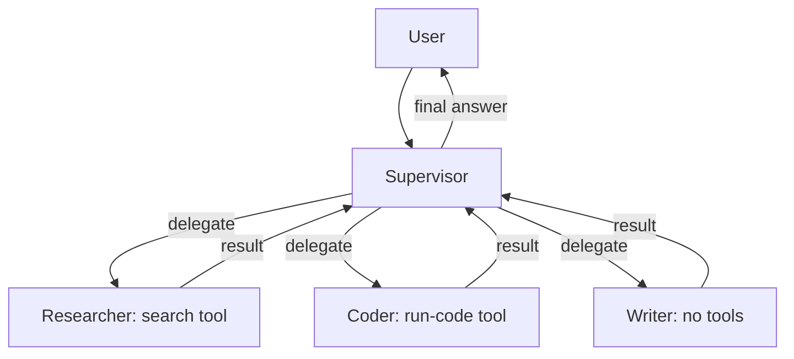
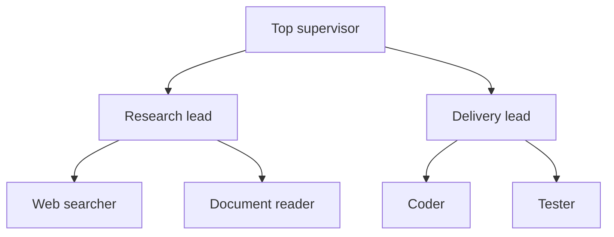
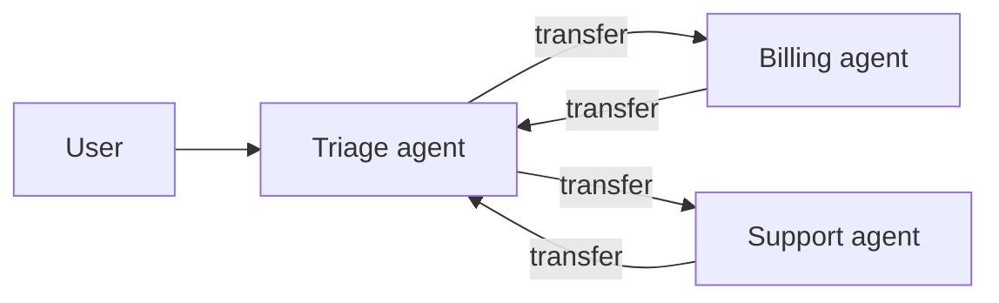
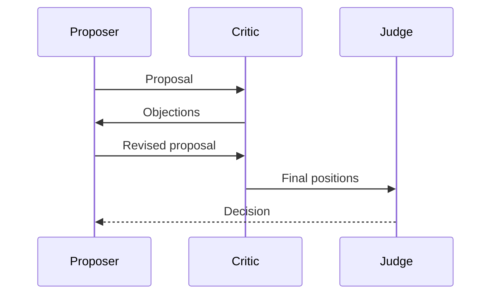

# Module 4: Multi-Agent Structures

**Goal:** understand when and how to split work across several agents, and the main structures used.
**Time:** ~20 min. **Prerequisites:** [Module 3](03-patterns.md).

A **multi-agent system** uses several LLM-driven agents, each with its own instructions, tools and context, that cooperate on a task.

## 1. Why (and why not)

| Reasons to split | Reasons not to |
|---|---|
| Too many tools for one agent (small models degrade past ~5) | More LLM calls: cost and latency multiply |
| Different roles need different prompts or models | Errors and misunderstandings compound between agents |
| Context window overflow: give each agent a focused context | Harder to debug and test |
| Independent subtasks can run in parallel | A single agent with good tools often suffices |

**Rule of thumb:** start with one agent. Split only when you hit a concrete limit (tool overload, context size, conflicting instructions).

## 2. Structures at a glance

| Structure | Who decides next step | Best for | Risk |
|---|---|---|---|
| Supervisor | One central agent | Clear task decomposition | Supervisor bottleneck |
| Hierarchical | Tree of supervisors | Large, layered problems | Complexity, latency |
| Swarm / handoff | Each agent hands off to the next | Customer-support style flows | Hard to trace, loops |
| Pipeline | Fixed order (code) | Known stages | Rigid |
| Debate / critic | Peers challenge each other | Reasoning, review, quality | Cost, agreement bias |
| Blackboard | Shared state, agents act when relevant | Collaborative, loosely coupled | Coordination conflicts |

## 3. Supervisor (orchestrator) pattern

A supervisor agent receives the goal, picks a worker agent, reads its result, and repeats until done. Workers are specialists with narrow tools.



```text
state = {goal, notes: []}
for step in 1..MAX_STEPS:
    decision = supervisor_llm(state)          # {next: "researcher"|"coder"|"writer"|"FINISH", task: "..."}
    if decision.next == "FINISH": return decision.answer
    result = WORKERS[decision.next](decision.task)
    state.notes.append(result)
raise "step limit"
```

Simple way to build it: **workers as tools**. Each worker is a function that runs its own agent loop and returns text; the supervisor sees them as ordinary tools (see example below).

## 4. Hierarchical teams

Supervisors manage other supervisors. Use it when one supervisor would face too many workers.



Keep depth to 2 levels; each level adds latency and loses information in summaries.

## 5. Swarm / handoff

Agents are peers. The active agent can **hand off** the conversation to another agent by calling a special tool (e.g. `transfer_to_billing`). There is no central controller; the conversation history (or a trimmed version) travels with the handoff.



```text
active = triage_agent
loop:
    reply = run(active, messages)
    if reply.handoff_to: active = AGENTS[reply.handoff_to]; continue
    return reply.text
```

This is the idea behind OpenAI Swarm and the OpenAI Agents SDK "handoffs". Add a hop limit to avoid ping-pong loops. Runnable (JavaScript): [`examples/js/m04_handoff.mjs`](../examples/js/m04_handoff.mjs), run with `node examples/js/m04_handoff.mjs`.

## 6. Pipeline (sequential roles)

Fixed order, each agent transforms the previous output: *researcher -> writer -> editor*. It is prompt chaining (Module 3) with role agents. Predictable and easy to test.

## 7. Debate and critic

Two or more agents argue or review; a judge or a fixed number of rounds decides.



Notes: agents tend to agree with each other (sycophancy). Give the critic a clear adversarial role and concrete criteria, and prefer different models or prompts for diversity.

## 8. Communication and shared state

| Mechanism | How | Good for |
|---|---|---|
| Message passing | Output of one is input of the next | Pipelines, handoffs |
| Shared state / blackboard | A common dict or store all agents read and write | Graph frameworks (LangGraph) |
| Tool-call return values | Workers exposed as tools | Supervisor pattern |
| Shared memory store | Vector DB or files | Long-running teams |

Practical rules:

- Pass **only the needed context** to each agent; summaries beat full transcripts.
- Use **structured messages** (JSON with fields) between agents.
- Give every agent a **single clear responsibility** and a small tool set.
- Put **limits** everywhere: steps per agent, total steps, hops, cost.
- **Trace** the whole system (who called whom, with what, and the result).

## 9. Example: supervisor with workers as tools

[`examples/python/m04_supervisor.py`](../examples/python/m04_supervisor.py) builds two specialist agents (a "calculator" and a "writer") and a supervisor that calls them as tools (run: `python examples/python/m04_supervisor.py`, Python only). The core idea:

```python
def make_worker_tool(name, description, system, tools):
    def worker(task: str) -> str:
        return run_agent(task, tools, system=system, max_steps=5)   # from Module 2
    worker.__name__ = name
    return Tool(worker, description, TASK_SCHEMA)

calculator = make_worker_tool("calculator", "Specialist for arithmetic.", "...", MATH_TOOLS)
writer = make_worker_tool("writer", "Specialist for writing short text from given facts.", "...", [])
run_agent(goal, [calculator, writer], system="Delegate; do not solve yourself.")
```

## Small local model notes

- Supervisors that must emit structured routing decisions are fragile on small models: keep the worker list short (2-4) and the descriptions distinct.
- Use a bigger model for the supervisor and smaller ones for workers when possible.
- Local servers handle one request at a time; multi-agent runs are sequential and slow, so budget for it.

## Key takeaways

- One agent first; split for tool overload, context limits, or role separation.
- Supervisor = simple and controllable; handoff = flexible; debate = quality.
- Control context flow, use structured messages, and cap every loop.

## Exercises

1. Run the supervisor example, then add a third worker (e.g. `translator`). Does routing still work?
2. Implement a handoff between `triage`, `billing` and `support` agents with a maximum of 4 hops (`examples/js/m04_handoff.mjs` is a starting point).
3. Build a proposer/critic pair for code review comments with at most 2 rounds.
4. Measure LLM calls and total tokens for the same task as single agent vs. supervisor.

**Next:** [Module 5: RAG, memory & tools](05-rag-memory-tools.md) (coming next)
