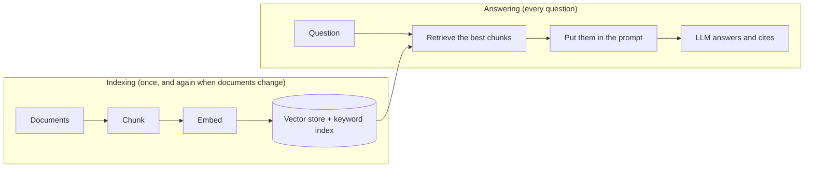

# Module 5: Retrieval-Augmented Generation (RAG)

**Goal:** give an LLM access to knowledge that is not in its weights, with sources you can check, and learn how to measure and improve retrieval.
**Time:** ~40 min. **Prerequisites:** [Module 2](02-building-blocks.md) (the agent loop and tools are reused; embeddings are new).

> **Status:** this handout covers the RAG basics and knowledge bases in practice (updates, versions, scale). GraphRAG is added in the next part.

## Setup: an embedding model

RAG needs an **embedding model** next to the chat model. Like the chat model, it is configured per provider, with `<PROVIDER>_EMBED_MODEL`:

| Provider | Setting in `.env` | Notes |
|---|---|---|
| Azure OpenAI | `AZURE_EMBED_MODEL=text-embedding-3-small` | the name of a **deployment** on the same resource as your chat model (see below) |
| LM Studio | `LMSTUDIO_EMBED_MODEL=text-embedding-nomic-embed-text-v1.5` | download an embedding model in LM Studio; the name is what `http://localhost:1234/v1/models` lists |
| none | leave it unset | the examples fall back to keyword search (BM25) only |

**Creating the Azure deployment.** In the Azure portal or Microsoft Foundry, open your Azure OpenAI resource, go to *Deployments*, choose *Deploy model*, pick `text-embedding-3-small`, keep the default deployment name (the same) and set a quota. The base URL and API key do not change. With the CLI ([reference](https://learn.microsoft.com/en-us/cli/azure/cognitiveservices/account/deployment)):

```bash
az cognitiveservices account deployment create --resource-group <group> --name <resource-name> \
  --deployment-name text-embedding-3-small --model-name text-embedding-3-small --model-version "1" \
  --model-format OpenAI --sku-name Standard --sku-capacity 10
```

Available SKUs, versions and quotas depend on the region, so check the portal if the command is refused. [Generate embeddings with Azure OpenAI](https://learn.microsoft.com/en-us/azure/foundry/openai/how-to/embeddings) shows the call itself.

**The knowledge base** of this module is the handouts of Modules 1-4, so you can ask questions about what you have just read. (Later handouts talk about RAG itself and contain the example queries, which would make the examples search their own explanation.)

Run from the project root, in Python or JavaScript:

| Lesson | Python | JavaScript |
|---|---|---|
| Naive RAG, end to end | `python examples/python/m05_rag_basic.py` | `node examples/js/m05_rag_basic.mjs` |
| Hybrid search, filters, reranking | `python examples/python/m05_rag_hybrid.py` | `node examples/js/m05_rag_hybrid.mjs` |
| Measuring recall | `python examples/python/m05_rag_eval.py` | `node examples/js/m05_rag_eval.mjs` |
| Agentic RAG | `python examples/python/m05_rag_tool.py` | `node examples/js/m05_rag_tool.mjs` |
| A knowledge base that changes | `python examples/python/m05_kb_update.py` | `node examples/js/m05_kb_update.mjs` |
| Growth: exact vs approximate search | `python examples/python/m05_kb_scale.py` | `node examples/js/m05_kb_scale.mjs` |

The first run embeds the chunks and saves them in `examples/.rag_index/` (one file per embedding model, git-ignored); later runs load them. It costs a tiny fraction of a cent at list prices. `m05_kb_update` needs an embedding model (it has no keyword-only mode); `m05_kb_scale` needs no model at all, it uses synthetic vectors.

## 1. Why retrieval?

A model knows only what was in its training data, which is old, public and not citable. RAG fetches the relevant passages at question time and puts them in the prompt:



| Use RAG when | Skip it when |
|---|---|
| The knowledge is private, new or changes often | The whole text fits in the context window and is read often: just put it in the prompt |
| You need sources the user can check | The model already knows it and nobody needs a source |
| There is far more text than fits in a prompt | A database query or an API gives the exact answer |

RAG reduces made-up answers, but it does not remove them: the model can still ignore or misread the sources, which is why the examples ask for citations and an explicit "I do not know".

## 2. Embeddings and similarity

An **embedding** turns a text into a list of numbers (a vector, 1536 numbers for `text-embedding-3-small`) so that texts with similar meaning get similar vectors. **Cosine similarity** measures how close two vectors point: 1 means the same direction, around 0 unrelated.

Two things matter in practice:

- **Scores only mean something within one model.** Our test on three short texts:

  | Pair | `text-embedding-3-small` (Azure) | `nomic-embed-text-v1.5` (LM Studio) |
  |---|---|---|
  | "the cat sat on the mat" vs "a kitten rests on a rug" | 0.54 | 0.76 |
  | "the cat..." vs "quarterly tax return" (unrelated) | 0.08 | 0.47 |

  Unrelated text scores near 0 with one model and near 0.5 with the other. A fixed similarity threshold must therefore be **calibrated for your model** (exercise 3).
- **Queries and documents are embedded differently by some models.** nomic expects the prefixes `search_query: ` and `search_document: `. `embed(texts, kind="query" | "document")` in `llm_client` adds them automatically for nomic; for any other model that needs them, set `<PROVIDER>_EMBED_QUERY_PREFIX` and `<PROVIDER>_EMBED_DOC_PREFIX`. Always read the model card.

Vectors from different models cannot be mixed, and you cannot compare them with each other: change the model and you must embed everything again.

## 3. Chunking

You do not embed whole documents: a vector of a 40-page document blurs everything, and a prompt cannot hold it. You cut documents into **chunks**. Small chunks match precisely but lose context; large chunks keep context but dilute the match.

`chunk_markdown` in [`retrieval.py`](../examples/python/retrieval.py) / [`retrieval.mjs`](../examples/js/retrieval.mjs) splits by the structure of the document:

- one chunk per section (by heading), split between paragraphs when longer than 1500 characters, with one paragraph of overlap;
- headings inside code blocks are not headings, and diagrams (mermaid) are dropped as noise;
- every chunk keeps its **section path**, for example `Module 3: Agent Patterns > 8. Reflection > Reflection vs. evaluator-optimizer`. The path is prepended to the text that is embedded and keyword-indexed (a "contextual header"), so a short chunk still knows where it belongs, and it is shown in the citation.

The Modules 1-4 handouts give **66 chunks** (median about 660 characters, the longest about 1850). Other strategies exist: fixed-size windows (simple, cuts sentences), sentence or semantic splitting, parent-child (match small chunks, return the larger section) and LLM-written context per chunk. Which is best depends on your documents: measure (section 6).

## 4. Naive RAG: `m05_rag_basic`

The whole pipeline in four steps: embed the question, take the closest chunks, put them in the prompt as numbered sources, answer.

```python
def ask(retriever, question, k=4):
    hits = retriever.search(question, k=k, mode="dense")        # 1. retrieve: (score, chunk) pairs
    hits = [(s, c) for s, c in hits if s >= MIN_SCORE]           # 2. drop weak matches
    return answer_with_sources(question, hits)                   # 3. augment and generate (rag.py)
```

`answer_with_sources` (in [`rag.py`](../examples/python/rag.py) / [`rag.mjs`](../examples/js/rag.mjs)) formats the chunks as `[1] file > section` plus text, and instructs the model to use only these sources, to cite them like `[1]`, and to say so when they do not contain the answer. A real run (shortened):

```text
Q: How can I continue a conversation across several run_agent calls?
  [1] 0.59  02-building-blocks.md > ... > 6. The agent loop, made reusable > Continuing a conversation (`messages=`)
  [2] 0.52  04-multi-agent.md > ... > 5. Swarm / handoff
  [3] 0.52  02-building-blocks.md > ... > 6. The agent loop, made reusable
  ...
A: To continue a conversation across several `run_agent` calls, reuse the same `messages` list ... [1][3]

Q: What is the capital of Australia?
  (nothing above the score threshold)
A: I do not know based on the handouts (nothing relevant was found).
```

The last question is not in the handouts, and the right behaviour is to say so. Two defences work together: the **score threshold** (nothing retrieved, the model is not even asked) and the **prompt instruction**. With Azure's model the unrelated question scored below the threshold of 0.25. With nomic the same question scored 0.54, far above it, so only the prompt instruction prevented a made-up answer. Calibrate the threshold per model (`RAG_MIN_SCORE`).

## 5. Better retrieval: `m05_rag_hybrid`

Embeddings find *meaning*, but they are weak on exact strings such as identifiers, error codes and names. **BM25** is the classic keyword ranking (a few lines in `retrieval.py`): strong on exact terms, blind to synonyms. Real output for two queries (top 3 each):

```text
Q (meaning, few shared words): how does the model remember earlier turns of a conversation?
  dense  0.53 02:5. Memory and context | 0.46 02:Continuing a conversation | 0.40 01:Reading the messages ...
  bm25   6.60 02:Continuing a conversation | 6.34 01:The conversation behind it | 5.52 02:5. Memory and context
  hybrid 0.03 02:Continuing a conversation | 0.03 02:5. Memory and context | 0.03 01:The conversation behind it

Q (an exact identifier): model_dump
  dense  0.32 02:3. Tool calling | 0.30 02:Reliability with small local mod | 0.30 02:4. Structured output
  bm25   2.38 01:Where do these messages come fro | 2.09 02:Continuing a conversation | 1.85 02:Further reading
  hybrid 0.03 01:Where do these messages come fro | 0.03 02:Further reading | 0.03 02:Further reading
```

For the identifier, dense search returns generic tool-calling sections and misses the one chunk that explains `model_dump`; BM25 finds it. **Hybrid search** runs both and merges the rankings with **reciprocal rank fusion** (RRF): an item ranked *r*-th in a list earns `1 / (60 + r)` points, and the sums decide. RRF needs no score scaling, which matters because cosine, BM25 and fused scores are on different scales (see the numbers above).

```python
def rrf(rankings, k=60):
    fused = {}
    for ranking in rankings:
        for rank, chunk_id in enumerate(ranking, start=1):
            fused[chunk_id] = fused.get(chunk_id, 0.0) + 1.0 / (k + rank)
    return fused
```

Two more tools in the same lesson:

- **Metadata filters.** `retriever.search(query, where=lambda chunk: chunk["doc_id"] == "03-patterns.md")` searches only part of the corpus. Filters are how you narrow a big knowledge base by product, language, date, version or user permission.
- **Reranking.** Retrieve wide (20 candidates, cheap), let a stronger and slower step read them and keep the best 4 (`rerank` in `rag.py` asks the LLM to score each passage 0-10). A dedicated cross-encoder model is the usual production choice; the LLM version shows the idea. It costs one more model call per question, and as the next section shows, it must earn its place.

## 6. Measuring recall: `m05_rag_eval`

"It seems to work" is not a measurement. [`examples/rag_golden.json`](../examples/rag_golden.json) holds 18 questions, each with the section(s) that answer it. A retrieval is a **hit** when one of those sections is among the top *k* chunks. The lesson reports:

- **recall@k**: the share of questions with a hit in the top *k*;
- **MRR** (mean reciprocal rank): the average of `1 / rank of the first hit`, which rewards putting the right chunk first.

Results on the 66 chunks (Azure, `text-embedding-3-small`; the other rows are deterministic):

| Method | recall@1 | recall@3 | recall@5 | MRR |
|---|---|---|---|---|
| BM25 (keywords) | 0.61 | 0.83 | 0.94 | 0.73 |
| Dense (embeddings) | 0.72 | 0.89 | 1.00 | 0.82 |
| Hybrid (RRF) | 0.78 | 0.94 | 1.00 | 0.87 |
| Hybrid + LLM rerank | 0.78 to 0.83 | 0.94 to 1.00 | 1.00 | 0.88 to 0.89 |

(Measured on the handouts as they are in this repository; the numbers shift a little whenever the handouts change, which is itself a reason to re-run the evaluation after every change.)

The same lesson with LM Studio and nomic gives: BM25 as above, dense 0.78 / 0.78 / 0.89 / 0.81, hybrid 0.83 / 0.89 / 0.94 / 0.87, with one question missed in the top 5.

How to read this honestly:

- **Hybrid is never worse than either single method and usually better**, on both embedding models (it ties on a few metrics). That is typical, and it is cheap.
- **The reranker's row is a range**, because even at temperature 0 an LLM gives slightly different scores on every run (6 runs here: MRR 0.88 to 0.89; earlier runs on a slightly different version of the handouts spread from 0.84 to 0.94; plain hybrid is deterministic at 0.87). Its gain is small and within that noise. Do not add a reranker because it "feels better": measure it, repeat the measurement, and weigh the extra latency and cost.
- **18 questions is a tiny set**: one question is 5.6 points of recall, so differences of one question mean nothing. It is enough to teach the method, not to make decisions. Use 50 to 200 real questions in practice.
- **Read the misses.** The list of missed questions shows *why* retrieval fails (for example, sections about the trace *output* outranking the section that explains how to *switch it on*). That tells you what to fix: the chunking, the query, or the document.

## 7. Agentic RAG: `m05_rag_tool`

In naive RAG the code always retrieves once. In **agentic RAG** retrieval is a tool, and the agent loop from Module 2 decides *whether* to search, *with which query*, and *how often*:

```python
def search_docs(query: str) -> str:
    hits = retriever.search(query, k=4, mode="hybrid")
    return format_sources(hits, max_chars=800) if hits else "No results."

TOOLS = [Tool(search_docs, "Search the tutorial handouts ... Use short, specific queries ...",
              {"type": "object", "properties": {"query": {"type": "string"}}, "required": ["query"]})]
run_agent(question, TOOLS, system="Use search_docs for questions about the handouts, cite sources ...")
```

Real trace (`LLM_TRACE` on), shortened:

```text
Q: How does reflection differ from evaluator-optimizer, and which one has a loop?
[step 1] assistant -> TOOL CALL search_docs({"query":"reflection vs evaluator-optimizer loop"})
[step 1] tool      <- [1] 03-patterns.md > ... > Reflection vs. evaluator-optimizer ...
[step 2] assistant -> FINAL ANSWER (no tool_calls): Reflection and evaluator-optimizer are both ...

Q: What is 17 * 3?
[step 1] assistant -> FINAL ANSWER (no tool_calls): 17 * 3 = **51**.
```

The model rewrote the question into a short query itself, and skipped retrieval for the arithmetic question.

| | Naive RAG | Agentic RAG |
|---|---|---|
| Who decides to retrieve | your code, always, once | the model, as needed |
| Query | the user's words | a query the model writes |
| Multi-step questions | one shot | can search again with a new query |
| Cost and latency | one retrieval, one call | at least two model calls, sometimes more |
| Typical failures | a bad query is never fixed | a skipped search (it answers from memory), a loop of useless searches |

Use naive RAG when every question needs the knowledge, and agentic RAG when retrieval is one tool among several or questions are multi-step. Cap the steps, as always.

## 8. Knowledge bases in practice: updates, versions and scale

The index of the lessons above is built once. A real **knowledge base** lives for years: documents are edited, new versions replace old ones, some must disappear, the corpus grows from hundreds to millions of chunks, and one day the embedding model changes. Two lessons cover this: `m05_kb_update` (the lifecycle) and `m05_kb_scale` (growth), on top of a shared building block, [`kb.py`](../examples/python/kb.py) / [`kb.mjs`](../examples/js/kb.mjs).

### 8.1 What goes wrong if you ignore it

| Event | What goes wrong | What to do | Lesson step |
|---|---|---|---|
| A document is new or changed | You re-embed everything every night (slow, costly), or you never update (stale answers) | Detect changes by content hash, embed only new chunks | 1 to 3 |
| A new version replaces an old one | Old and new text are both retrieved, and the answer contradicts itself | Give chunks a validity period, search the current one by default, "as of" for history | 3 |
| A document is deleted | The system still answers from it (a legal and trust problem) | Tombstone it, purge old versions, clean caches and backups | 4 and 5 |
| An update is bad (a parser bug, a wrong edit) | Recall drops silently for everybody | Build a new generation, validate it on the golden set, then switch | 6 |
| The embedding model or the chunking changes | Mixed vectors give meaningless scores | Record the model, refuse to mix, rebuild as a planned release | 8 |
| The corpus grows | Latency, cost, and recall all suffer | The levers of section 8.6 | `m05_kb_scale` |

### 8.2 Incremental sync: pay for the change, not for the corpus

`KnowledgeBase.sync(documents)` compares each document with the stored one by **content hash**. For a changed document it re-chunks and compares the **chunks** by their own hash (section path plus text). Chunks whose hash is known keep their vector; only new chunks go to the embedding model. The identity of a chunk is its content, not its position, because an inserted paragraph shifts every position after it. Real output of the lesson (shortened):

```text
1. First sync (day 0): every chunk is new
   chunks:    0 kept, 66 added          EMBEDDED:  66 chunks sent to the embedding model
2. The same sync again
   documents: 4 unchanged               EMBEDDED:  0 chunks
3. Edit ONE table row in 03-patterns.md
   documents: ~1 changed ['03-patterns.md'], 3 unchanged
   chunks:    15 kept, 1 added, 1 superseded (old version kept)
   EMBEDDED:  1 chunks
```

The cost of an update follows the size of the *change*, and running the sync twice changes nothing (it is **idempotent**, so a scheduled job can retry safely). Two practical points: structure-aware chunks keep a change local (an edit touches one section, not the rest of the document), and detecting deletions needs the full list of current documents from the source (or delete events from it), because a document that simply stops arriving is invisible otherwise.

### 8.3 Versions and "as of" queries

When a chunk is replaced, `keep_versions=True` keeps the old one with a validity period (`valid_from`, `valid_to`) instead of dropping it. Searches default to the current chunks; `retriever(as_of=date)` answers "what did the handbook say on that date?":

```text
   today:        | LLM calls | 2 at least, up to `1 + 2 * MAX_ROUNDS` | 3 (2 if you skip the final revision) |
   as of day 5:  | LLM calls | 2 at least, up to `1 + 2 * MAX_ROUNDS` | Always 3 |
```

| Policy | When it fits | Watch out for |
|---|---|---|
| Replace: only the latest is stored | Most documentation, FAQs | No history, no audit, no "what applied on that date" |
| Keep old versions hidden, with validity periods | Policies, contracts, regulations: you may need to prove what applied then | Index size, and a purge path for deletions |
| Keep all versions searchable | Research archives, where old versions are content | Contradictions in one answer: always show version and date in the citation, and prefer one version per document |

Never let two versions of one document compete in the same prompt. Related: **duplicates**. Exact duplicates are found by hash. Near-duplicates (the same text with small edits, copies in several places) fill the top results with the same content and push out other answers: detect them (for example by embedding similarity above a high threshold) and keep one.

### 8.4 Deleting for real

A deleted document is first *hidden* (its chunks get a `valid_to`), which is why "as of day 25" still finds it. For a **compliance** deletion that is not enough: the content must leave the index.

```text
   'When is the release freeze?' -> 06-notes.md > Release freeze
   after the delete:             -> NOT FOUND in the top 3 chunks
   as of day 25 (still kept):    -> 06-notes.md > Release freeze
   purged old versions: 2 ...
   as of day 25 now:             -> NOT FOUND in the top 3 chunks
```

(A search always returns *something*, so the lesson checks the content of the top results, not whether the list is empty.) In production the content must also leave every place derived from it: the keyword index, embedding and result caches, logs, backups, evaluation sets and, with GraphRAG, the entities and relations extracted from it. Verify by searching for the deleted text.

### 8.5 Releasing safely: generations and a validation gate

Updating the live index in place means a crash or a bad batch leaves it half-changed, and everybody sees it. The lesson works with **generations**: each commit writes a new file (`kb-0006.json`), validates it, and only then switches the `CURRENT` pointer (an atomic rename, so a reader sees the old generation or the new one, never half of each). The previous generation stays on disk, so a rollback is one switch. The validation is the golden set from section 6:

```text
   live generation 5: recall@5 = 1.00
   (a bad edit: a whole section was deleted by mistake)
   validation of generation 6: recall@5 = 0.94 (must be at least 1.00)
   -> REJECTED: the live generation does not change
   ...
   (the bad edit is reverted; now a harmless edit in 04-multi-agent.md)
   validation of generation 6: recall@5 = 1.00 (must be at least 1.00)
   -> released as generation 6
```

The bad edit would have gone live unnoticed in an in-place update. Good gates check recall on the golden set, include questions that must return "no answer", and sanity-check sizes (the number of chunks should not suddenly halve). Vector databases and search services offer the same idea under names such as aliases or index swaps.

### 8.6 Changing the embedding model or the chunking

Vectors of different models are not comparable, and neither are vectors made from differently cut chunks of the same model. The knowledge base records the model it was built with and refuses to mix:

```text
   refused: this knowledge base was embedded with 'some-other-embedding-model' but the configured model is
   'text-embedding-3-small'. Vectors of different models cannot be mixed: call rebuild() to embed everything again.
   a rebuild would embed all 66 chunks again (about 12,058 tokens): plan it like a release
```

The cost is every chunk once: tokens times your model's price per million tokens, plus the time under the provider's rate limits. For a large corpus, rebuild into a **new generation** while the old one keeps serving, compare recall on the golden set (a "better" model can be worse on your data), then switch. Providers retire models, so plan this before you are forced to.

### 8.7 Many documents, and keeping recall

As a corpus grows, recall tends to fall: more near-duplicates and similar sections compete for the top places, generic text crowds the embedding space, and approximate search starts to skip true neighbours. The levers, with what each fixes and how to check it:

| Lever | Fixes | Cost or risk | How to check |
|---|---|---|---|
| Hybrid search (BM25 plus embeddings) | Exact terms, names, identifiers | Almost none | Golden-set recall, as in section 6 |
| A wide candidate pool plus a reranker | The right chunk is retrieved but not at the top | Latency and cost per question | Compare recall@20 with recall@5: a big gap means the reranker has room to help |
| Metadata filters and routing (product, language, date, tenant) | Removes distractors, shrinks the search space | Needs clean metadata | Recall with and without the filter |
| Hierarchical retrieval (pick documents by their summaries first, then search inside them) | Very large corpora of long documents | Two stages, summary quality | Does stage 1 select the right document? |
| Better chunks: section paths, parent-child, context per chunk | Chunks that lose their meaning out of context | A re-index | Golden-set recall |
| Query rewriting, decomposition, multi-query | Vague or multi-part questions | An extra LLM call | Recall on the hard questions |
| De-duplication | Duplicates filling the top results | Extra processing | Share of duplicates in the top results |
| An approximate index, tuned and measured | Search latency at scale | Recall lost to approximation | Recall against exact search, see below |

**Approximate search, measured.** Brute force compares the query with every vector, so its time grows with the corpus. Approximate nearest-neighbour (ANN) indexes look at a part of the vectors. `m05_kb_scale` builds a simple IVF index (k-means groups the vectors into lists; a query scans only the `nprobe` closest lists) on synthetic clustered vectors and compares it with exact search. Real output for 10,000 vectors of 64 dimensions (recall is identical in Python and JavaScript; times are Python's, JavaScript is about 7 times faster):

| Method | ms per query | Share of vectors scanned | recall@10 against exact |
|---|---|---|---|
| exact | 30.1 | 100% | 1.00 |
| IVF, `nprobe=1` | 1.3 | 2% | 0.83 |
| IVF, `nprobe=2` | 2.0 | 3% | 0.95 |
| IVF, `nprobe=4` | 3.9 | 4% | 1.00 |
| IVF, `nprobe=8` | 5.6 | 9% | 1.00 |

What to take from it:

- **It is a trade-off you set.** Scanning 2% of the vectors is 20 times faster and loses 17% of the true neighbours; scanning 4% recovers all of them on this data. A parameter such as `nprobe` (or `ef_search` in HNSW) is a recall dial.
- **The same setting loses more on a bigger index.** With 2,000 vectors, `nprobe=1` already reached 0.97; with 10,000 it fell to 0.83. Tune again as the corpus grows.
- **Brute force does not disappear overnight.** Exact search cost about 47 ns per vector element in this pure-Python teaching code, which extrapolates to about 72 s per query for 1,000,000 vectors of 1536 numbers (JavaScript: about 10 s). Optimized libraries are far faster, so the real switch point depends on your latency target and hardware: measure it, do not guess.
- **The data here is synthetic.** Real embeddings are not neat clusters, so your numbers will differ. Measure two recalls on your own data: the ANN recall against exact search, and the end-to-end golden-set recall, because approximation is only one of the places recall is lost.

Keep the golden set growing with the corpus, slice its metrics by document type and age, and read the queries that returned nothing or only weak matches: they show where the knowledge base has holes.

### 8.8 Permissions on a shared knowledge base

When different users may see different documents, apply the permission as a **filter at retrieval** (the `where` argument of section 5, with an owner or group stored as metadata on each chunk). Never retrieve first and hide afterwards: the hidden text has already been ranked and may already be in a prompt. A permission change touches only metadata, so it needs no re-embedding, but it must reach the index quickly, or a person who lost access still gets answers from the document.

## From tutorial to production

The examples are small on purpose. What changes with real documents and real users, and what to look for:

| Area | In this tutorial | What to look for in production |
|---|---|---|
| Chunking | headings, up to 1500 characters, one paragraph of overlap | Test chunk sizes on your data. PDFs, tables, scans and code need their own parsers. Keep source, page, author and version as metadata. Consider parent-child chunks and contextual headers |
| Embeddings | one model, as is | Choose by measuring on your own questions (public leaderboards are only a hint). Pin the model version, mind dimension and cost, check multilingual needs. A model change means re-embedding everything |
| Vector store | a list in memory, brute force, a JSON file | An approximate-nearest-neighbour index (HNSW or IVF) in a vector database or search service, with persistence, backups and filters. Measure the recall lost to approximation against exact search |
| Retrieval | hybrid with RRF, an optional LLM reranker | Candidate pool size, a cross-encoder reranker, query rewriting, per-model thresholds, a clear "no answer" path |
| Generation | numbered sources, a citation prompt | Check that the citations really support the claims (faithfulness), watch the context size, remember that models use the middle of a long context worse ([Lost in the Middle](https://arxiv.org/abs/2307.03172)) |
| Evaluation | 18 questions | 50 to 200 real questions including ones with no answer, recall@k and answer faithfulness, run on every change, trend over time. LLM judges are noisy: repeat |
| Security | none | Retrieved text is **untrusted input** and can contain instructions (prompt injection). Enforce access control **at retrieval** (filter by user or tenant), never after generation. Handle personal data |
| Operations | prints | Log the query, the retrieved ids and scores, the answer and user feedback. Track latency and cost per stage. Alert on empty or low-score retrievals. Re-run the golden set after every re-index. Retry dropped connections, 429 and 5xx with a growing pause (the Python SDK does by default, the JavaScript client here does it explicitly) |
| Updates and versions | `sync` by content hash, validity periods | A reliable source of truth (a crawler, a CMS, change events), idempotent jobs, a freshness target and a metric for the lag, one version of a document per answer, visible version and date in citations |
| Deletion and retention | `purge_history` | Deletion reaches the index, caches, logs, backups, evaluation sets and derived data. Test it by searching. Keep a record of what was deleted and when |
| Index releases | generations, a golden-set gate, a pointer switch, rollback | Blue/green indexes, gates for recall, "no answer" cases and size, automatic rollback, a changelog of what each release contained |
| Scale | brute force, and a synthetic IVF experiment | An ANN index in a vector database or search service, recall against exact search as a tracked number, sharding or routing by tenant or topic, re-tuning as the corpus grows, a rebuild plan for model changes |

Retrieval problems are the most common reason a RAG system disappoints; [Seven failure points when engineering a RAG system](https://arxiv.org/abs/2401.05856) is a good checklist.

## Key takeaways

- RAG = retrieve relevant chunks, put them in the prompt, answer from them with citations. It adds knowledge and checkability, not certainty.
- Chunk by structure and keep the section path with every chunk.
- Embedding scores are only comparable within one model: calibrate thresholds, and re-embed when the model changes.
- Dense search finds meaning, BM25 finds exact terms: hybrid search with RRF is a cheap, strong default.
- Measure retrieval with a golden set (recall@k, MRR) before and after every change, and treat small differences with suspicion.
- Agentic RAG makes retrieval a tool: more flexible, more calls.
- A knowledge base changes: detect changes by content hash and embed only what is new, so the cost follows the change and not the corpus.
- Keep old versions with a validity period instead of mixing them, delete for real when you must, and release a new index only after it passes the golden set.
- Vectors of different embedding models cannot be mixed: record the model and treat a change as a planned rebuild.
- Approximate search trades recall for speed through a dial you must measure on your own data, and re-tune as the corpus grows.

## Exercises

1. Change `max_chars` in `chunk_markdown` (for example 500, 1500, 4000) and rerun the evaluation. How do the recall numbers change, and which chunk size would you choose?
2. Add five questions to `rag_golden.json`, including one whose answer is not in the handouts. How should a "no answer" question be scored?
3. Calibrate `RAG_MIN_SCORE`: print the top score for 10 questions that the handouts answer and 10 that they do not, and choose a threshold for your embedding model.
4. Implement multi-query retrieval: ask the LLM for three rephrasings of the question, search with each, merge the results with `rrf`. Does recall improve?
5. Run the evaluation with Azure and with LM Studio (`LLM_PROVIDER`). Why does each provider create its own index file?
6. Give `search_docs` an optional `module` argument (a metadata filter) and let the agent use it.
7. In `m05_kb_update` set `keep_versions=False` and compare the reports of steps 3 and 4. What do you gain, and what can you no longer answer?
8. Add a second check to the release gate: the number of current chunks must not change by more than 20%. Test it with an edit that removes half of a handout.
9. Add near-duplicate detection to `sync`: report new chunks whose vector is more than 0.95 cosine-similar to an existing one. Which threshold separates "copy with small edits" from "similar topic"?
10. In `m05_kb_scale` set `CLUSTERS = 5` and `SIGMA = 0.3` (data with less structure). How does recall at `nprobe=1` change, and what does that say about trusting numbers from synthetic data?
11. Rebuild the knowledge base with a different `max_chars` in `CHUNKER` (see `kb.py`). Why must this be treated like a model change?

## Further reading

- Lewis et al., [*Retrieval-Augmented Generation for Knowledge-Intensive NLP Tasks*](https://arxiv.org/abs/2005.11401) (2020): the paper that named RAG
- Barnett et al., [*Seven Failure Points When Engineering a Retrieval Augmented Generation System*](https://arxiv.org/abs/2401.05856) (2024): where real systems break
- Es et al., [*Ragas: Automated Evaluation of Retrieval Augmented Generation*](https://arxiv.org/abs/2309.15217) (2023): metrics beyond recall, such as faithfulness
- Anthropic, [*Contextual retrieval*](https://www.anthropic.com/research/contextual-retrieval) (2024): LLM-written context per chunk, hybrid search and reranking, with measured gains
- Cormack et al., [*Reciprocal Rank Fusion outperforms Condorcet and individual rank learning methods*](https://cormack.uwaterloo.ca/cormacksigir09-rrf.pdf) (2009) and [Okapi BM25](https://en.wikipedia.org/wiki/Okapi_BM25)
- Embeddings in practice: OpenAI, [*Vector embeddings*](https://developers.openai.com/api/docs/guides/embeddings); [Azure OpenAI embeddings](https://learn.microsoft.com/en-us/azure/foundry/openai/how-to/embeddings); the [nomic-embed-text-v1.5 model card](https://huggingface.co/nomic-ai/nomic-embed-text-v1.5) (note the task prefixes); the [MTEB leaderboard](https://huggingface.co/spaces/mteb/leaderboard)
- Pinecone, [*Chunking strategies for LLM applications*](https://www.pinecone.io/learn/chunking-strategies/)
- Scaling the search: Malkov and Yashunin, [*Efficient and robust approximate nearest neighbor search using Hierarchical Navigable Small World graphs*](https://arxiv.org/abs/1603.09320) (HNSW, 2016); Johnson et al., [*Billion-scale similarity search with GPUs*](https://arxiv.org/abs/1702.08734) (the FAISS paper, 2017); [FAISS](https://github.com/facebookresearch/faiss), [pgvector](https://github.com/pgvector/pgvector), [Qdrant](https://qdrant.tech/documentation/) and [Azure AI Search vector search](https://learn.microsoft.com/en-us/azure/search/vector-search-overview)
- Choosing and tuning an index: the FAISS wiki pages [*Faiss indexes*](https://github.com/facebookresearch/faiss/wiki/Faiss-indexes) and [*Indexing 1M vectors*](https://github.com/facebookresearch/faiss/wiki/Indexing-1M-vectors), and [ANN-Benchmarks](https://ann-benchmarks.com/) for the recall-versus-speed curves of many libraries

**Next:** Module 6: Memory (coming next)
