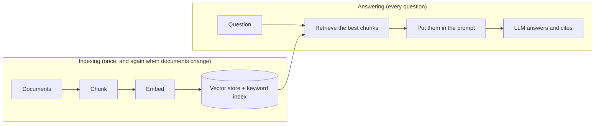

# Module 5: Retrieval-Augmented Generation (RAG)

**Goal:** give an LLM access to knowledge that is not in its weights, with sources you can check, and learn how to measure and improve retrieval.
**Time:** ~40 min. **Prerequisites:** [Module 2](02-building-blocks.md) (the agent loop and tools are reused; embeddings are new).

This is the first of three modules on knowledge: **RAG** (this module: finding the right text and answering from it), [**Knowledge bases**](06-knowledge-bases.md) (keeping it working as documents change and grow) and [**GraphRAG**](07-graphrag.md) (questions whose answers live in the relations between documents). How they relate: see the [overview in the README](../README.md#how-modules-5-to-7-fit-together).

## Setup: an embedding model

RAG needs an **embedding model** next to the chat model. Like the chat model, it is configured per provider, with `<PROVIDER>_EMBED_MODEL`:

| Provider | Setting in `.env` | Notes |
|---|---|---|
| Azure OpenAI | `AZURE_EMBED_MODEL=text-embedding-3-small` | the name of a **deployment** on the same resource as your chat model (see below) |
| LM Studio | `LMSTUDIO_EMBED_MODEL=text-embedding-nomic-embed-text-v1.5` | download an embedding model in LM Studio; the name is what `http://localhost:1234/v1/models` lists |
| none | leave it unset | the examples fall back to keyword search (BM25) only |

**Creating the Azure deployment.** In the Azure portal or Microsoft Foundry, open your Azure OpenAI resource, go to *Deployments*, choose *Deploy model*, pick `text-embedding-3-small`, keep the default deployment name (the same) and set a quota. The base URL and API key do not change. With the CLI ([reference](https://learn.microsoft.com/en-us/cli/azure/cognitiveservices/account/deployment)):

```bash
az cognitiveservices account deployment create --resource-group <group> --name <resource-name> \
  --deployment-name text-embedding-3-small --model-name text-embedding-3-small --model-version "1" \
  --model-format OpenAI --sku-name Standard --sku-capacity 10
```

Available SKUs, versions and quotas depend on the region, so check the portal if the command is refused. [Generate embeddings with Azure OpenAI](https://learn.microsoft.com/en-us/azure/foundry/openai/how-to/embeddings) shows the call itself.

**The knowledge base** of this module is the handouts of Modules 1-4, so you can ask questions about what you have just read. (Later handouts talk about RAG itself and contain the example queries, which would make the examples search their own explanation.)

Run from the project root, in Python or JavaScript:

| Lesson | Python | JavaScript |
|---|---|---|
| Naive RAG, end to end | `python examples/python/m05_rag_basic.py` | `node examples/js/m05_rag_basic.mjs` |
| Hybrid search, filters, reranking | `python examples/python/m05_rag_hybrid.py` | `node examples/js/m05_rag_hybrid.mjs` |
| Measuring recall | `python examples/python/m05_rag_eval.py` | `node examples/js/m05_rag_eval.mjs` |
| Agentic RAG | `python examples/python/m05_rag_tool.py` | `node examples/js/m05_rag_tool.mjs` |

The first run embeds the chunks and saves them in `examples/.rag_index/` (one file per embedding model, git-ignored); later runs load them. It costs a tiny fraction of a cent at list prices.

## 1. Why retrieval?

A model knows only what was in its training data, which is old, public and not citable. RAG fetches the relevant passages at question time and puts them in the prompt:



| Use RAG when | Skip it when |
|---|---|
| The knowledge is private, new or changes often | The whole text fits in the context window and is read often: just put it in the prompt |
| You need sources the user can check | The model already knows it and nobody needs a source |
| There is far more text than fits in a prompt | A database query or an API gives the exact answer |

RAG reduces made-up answers, but it does not remove them: the model can still ignore or misread the sources, which is why the examples ask for citations and an explicit "I do not know".

## 2. Embeddings and similarity

An **embedding** turns a text into a list of numbers (a vector, 1536 numbers for `text-embedding-3-small`) so that texts with similar meaning get similar vectors. **Cosine similarity** measures how close two vectors point: 1 means the same direction, around 0 unrelated.

Two things matter in practice:

- **Scores only mean something within one model.** Our test on three short texts:

  | Pair | `text-embedding-3-small` (Azure) | `nomic-embed-text-v1.5` (LM Studio) |
  |---|---|---|
  | "the cat sat on the mat" vs "a kitten rests on a rug" | 0.54 | 0.76 |
  | "the cat..." vs "quarterly tax return" (unrelated) | 0.08 | 0.47 |

  Unrelated text scores near 0 with one model and near 0.5 with the other. A fixed similarity threshold must therefore be **calibrated for your model** (exercise 3).
- **Queries and documents are embedded differently by some models.** nomic expects the prefixes `search_query: ` and `search_document: `. `embed(texts, kind="query" | "document")` in `llm_client` adds them automatically for nomic; for any other model that needs them, set `<PROVIDER>_EMBED_QUERY_PREFIX` and `<PROVIDER>_EMBED_DOC_PREFIX`. Always read the model card.

Vectors from different models cannot be mixed, and you cannot compare them with each other: change the model and you must embed everything again.

## 3. Chunking

You do not embed whole documents: a vector of a 40-page document blurs everything, and a prompt cannot hold it. You cut documents into **chunks**. Small chunks match precisely but lose context; large chunks keep context but dilute the match.

`chunk_markdown` in [`retrieval.py`](../examples/python/retrieval.py) / [`retrieval.mjs`](../examples/js/retrieval.mjs) splits by the structure of the document:

- one chunk per section (by heading), split between paragraphs when longer than 1500 characters, with one paragraph of overlap;
- headings inside code blocks are not headings, and diagrams (mermaid) are dropped as noise;
- every chunk keeps its **section path**, for example `Module 3: Agent Patterns > 8. Reflection > Reflection vs. evaluator-optimizer`. The path is prepended to the text that is embedded and keyword-indexed (a "contextual header"), so a short chunk still knows where it belongs, and it is shown in the citation.

**What a chunk carries.** The chunk is the unit that is searched, cited and (in Module 6) synchronised, so it carries its own address:

```text
{ "id":         "03-patterns.md#10",        # doc_id + running number within the document
  "doc_id":     "03-patterns.md",           # which file
  "section":    "Module 3: Agent Patterns > 8. Reflection > Reflection vs. evaluator-optimizer",
  "start_line": 191,                        # line of the file where the chunk's first paragraph begins (1-based)
  "text":       "Both are \"generate, critique, improve\". They differ ...",
  "hash":       "13eac309e703" }            # fingerprint of section + text: identifies content, not a place
```

Together `doc_id`, `section` and `start_line` locate the passage in the original: open the file, go to the line. Three details to know:

- `id` is only a running number: it shifts when text is inserted before the chunk. Use `hash` to recognise content and `doc_id` + `start_line` to find it, and remember that both change when the document is edited.
- `start_line` is the line of the *first paragraph*. A chunk that overlaps its predecessor starts at the repeated paragraph, and diagrams that were dropped from the text still count as lines, so the number matches what an editor shows.
- There is no end line, page number or character span. Production systems usually add some of them (page for PDFs, a character span to highlight the cited passage, the source URL, the document version) and keep the metadata next to the vector in the store, so a filter or a citation never needs the original file. Adding `end_line` is exercise 7.

The Modules 1-4 handouts give **66 chunks** (median about 660 characters, the longest about 1850). Other strategies exist: fixed-size windows (simple, cuts sentences), sentence or semantic splitting, parent-child (match small chunks, return the larger section) and LLM-written context per chunk. Which is best depends on your documents: measure (section 6).

## 4. Naive RAG: `m05_rag_basic`

The whole pipeline in four steps: embed the question, take the closest chunks, put them in the prompt as numbered sources, answer.

```python
def ask(retriever, question, k=4):
    hits = retriever.search(question, k=k, mode="dense")        # 1. retrieve: (score, chunk) pairs
    hits = [(s, c) for s, c in hits if s >= MIN_SCORE]           # 2. drop weak matches
    return answer_with_sources(question, hits)                   # 3. augment and generate (rag.py)
```

`answer_with_sources` (in [`rag.py`](../examples/python/rag.py) / [`rag.mjs`](../examples/js/rag.mjs)) formats the chunks as `[1] file > section` plus text, and instructs the model to use only these sources, to cite them like `[1]`, and to say so when they do not contain the answer. A real run (shortened):

```text
Q: How can I continue a conversation across several run_agent calls?
  [1] 0.59  02-building-blocks.md > ... > 6. The agent loop, made reusable > Continuing a conversation (`messages=`)
  [2] 0.52  04-multi-agent.md > ... > 5. Swarm / handoff
  [3] 0.52  02-building-blocks.md > ... > 6. The agent loop, made reusable
  ...
A: To continue a conversation across several `run_agent` calls, reuse the same `messages` list ... [1][3]

Q: What is the capital of Australia?
  (nothing above the score threshold)
A: I do not know based on the handouts (nothing relevant was found).
```

The last question is not in the handouts, and the right behaviour is to say so. Two defences work together: the **score threshold** (nothing retrieved, the model is not even asked) and the **prompt instruction**. With Azure's model the unrelated question scored below the threshold of 0.25. With nomic the same question scored 0.54, far above it, so only the prompt instruction prevented a made-up answer. Calibrate the threshold per model (`RAG_MIN_SCORE`).

## 5. Better retrieval: `m05_rag_hybrid`

Embeddings find *meaning*, but they are weak on exact strings such as identifiers, error codes and names. **BM25** is the classic keyword ranking (a few lines in `retrieval.py`): strong on exact terms, blind to synonyms. Real output for two queries (top 3 each):

```text
Q (meaning, few shared words): how does the model remember earlier turns of a conversation?
  dense  0.53 02:5. Memory and context | 0.46 02:Continuing a conversation | 0.40 01:Reading the messages ...
  bm25   6.60 02:Continuing a conversation | 6.34 01:The conversation behind it | 5.52 02:5. Memory and context
  hybrid 0.03 02:Continuing a conversation | 0.03 02:5. Memory and context | 0.03 01:The conversation behind it

Q (an exact identifier): model_dump
  dense  0.32 02:3. Tool calling | 0.30 02:Reliability with small local mod | 0.30 02:4. Structured output
  bm25   2.38 01:Where do these messages come fro | 2.09 02:Continuing a conversation | 1.85 02:Further reading
  hybrid 0.03 01:Where do these messages come fro | 0.03 02:Further reading | 0.03 02:Further reading
```

For the identifier, dense search returns generic tool-calling sections and misses the one chunk that explains `model_dump`; BM25 finds it. **Hybrid search** runs both and merges the rankings with **reciprocal rank fusion** (RRF): an item ranked *r*-th in a list earns `1 / (60 + r)` points, and the sums decide. RRF needs no score scaling, which matters because cosine, BM25 and fused scores are on different scales (see the numbers above).

```python
def rrf(rankings, k=60):
    fused = {}
    for ranking in rankings:
        for rank, chunk_id in enumerate(ranking, start=1):
            fused[chunk_id] = fused.get(chunk_id, 0.0) + 1.0 / (k + rank)
    return fused
```

Two more tools in the same lesson:

- **Metadata filters.** `retriever.search(query, where=lambda chunk: chunk["doc_id"] == "03-patterns.md")` searches only part of the corpus. Filters are how you narrow a big knowledge base by product, language, date, version or user permission.
- **Reranking.** Retrieve wide (20 candidates, cheap), let a stronger and slower step read them and keep the best 4 (`rerank` in `rag.py` asks the LLM to score each passage 0-10). A dedicated cross-encoder model is the usual production choice; the LLM version shows the idea. It costs one more model call per question, and as the next section shows, it must earn its place.

## 6. Measuring recall: `m05_rag_eval`

"It seems to work" is not a measurement. [`examples/rag_golden.json`](../examples/rag_golden.json) holds 18 questions, each with the section(s) that answer it. A retrieval is a **hit** when one of those sections is among the top *k* chunks. The lesson reports:

- **recall@k**: the share of questions with a hit in the top *k*;
- **MRR** (mean reciprocal rank): the average of `1 / rank of the first hit`, which rewards putting the right chunk first.

Results on the 66 chunks (Azure, `text-embedding-3-small`; the other rows are deterministic):

| Method | recall@1 | recall@3 | recall@5 | MRR |
|---|---|---|---|---|
| BM25 (keywords) | 0.61 | 0.83 | 0.94 | 0.73 |
| Dense (embeddings) | 0.72 | 0.89 | 1.00 | 0.82 |
| Hybrid (RRF) | 0.78 | 0.89 | 1.00 | 0.86 |
| Hybrid + LLM rerank | 0.72 to 0.94 | 1.00 | 1.00 | 0.84 to 0.96 |

(Measured on the handouts as they are in this repository; the numbers shift a little whenever the handouts change, which is itself a reason to re-run the evaluation after every change.)

The same lesson with LM Studio and nomic gives: BM25 as above, dense 0.78 / 0.78 / 0.89 / 0.81, hybrid 0.83 / 0.89 / 0.94 / 0.87, with one question missed in the top 5.

How to read this honestly:

- **Hybrid is never worse than either single method and usually better**, on both embedding models (it ties on a few metrics). That is typical, and it is cheap.
- **The reranker's row is a range**, because even at temperature 0 an LLM gives slightly different scores on every run (5 runs here). It improved recall@3 every time (1.00 against 0.89 for plain hybrid), but its MRR ranged from 0.84 to 0.96 against 0.86 for hybrid: on average a little better (about 0.90), yet a single run can be worse, and the spread is as large as the gain. Do not add a reranker because it "feels better": measure it, repeat the measurement, and weigh the extra latency and cost.
- **18 questions is a tiny set**: one question is 5.6 points of recall, so differences of one question mean nothing. It is enough to teach the method, not to make decisions. Use 50 to 200 real questions in practice.
- **Read the misses.** The list of missed questions shows *why* retrieval fails (for example, sections about the trace *output* outranking the section that explains how to *switch it on*). That tells you what to fix: the chunking, the query, or the document.

## 7. Agentic RAG: `m05_rag_tool`

In naive RAG the code always retrieves once. In **agentic RAG** retrieval is a tool, and the agent loop from Module 2 decides *whether* to search, *with which query*, and *how often*:

```python
def search_docs(query: str) -> str:
    hits = retriever.search(query, k=4, mode="hybrid")
    return format_sources(hits, max_chars=800) if hits else "No results."

TOOLS = [Tool(search_docs, "Search the tutorial handouts ... Use short, specific queries ...",
              {"type": "object", "properties": {"query": {"type": "string"}}, "required": ["query"]})]
run_agent(question, TOOLS, system="Use search_docs for questions about the handouts, cite sources ...")
```

Real trace (`LLM_TRACE` on), shortened:

```text
Q: How does reflection differ from evaluator-optimizer, and which one has a loop?
[step 1] assistant -> TOOL CALL search_docs({"query":"reflection vs evaluator-optimizer loop"})
[step 1] tool      <- [1] 03-patterns.md > ... > Reflection vs. evaluator-optimizer ...
[step 2] assistant -> FINAL ANSWER (no tool_calls): Reflection and evaluator-optimizer are both ...

Q: What is 17 * 3?
[step 1] assistant -> FINAL ANSWER (no tool_calls): 17 * 3 = **51**.
```

The model rewrote the question into a short query itself, and skipped retrieval for the arithmetic question.

| | Naive RAG | Agentic RAG |
|---|---|---|
| Who decides to retrieve | your code, always, once | the model, as needed |
| Query | the user's words | a query the model writes |
| Multi-step questions | one shot | can search again with a new query |
| Cost and latency | one retrieval, one call | at least two model calls, sometimes more |
| Typical failures | a bad query is never fixed | a skipped search (it answers from memory), a loop of useless searches |

Use naive RAG when every question needs the knowledge, and agentic RAG when retrieval is one tool among several or questions are multi-step. Cap the steps, as always.

## Where this module stops

Two situations push plain RAG past its limits, and each has its own module:

- **The documents change and the corpus grows.** Here the index was built once from fixed handouts. A real knowledge base needs updates by content hash, versions, deletions, safe index releases and recall that survives growth: [Module 6](06-knowledge-bases.md).
- **The answer lives in the relations between documents**, not in any single chunk. "Which patterns from Module 3 does the supervisor of Module 4 build on?" needs pieces from two handouts that no single chunk contains. GraphRAG extracts entities and relations to answer such multi-hop questions: [Module 7](07-graphrag.md).

## From tutorial to production

The examples are small on purpose. What changes with real documents and real users, and what to look for:

| Area | In this tutorial | What to look for in production |
|---|---|---|
| Chunking | headings, up to 1500 characters, one paragraph of overlap | Test chunk sizes on your data. PDFs, tables, scans and code need their own parsers. Keep source, page, author and version as metadata. Consider parent-child chunks and contextual headers |
| Embeddings | one model, as is | Choose by measuring on your own questions (public leaderboards are only a hint). Pin the model version, mind dimension and cost, check multilingual needs. A model change means re-embedding everything |
| Vector store | a list in memory, brute force, a JSON file | An approximate-nearest-neighbour index (HNSW or IVF) in a vector database or search service, with persistence, backups and filters. Measure the recall lost to approximation against exact search ([Module 6](06-knowledge-bases.md#7-many-documents-and-keeping-recall)) |
| Retrieval | hybrid with RRF, an optional LLM reranker | Candidate pool size, a cross-encoder reranker, query rewriting, per-model thresholds, a clear "no answer" path |
| Generation | numbered sources, a citation prompt | Check that the citations really support the claims (faithfulness), watch the context size, remember that models use the middle of a long context worse ([Lost in the Middle](https://arxiv.org/abs/2307.03172)) |
| Evaluation | 18 questions | 50 to 200 real questions including ones with no answer, recall@k and answer faithfulness, run on every change, trend over time. LLM judges are noisy: repeat |
| Security | none | Retrieved text is **untrusted input** and can contain instructions (prompt injection). Enforce access control **at retrieval** (filter by user or tenant), never after generation. Handle personal data |
| Operations | prints | Log the query, the retrieved ids and scores, the answer and user feedback. Track latency and cost per stage. Alert on empty or low-score retrievals. Re-run the golden set after every re-index. Retry dropped connections, 429 and 5xx with a growing pause (the Python SDK does by default, the JavaScript client here does it explicitly) |

Retrieval problems are the most common reason a RAG system disappoints; [Seven failure points when engineering a RAG system](https://arxiv.org/abs/2401.05856) is a good checklist.

## Key takeaways

- RAG = retrieve relevant chunks, put them in the prompt, answer from them with citations. It adds knowledge and checkability, not certainty.
- Chunk by structure and keep the section path with every chunk.
- Embedding scores are only comparable within one model: calibrate thresholds, and re-embed when the model changes.
- Dense search finds meaning, BM25 finds exact terms: hybrid search with RRF is a cheap, strong default.
- Measure retrieval with a golden set (recall@k, MRR) before and after every change, and treat small differences with suspicion.
- Agentic RAG makes retrieval a tool: more flexible, more calls.

## Exercises

1. Change `max_chars` in `chunk_markdown` (for example 500, 1500, 4000) and rerun the evaluation. How do the recall numbers change, and which chunk size would you choose?
2. Add five questions to `rag_golden.json`, including one whose answer is not in the handouts. How should a "no answer" question be scored?
3. Calibrate `RAG_MIN_SCORE`: print the top score for 10 questions that the handouts answer and 10 that they do not, and choose a threshold for your embedding model.
4. Implement multi-query retrieval: ask the LLM for three rephrasings of the question, search with each, merge the results with `rrf`. Does recall improve?
5. Run the evaluation with Azure and with LM Studio (`LLM_PROVIDER`). Why does each provider create its own index file?
6. Give `search_docs` an optional `module` argument (a metadata filter) and let the agent use it.
7. Add `end_line` to the chunks (Python and JavaScript), and make the citation print `file:start-end`. Which chunks overlap, and what do the overlapping ranges tell you about the chunker?

## Further reading

- Lewis et al., [*Retrieval-Augmented Generation for Knowledge-Intensive NLP Tasks*](https://arxiv.org/abs/2005.11401) (2020): the paper that named RAG
- Barnett et al., [*Seven Failure Points When Engineering a Retrieval Augmented Generation System*](https://arxiv.org/abs/2401.05856) (2024): where real systems break
- Es et al., [*Ragas: Automated Evaluation of Retrieval Augmented Generation*](https://arxiv.org/abs/2309.15217) (2023): metrics beyond recall, such as faithfulness
- Anthropic, [*Contextual retrieval*](https://www.anthropic.com/research/contextual-retrieval) (2024): LLM-written context per chunk, hybrid search and reranking, with measured gains
- Cormack et al., [*Reciprocal Rank Fusion outperforms Condorcet and individual rank learning methods*](https://cormack.uwaterloo.ca/cormacksigir09-rrf.pdf) (2009) and [Okapi BM25](https://en.wikipedia.org/wiki/Okapi_BM25)
- Embeddings in practice: OpenAI, [*Vector embeddings*](https://developers.openai.com/api/docs/guides/embeddings); [Azure OpenAI embeddings](https://learn.microsoft.com/en-us/azure/foundry/openai/how-to/embeddings); the [nomic-embed-text-v1.5 model card](https://huggingface.co/nomic-ai/nomic-embed-text-v1.5) (note the task prefixes); the [MTEB leaderboard](https://huggingface.co/spaces/mteb/leaderboard)
- Pinecone, [*Chunking strategies for LLM applications*](https://www.pinecone.io/learn/chunking-strategies/)

**Next:** [Module 6: Knowledge bases](06-knowledge-bases.md)
