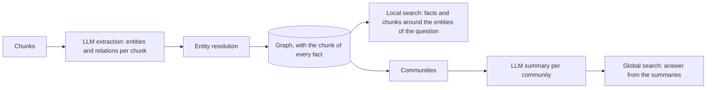
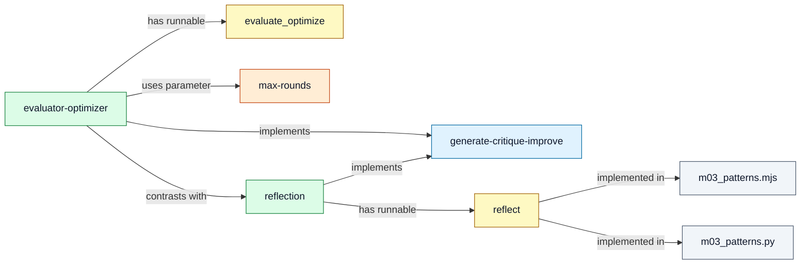
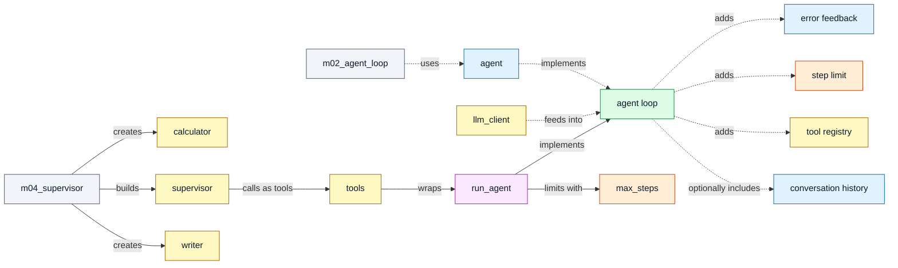
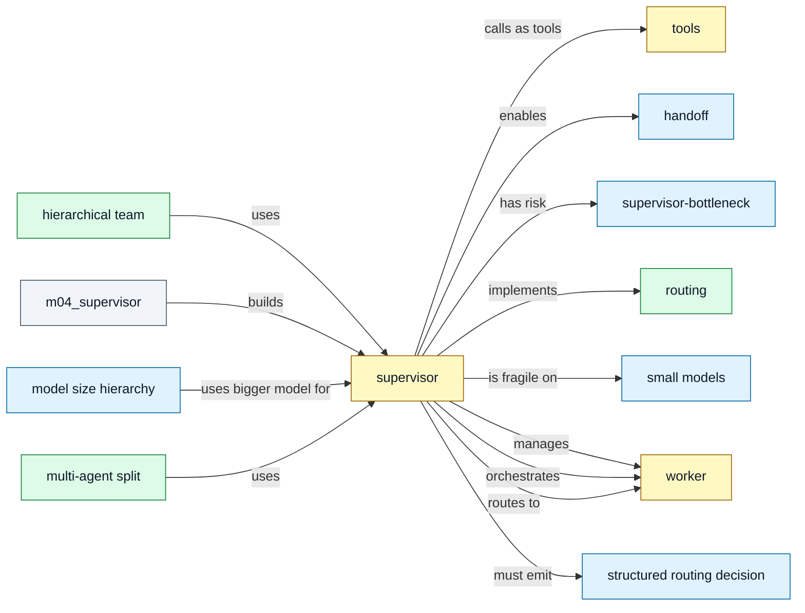
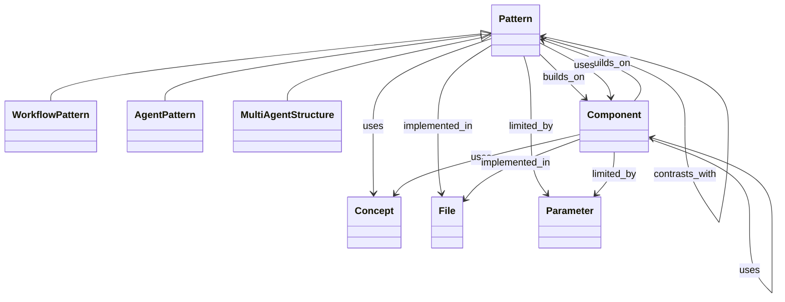
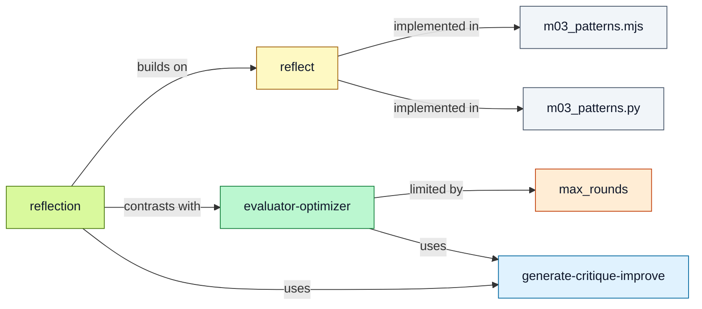
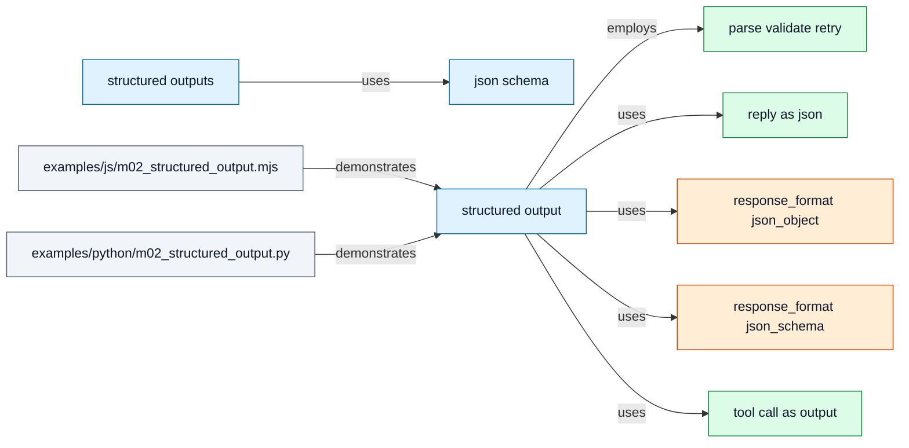
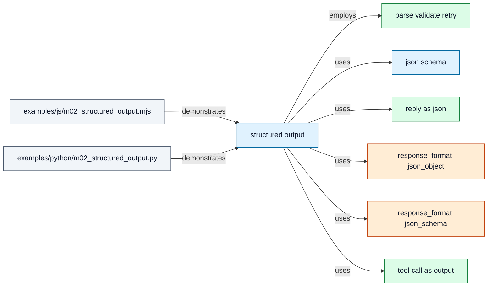

# Module 7: GraphRAG

**Goal:** understand what a knowledge graph adds to retrieval, build one from text with an LLM, use it for local and global questions, and judge honestly whether it is worth its cost.
**Time:** ~35 min. **Prerequisites:** [Module 5](05-rag.md) (the retriever and the golden-set method; Module 6, [knowledge bases](06-knowledge-bases.md), helps for the section on updates).

How this module relates to RAG (Module 5) and knowledge bases (Module 6): see the [overview in the README](../README.md#how-modules-5-to-7-fit-together).

## Setup

No new settings: GraphRAG uses the chat model and the embedding model you already configured ([setup](05-rag.md#setup-an-embedding-model)), and the handouts of Modules 1-4 as its documents. Run from the project root:

| Lesson | Python | JavaScript |
|---|---|---|
| Build the graph from the handouts | `python examples/python/m07_graph_build.py` | `node examples/js/m07_graph_build.mjs` |
| Local search, compared with plain RAG | `python examples/python/m07_graphrag.py` | `node examples/js/m07_graphrag.mjs` |
| Global search over communities | `python examples/python/m07_graphrag_global.py` | `node examples/js/m07_graphrag_global.mjs` |
| Look at the graph: diagrams and growth | `python examples/python/m07_graph_diagrams.py` | `node examples/js/m07_graph_diagrams.mjs` |
| An ontology-guided graph, compared with the open one | `python examples/python/m07_graph_ontology.py` | `node examples/js/m07_graph_ontology.mjs` |

The first run **makes one LLM call per chunk** (66 calls, about a minute on Azure with four in parallel). The graph is saved in `examples/.rag_index/graph-<chat model>.json` (git-ignored) and shared by Python and JavaScript; a different chat model or a changed extraction prompt makes a new graph. Summaries of communities are cached in the same file. The diagram lesson makes no LLM calls once the graph exists; the ontology lesson makes 6, and its numbers vary a little from run to run.

**The diagrams in this handout come from these lessons**, printed as Mermaid text (GitHub renders it). To explore one, paste it into [mermaid.live](https://mermaid.live).

## 1. Why a graph?

Retrieval of chunks (Module 5) finds the passages *closest to the question*. Three kinds of questions escape it:

| Kind of question | Why plain retrieval struggles | What a graph adds |
|---|---|---|
| **Multi-hop**: "Which Module 2 component runs each worker of the Module 4 supervisor?" | The answer is spread over sections that do not share words with the question and with each other | Entities link the sections: *supervisor* is connected to *worker*, to *run_agent*, to the chunk that explains it |
| **Global**: "What are the main themes of the handouts?" | No chunk contains the answer, and top-k returns only a few chunks | Communities and their summaries describe the whole set |
| **Relations**: "What contrasts with what? What builds on what?" | Relations are implicit in prose | They are extracted once and stored as edges |

GraphRAG is therefore an *indexing* idea: spend LLM calls up front to turn text into entities and relations. Whether that pays off is an empirical question, and sections 7 and 10 give a sober answer.

## 2. What a knowledge graph is, and how this one is built

A knowledge graph is a set of **entities** (nodes) connected by **relations** (edges): `supervisor --manages--> worker`. Here an LLM reads every chunk and lists both.



One design decision matters more than any other: the **source of truth is one extraction record per chunk** (the entities and relations the LLM found in it). The graph itself (nodes, edges, neighbours) is *derived* from the records. So every node and edge knows which chunks it came from (**provenance**), every fact can be cited, and updating the graph is the same operation as the sync of Module 6: extract new chunks, drop the records of removed chunks, rebuild. The building block is [`graph_store.py`](../examples/python/graph_store.py) / [`graph_store.mjs`](../examples/js/graph_store.mjs).

### What it looks like, and how it grows

The pictures below are generated from the real graph of the handouts by `m07_graph_diagrams`. The colour of a node is its entity type (concept, pattern, component, parameter, file, tool, ...).

**One chunk.** The extraction of a single chunk, *Reflection vs. evaluator-optimizer*: 8 entities and 8 relations. On its own it is a small, readable graph.



**Two chunks merge.** Now two chunks from *different handouts*, extracted separately: the supervisor example of Module 4 (solid lines) and the reusable agent loop of Module 2 (dashed lines). Entities with the same name are one node, so the two small graphs grow together through the node they share, `agent loop`: the supervisor's `run_agent` *implements* it, and the Module 2 facts describe what it adds (a step limit, error feedback, a tool registry). This is how isolated per-chunk facts become one connected graph. (A fact found in both chunks would be drawn as a thick line; there is none here.)



**One entity and its neighbours.** The hub *supervisor*, one hop out, with its best supported facts. Local search (section 6) walks exactly such neighbourhoods.



**Growth.** The whole graph is too large to draw (336 entities), so here are the numbers as chunks are added in document order:

| Chunks added | Entities | Relations | Relations per entity | Connected parts | Largest part |
|---|---|---|---|---|---|
| 1 | 5 | 4 | 0.80 | 1 | 5 |
| 4 | 25 | 22 | 0.88 | 4 | 18 |
| 16 | 84 | 94 | 1.12 | 4 | 77 |
| 33 | 169 | 204 | 1.21 | 8 | 130 |
| 66 | 336 | 405 | 1.21 | 24 | 279 |

What the table and the finished graph tell you:

- **Entities and relations grow roughly in step with the chunks** (about 5 entities and 6 relations per chunk). A million chunks give a graph of millions of nodes, which is a storage question ([Module 8](08-graph-databases.md)) and a drawing question: you look at neighbourhoods, communities and filtered views, never at the whole.
- **Most entities are seen once.** 78% of the entities appear in exactly one chunk and only 22% in two or more; 12 of them appear in five or more. The facts that connect the graph are carried by a few **hubs** (12 entities have 10 or more relations; `agent loop` has 35), while the median entity has a single relation.
- **Connectedness grows slowly.** The graph is one part at one chunk, 4 parts at 16, and 24 parts at 66, but the largest part holds 279 of the 336 entities (83%). The small remaining parts are isolated facts. Entity resolution (section 5) matters because every wrongly split entity is a missing link.

## 3. Ontology, taxonomy and knowledge graph: what did we build?

A natural question: if an LLM extracts entities and relations, have we built an **ontology**? Almost, and the difference matters. What we extracted is a **knowledge graph**: *facts* about specific things (`supervisor --manages--> worker`). An **ontology** is the *schema* that says what kinds of things and relations may exist at all. The three terms sit on a spectrum of formality:

| Term | What it is | Example from the handouts | How formal |
|---|---|---|---|
| **Controlled vocabulary** | An agreed list of terms, nothing more | The entity types `concept, pattern, component, tool, file, parameter, provider, other` in `graph_store` | A list |
| **Taxonomy** | A hierarchy of categories, with one relation: "is a kind of" (broader and narrower) | Patterns are *workflow patterns* (prompt chaining, routing, ...) or *agent patterns* (ReAct, plan-and-execute, reflection); multi-agent structures are supervisor, hierarchical team, handoff, debate | A tree or a simple graph |
| **Ontology** | A formal, explicit specification of a domain: the classes (with their taxonomy), the *kinds* of relations, which classes each relation may connect (domain and range), constraints, and rules that support reasoning. Gruber's classic definition is "an explicit specification of a conceptualization" | `implemented in` may only go from a Pattern or Component to a File; `variant of` only from a Pattern to a Pattern; a Reflection *is a* Pattern, and a Pattern is not a File | Formal, usually written in OWL or RDFS |
| **Knowledge graph** | The *data*: the specific entities and the relations between them, ideally following an ontology | The graph of this module: 336 entities, 405 relations | As formal as the schema it follows |

They fit together like this: a **taxonomy is the backbone of an ontology** (its class hierarchy); the ontology adds the typed relations, constraints and rules; the knowledge graph is the instance data that follows the ontology. Ontologists call the schema part the T-Box (classes and relations) and the data part the A-Box (individuals and facts). A thesaurus sits between taxonomy and ontology: a taxonomy plus related and synonymous terms (the W3C's SKOS standard represents taxonomies and thesauri; OWL represents ontologies).

### What this tutorial built

An **open** knowledge graph, extracted without a schema ("schema on read"). Measured against the table above:

- **Types:** a flat list of eight, with no hierarchy. Not even a taxonomy: nothing says that a *supervisor* and a *handoff* are both multi-agent structures.
- **Relations:** free text (`uses-parameter`, `implemented-in`, `contrasts with`). There is no vocabulary of relations, and nothing says which classes a relation may connect, so nothing prevents `reflection --implements--> m03_patterns.py` from being extracted backwards.
- **No constraints and no reasoning.**

That is why the extraction was cheap to start, why it found things nobody planned (function names such as `evaluate-optimize` became entities), and why it is noisy: duplicate names (section 5), `other` entities and relation labels that differ by a hyphen.

### Three ways to build the graph

| Approach | Where the schema comes from | Strengths | Weaknesses |
|---|---|---|---|
| **Open extraction** (this module) | Nowhere: the LLM invents types and labels | Cheap to start, finds the unexpected | Noisy, duplicates, no guarantees |
| **Ontology-guided extraction** | A hand-written or reviewed ontology, put in the prompt. The LLM may only use its classes and relations, and the output is **validated** against it (allowed labels, domain and range); a violation is rejected or sent back like invalid JSON in Module 2 | Clean, typed, consistent and stable across re-extractions; enables typed queries and taxonomy-based reasoning | Needs domain expertise and maintenance; misses what the ontology lacks (allow an `other` class and review it) |
| **Manually curated, or from existing sources** | Experts, or a database, a catalogue or a public graph such as Wikidata; an LLM at most links text to the existing entities | The highest quality | Slow and expensive; does not cover free text |

They combine: start **open**, count which types and labels the LLM uses most, review them into a first ontology, and then enforce it ("ontology learning": the LLM proposes, people decide). Real tools do the enforcing: the GraphRAG SDK of FalkorDB, for example, states that its ontology constrains what can be extracted, so that the graph stores typed, checkable facts instead of free-form model output.

### An ontology for these handouts, and a guided extraction

The handouts have a small working ontology: [`examples/ontology.json`](../examples/ontology.json), with 8 classes (a taxonomy under *Pattern*, plus Component, File, Parameter and an escape class Concept) and 6 relations, each with the classes it may connect. As a diagram (generated by `m07_graph_ontology`; a triangle arrow is "is a kind of", the other arrows say which classes a relation may connect):



`m07_graph_ontology` puts this ontology in the extraction prompt and then **validates** every answer: classes and relations that are not in the ontology are dropped, and a relation whose endpoints break its domain or range (checked through the taxonomy: a WorkflowPattern counts as a Pattern) is rejected with a reason. A real run on 6 chunks, next to the open extraction of the same chunks:

| | Open extraction | Ontology-guided |
|---|---|---|
| Entities | 48 | 45 |
| Relations | 43 | 37 accepted, 4 rejected (of 41 proposed) |
| **Distinct relation labels** | **26** (free text) | **6** (the ontology's) |
| Types of the entities | 8 flat types | 8 classes, with a taxonomy |

(A second run, in JavaScript, gave 46 entities, 38 accepted and 3 rejected: the numbers move a little, the pattern does not.) The same chunk as in the first figure of section 2, now guided, with the colours of the *ontology classes*: 7 entities, 7 relations, every relation one of the six allowed names:



The rejections are where the ontology bites:

```text
   m04_supervisor --implemented_in--> supervisor: domain: a File cannot be the source of implemented_in (needs Pattern or Component)
   m02_agent_loop.py --builds_on--> agent loop:    domain: a File cannot be the source of builds_on (needs Pattern or Component)
   debate --uses--> critic:                        range: a AgentPattern cannot be the target of uses (needs Component or Concept)
```

What the run shows:

- **The vocabulary collapses from 26 labels to 6.** That is what makes typed queries, constraints and database relationship types possible ([Module 8](08-graph-databases.md#3-mapping-the-graph-of-module-7)).
- **The validator catches errors the open graph accepted silently,** such as a *file* "implemented in" a pattern (a reversed direction).
- **It exposes modelling decisions the open graph let you postpone.** `debate --uses--> critic` was rejected because the model classed *critic* as an AgentPattern: is a critic a component, or a pattern? In one chunk the agent loop came out as an AgentPattern, elsewhere as a Component. Someone has to decide, and then the ontology (or its descriptions) is revised, which is the ontology-learning loop.
- **Valid is not true.** The validator checks the *form* of a triple, not whether the passage says it. Guided extraction also still needs review, and it can only express what the ontology allows.

All 6 chunks together, with the guided graph typed by class, are printed as the last diagram of the lesson.

Beyond validation, an ontology buys: **taxonomy-based expansion** in search (a question about "multi-agent structures" would also seed the supervisor, handoff and debate chunks through the subclass links, which neither plain RAG nor our open graph can do; exercise 9); **consistency** across re-extractions; and a direct mapping to database labels, relationship types and constraints ([Module 8](08-graph-databases.md#3-mapping-the-graph-of-module-7)). It costs expertise and upkeep, so invest when the domain is stable and shared (regulation, products, an audit trail, categories you aggregate by) and skip it for exploratory or fast-changing text. Version the ontology like the extraction prompt: a changed class or relation means re-extraction, planned like a release in [Module 6](06-knowledge-bases.md).

Two graph data models carry ontologies. **RDF** (triples with global identifiers) has the ontology languages built in (RDFS, OWL, with SHACL for validation) and is queried with SPARQL. A **property graph**, the model of this module and of most GraphRAG tools, has no widely used ontology language: the ontology lives in your labels, relationship types, constraints and the validation code you write.

## 4. Extraction: `m07_graph_build`

`extract_chunk` makes one LLM call per chunk. The prompt asks for JSON only: at most 8 entities (short, singular, canonical names, with a type from a fixed list) and at most 8 relations (a short verb phrase connecting two of the entities). The reply goes through the parse-validate-retry pattern of Module 2: bad JSON is sent back with a request to fix it, names are normalized, relations whose endpoints were not listed get them added, and a chunk that never yields usable JSON is *not stored*, so the next sync retries it.

What came out for the 66 chunks of Modules 1-4. The timing is from the first run (an Azure `gpt-5.4-nano` deployment, 4 calls in parallel; later runs report "0 extracted, 66 reused from the cache"). The counts are those of the current graph: the first build gave 339 entities and 403 relations, and five chunks were extracted again after an unrelated edit of the handouts, which moved the counts a little (an LLM does not extract the same thing twice):

```text
1. Extraction: one LLM call per chunk (66 chunks)
   66 chunks extracted, 0 reused from the cache, 0 failed, 54.1 s
2. What came out
   336 entities and 405 relations from 66 chunks (5.1 entities and 6.1 relations per chunk)
   entity types: concept 113, pattern 60, component 58, parameter 38, file 24, tool 24, other 10, provider 9
   best connected entities (name: relations, chunks):
     agent loop              35 relations, in 10 chunks
     agent                   18 relations, in 7 chunks
     tool_calls              17 relations, in 12 chunks
   one chunk's extraction (Reflection vs. evaluator-optimizer):
     entities:  evaluator-optimizer (pattern), reflection (pattern), generate-critique-improve (concept), max-rounds (parameter), ...
     relations: evaluator optimizer --implements--> generate critique improve; reflection --implements--> generate critique improve; ...
```

Things to notice:

- **Cost scales with the corpus, not with the questions.** One call per chunk: 66 here, a million chunks means a million LLM calls (plus time under rate limits). Embeddings for plain RAG cost far less. The saved records make this a one-time cost per chunk and per extraction prompt.
- **Quality depends on the model.** A small local model may fail on JSON or invent relations; here all 66 chunks succeeded. Always count failures and read samples.
- **The output is messy even when it works:** relation labels came back as `uses-parameter` and `implemented-in`, some entities are `other`, and the same idea appears under several names (section 5). The graph is *open*: nothing constrains the types or the labels (section 3 explains what an ontology would add).

## 5. Entity resolution: the main quality problem

If `tool` and `tools`, or `handoff` and `handoffs`, become different nodes, the graph is fragmented and every search that follows it loses links. **Entity resolution** decides which names are one entity. The lesson applies one simple, safe rule on the *derived* graph (the records stay untouched): names that differ only by plural forms are merged into the variant that occurs in most chunks. That merged 7 variants (`agents` into `agent`, `gates` into `gate`, `handoffs` into `handoff`, `local models` into `local model`, ...). Here is what one merge looks like on the real graph: `structured outputs` and `structured output` are two nodes, each holding part of the facts (10 nodes and 8 facts):



After the merge there is one node that holds the facts of both (9 nodes, the same 8 facts, now all connected to the node every search will find):



What remains after the automatic rule is a list of judgement calls:

```text
   still suspicious (a person, a rule or an LLM has to decide whether these are one entity):
     0.75  'chain of thought'  ~  'chain of thought prompting'
     0.75  'multi agent research system'  ~  'multi agent system'
     0.67  'agent loop'  ~  'supervisor agent loop'
     0.67  'agent loop'  ~  'worker agent loop'
```

The last two show why this is hard: *a worker's agent loop is an agent loop*, but merging them would erase a distinction the handouts make. A **false merge** corrupts the graph silently, a **missed merge** only fragments it, so be conservative.

| Technique | Good for | Risk |
|---|---|---|
| Normalization (case, punctuation, plurals) | Spelling variants | Almost none |
| Alias tables (a reviewed list: `run_agent` = `run agent`) | Known synonyms and abbreviations | Maintenance |
| Embedding similarity of names or descriptions, with a threshold | Synonyms ("LLM" and "language model") | False merges: tune and review |
| An LLM judging candidate pairs | Hard, context-dependent cases | Cost, and the LLM's own mistakes |
| Human review of the top candidates | The few entities everything hangs on | Time |

The same goes for the **schema**. An open schema (the LLM chooses entity types and relation labels) is flexible but noisy, as above; a closed one (a fixed list of types and relations, in the end an ontology) is cleaner but misses what you did not anticipate. Section 3 compares the approaches.

## 6. Local search: `m07_graphrag`

For a question, local search uses the graph in two ways ([`Graph.local_context`](../examples/python/graph_store.py)):

1. **Facts for the prompt.** Seeds are the entities *named in the question* plus the entities of the top-5 retrieved chunks. The search walks two hops over the graph and keeps the best relations: first those that touch an entity named in the question, then the nearest, then the best supported. They go into the prompt as compact lines, each with the chunk it came from.
2. **Chunks the plain search missed.** Every entity is linked to the chunks that mention it, so each entity *named in the question* gets its own best chunk (a retrieval filtered by that entity). This is what brings in the second and third part of a multi-part question. Remaining room (at most 5 extra chunks in all) is filled with the chunks the kept facts came from.

A real run for the question above (shortened):

```text
   the graph's facts around them (best 8 of 30):
     - supervisor --manages--> worker  [04-multi-agent.md#4]
     - supervisor --calls as tools--> tools  [04-multi-agent.md#9]
     - m04_supervisor --builds--> supervisor  [04-multi-agent.md#9]
   context chunks (top-5 by search, plus the ones the graph added):
     top-5  04 > 3. Supervisor (orchestrator) pattern
     top-5  04 > 9. Example: supervisor with workers as tools
     ...
     GRAPH  03 > 4. Orchestrator-workers
     GRAPH  02 > 6. The agent loop, made reusable
   needed: ['04 > 9. Example: supervisor with workers as tools', '02 > 6. The agent loop, made reusable']
   all needed sections present: plain top-5 NO, graph local yes
```

The plain top-5 never reached the Module 2 section that explains `run_agent`; the graph brought it in. (This question was *chosen* for the lesson because it shows the mechanism. The next section is the fair test.) Note also that both the plain and the graph answer were correct here: the Module 4 chunk already says that workers call `run_agent`. Evidence coverage and answer correctness are different measures.

## 7. Does it help? An honest comparison

`examples/graph_golden.json` holds 13 questions: 10 multi-hop ones that each need evidence from 2 or 3 sections, and 3 single-hop controls. For each method the lesson checks whether the context contains **all** the needed sections (no LLM calls, so it is cheap and repeatable). Plain retrieval is shown at several context sizes, because "just retrieve more" is the obvious competitor:

| Method | Multi-hop: all evidence | Share of evidence found | Average context | Single-hop |
|---|---|---|---|---|
| Plain top-5 | 6 / 10 | 0.73 | 3,620 chars | 3 / 3 |
| Plain top-8 | 7 / 10 | 0.88 | 6,169 chars | 3 / 3 |
| Plain top-10 | 8 / 10 | 0.92 | 7,450 chars | 3 / 3 |
| GraphRAG local (5 + up to 5) | 7 / 10 | 0.85 | 6,228 chars | 3 / 3 |

How to read it:

- **On this corpus GraphRAG local search gives no gain over simply retrieving more.** At about 6,200 characters it covers 7 of 10, exactly like plain top-8 at the same size, and plain top-10 (7,450 characters) covers 8. Ten questions are few, and one question is 10 points.
- **The result moved while I wrote this module, and that is part of the lesson.** An earlier build of the same graph scored 8 of 10 (about 6,100 characters, as good as top-10 with less context). Then five chunks were extracted again, only because an unrelated edit of the handouts changed their text, and the plan-and-execute question was no longer covered. Plain retrieval does not move like that. A result that one re-extraction of five chunks can change by a question tells you that a 10-question set cannot separate these methods, and that every change of the extraction (a model, a prompt, an update) needs the comparison to be run again.
- **Two questions fail for every method.** They ask for something spread over many places ("the limits that stop loops, in three handouts", "how too many tools connect small models and multi-agent design"), which no chunk-level or entity-level link captures well.
- **Why the gain is small here:** the corpus is small (66 chunks) and carefully structured, so hybrid search already puts most of the evidence in the top 10. The graph pays off where that is *not* true: large corpora, entity-heavy text (people, contracts, products, incidents) and questions that join facts from distant documents.
- **The costs are real:**

| | Plain RAG (Module 5) | GraphRAG local | GraphRAG global |
|---|---|---|---|
| Indexing | embeddings: cheap | one LLM call per chunk, plus resolution and review | the same, plus one call per community |
| Query | 1 retrieval, 1 call | 1 to 6 retrievals, a graph walk, 1 call | 1 call over all summaries |
| Explainability | the chunks | the chunks and the facts that led to them | the summaries |
| Typical failure | the right chunk is not retrieved | wrong or missing extractions, false merges | summaries that mix unrelated things |

## 8. Global search: `m07_graphrag_global`

"What are the main themes of the handouts as a whole?" has no answer in any chunk. GraphRAG groups the graph into **communities** (clusters of densely connected entities), has an LLM write a **title and summary** for each, and answers from the summaries. The lesson groups the graph with **label propagation**: every entity repeatedly takes the most common label among its neighbours, in a fixed order, so the result is the same every run. Production systems use the more refined **Leiden** algorithm, often with several levels of communities.

```text
1. Communities: 37 groups of at least 3 entities; sizes of the largest: [36, 23, 20, 20, 13, 12, 11, 9, 8, 8]
   1. 36 entities, e.g. evaluator-optimizer, reflection, react, routing, agent patterns
   2. 23 entities, e.g. agent, tools, get_time, llm, chatbot
   3. 20 entities, e.g. handoff, llm_choose, billing, constrained output, conversation history
   ...
3. A global question: What are the main themes of the handouts as a whole?

   Plain RAG (top-5 chunks):
     I don't know based on the handouts ... they don't include enough of the handouts "as a whole" ...

   GraphRAG global (community summaries):
     - LLM Agent Design Patterns: Evaluation-Optimization and Multi-Agent Orchestration
     - Building LLM Agents (Agent Architecture & Tool Use)
     - LLM Agent Orchestration with Handoff, Routing, and Constraints
     - LLM Agent Tool-Calling Loop & Trace Control
     ...
```

This is where GraphRAG earns its keep: plain RAG correctly says it cannot answer, and the community summaries give a usable overview. It also shows the weak spots. The titles are repetitive, a community such as `m01, lm studio, run_in_parallel, azure, extract_task` mixes unrelated things, and the quality of the themes depends on the quality of the graph. A summary is cached by the content of its community, so only changed communities are summarized again. With hundreds of communities the summaries no longer fit one prompt: the real method *maps* the question over each summary and then *reduces* the partial answers.

## 9. Keeping the graph up to date

Because every record knows its chunk, the sync of Module 6 applies directly: chunks are compared by hash, only new chunks are extracted, the records of removed chunks are dropped, and the derived graph is rebuilt (cheap). The lesson changes one sentence in one chunk, on a copy of the graph:

```text
   re-extracted 1, kept 65, removed the record of 1 (the old text)
   entities 336 -> 336; new: ['evaluate-optimize']; no longer in the graph: ['evaluate_optimize']
   (re-extracting the chunk can change more than the sentence you added: an LLM does not give the same answer twice)
```

What to plan for:

- **Re-extraction is not reproducible.** The new record differs from the old one in more than the added sentence (`evaluate_optimize` became `evaluate-optimize`), which resolution has to absorb.
- **Merges and communities are derived, so they follow.** An update can change which entities merge, and therefore the communities, and the summaries whose signature changed are regenerated.
- **Deletion must reach the derived data:** the records, the entities and relations that only came from the deleted text, the community summaries built from them, and the cache. Verify by searching the graph.
- **A new extraction prompt or schema invalidates everything** (`PROMPT_VERSION` in the code), like a new embedding model in Module 6: plan it as a release, with a validation gate.

Where the graph lives in production (PostgreSQL, Neo4j, FalkorDB, Memgraph, and how the records and the derived graph map onto them) is the subject of [Module 8](08-graph-databases.md).

## 10. When (not) to use GraphRAG

Try the cheaper steps first; each one fixes a different problem:

| Step | Try it when | Cost |
|---|---|---|
| Hybrid search and a good chunking (Module 5) | Always | Low |
| More candidates and a reranker | The right chunk is found but ranked low | A call per question |
| Query decomposition or multi-query, agentic RAG (Module 5) | Multi-part questions | More calls per question |
| **GraphRAG** | Many entities that recur across many documents, questions that join facts from far apart, or **global questions** about the whole set | LLM extraction of the whole corpus, resolution, maintenance |

| Use GraphRAG when | Skip it when |
|---|---|
| You need overviews and themes ("what are the main risks across these reports?") | Most questions are answered by one passage |
| The text is full of recurring entities and relations (cases, contracts, products, people) | The corpus is small or well structured, and hybrid search already works |
| You can afford the extraction and review of entities | You cannot evaluate it: without a multi-hop golden set you will not know whether it helped |

## From tutorial to production

The lessons run on 66 chunks. What changes with a real corpus, and what to look for:

| Area | In this tutorial | What to look for in production |
|---|---|---|
| Extraction cost and model | 66 calls, a small model, 4 in parallel | Calls grow with the corpus: budget them, use a cheaper model for extraction, batch and rate-limit, keep records so that nothing is extracted twice |
| Extraction quality | Counts and a few samples | Failure rate, valid-JSON rate, sampled review, the effect of a model or prompt change on the graph, a versioned prompt |
| Schema and ontology | Open: the LLM chooses types and labels | A governed ontology when the domain is stable (classes, relations with domain and range, a validator in the extraction step), a mapping for the rest, versioned like the prompt ([section 3](#3-ontology-taxonomy-and-knowledge-graph-what-did-we-build)) |
| Entity resolution | Plural forms plus a list of suspects | Alias tables, embedding clustering with review, an LLM judge for hard pairs, and a record of every merge so it can be undone |
| Storage | A JSON file and in-memory dictionaries | A database chosen for a measured need (PostgreSQL with `pgvector`, Neo4j, FalkorDB, Memgraph; [Module 8](08-graph-databases.md)), the extraction records kept as the source of truth, indexes on entity names and chunk links, backups, permissions as filters on the chunk link |
| Communities | Label propagation, one level | Leiden, several levels, summaries per level, a plan for recomputing and re-summarizing after changes |
| Updates | Hash-based re-extraction | Change feeds, idempotent jobs, validation gates before a new graph goes live ([Module 6](06-knowledge-bases.md)), deletion that reaches records, caches and summaries |
| Evaluation | 13 coverage questions, no answer scoring | A multi-hop and a global question set from real users, answer-level checks (LLM judges are noisy: repeat them), cost and latency next to quality |
| Security | None | Permissions apply to **facts** too: an edge extracted from a restricted chunk must not leak through a neighbour. Keep the chunk of every edge and filter by it |
| Libraries | Plain code | Microsoft's GraphRAG and LightRAG implement indexing, communities and query modes; Neo4j offers a GraphRAG package. Use one when you need scale, and keep this module's questions to evaluate it |

## Key takeaways

- GraphRAG is an *indexing* investment: an LLM turns text into entities and relations once, and searches then follow the links.
- Keep an extraction record per chunk and derive the graph from it: you get provenance, citations and incremental updates for free.
- Entity resolution is the main quality problem. Merge conservatively: a false merge is worse than a missed one.
- Local search brings facts and the chunks that plain retrieval missed; global search answers about the whole set from community summaries.
- Measure against the obvious competitor (just retrieve more). Here GraphRAG local search matched plain retrieval at the same context size but did not beat it (and one re-extraction moved the result by a question), while its clearest win was the global question.
- Try hybrid search, reranking and multi-query retrieval first; use GraphRAG for recurring entities, joined facts and global questions.

## Exercises

1. Change the extraction prompt (for example, limit the relations to a fixed list), raise `PROMPT_VERSION` and rebuild. How do the statistics change, and what happens to local-search coverage?
2. Add an alias table to the resolution (`run_agent` = `run agent`, `m02 agent loop` = `agent loop`). Does coverage change? Which merge is risky?
3. Vary `hops` (1, 2, 3) and `extra_chunks` (0, 3, 5, 8) in `local_context`. Plot coverage against average context size, together with plain top-k.
4. Add five multi-hop questions to `graph_golden.json` where you expect the graph to help. Does it?
5. Implement multi-query retrieval (Module 5, exercise 4) and compare it with graph local search on the golden set.
6. Change `min_size` and `rounds` in `communities`. Which communities are meaningful and which are noise?
7. Delete a section from the handouts and re-sync: which entities, facts and summaries disappear or become stale?
8. Write a small ontology for the handouts (classes, a taxonomy, relations with domain and range). Put it in the extraction prompt, add a validator that rejects triples breaking domain and range, and compare the statistics and the coverage with the open extraction. (`m07_graph_ontology` is a worked version: change `examples/ontology.json`, for example give `File` a subclass, and see which rejections change.)
9. Add taxonomy-based expansion to local search: a question that names a class ("multi-agent structures") also seeds its subclasses. Which golden questions change?
10. Where would you store this graph in production, and what would make you change your mind? Answer first, then read [Module 8](08-graph-databases.md), whose exercises load the graph into SQL and into a graph engine.

## Further reading

- Edge et al., [*From Local to Global: A Graph RAG Approach to Query-Focused Summarization*](https://arxiv.org/abs/2404.16130) (2024): the paper behind Microsoft's GraphRAG, with entity extraction, Leiden communities and global search
- Microsoft, [GraphRAG documentation](https://microsoft.github.io/graphrag/) and [repository](https://github.com/microsoft/graphrag)
- Guo et al., [*LightRAG: Simple and Fast Retrieval-Augmented Generation*](https://arxiv.org/abs/2410.05779) (2024) and its [repository](https://github.com/HKUDS/LightRAG): a lighter design with incremental updates in mind
- Peng et al., [*Graph Retrieval-Augmented Generation: A Survey*](https://arxiv.org/abs/2408.08921) (2024)
- Gutiérrez et al., [*HippoRAG: Neurobiologically Inspired Long-Term Memory for Large Language Models*](https://arxiv.org/abs/2405.14831) (2024): graph-based retrieval as a memory model, relevant for Module 9
- Hogan et al., [*Knowledge Graphs*](https://arxiv.org/abs/2003.02320) (2020): the background on graphs, schemas and resolution
- Traag et al., [*From Louvain to Leiden: guaranteeing well-connected communities*](https://arxiv.org/abs/1810.08473) (2018) and Raghavan et al., [*Near linear time algorithm to detect community structures in large-scale networks*](https://arxiv.org/abs/0709.2938) (2007, label propagation)
- Neo4j, [GraphRAG for Python](https://neo4j.com/docs/neo4j-graphrag-python/current/)
- Ontologies and taxonomies: Gruber, [*A Translation Approach to Portable Ontology Specifications*](https://tomgruber.org/writing/ontolingua-kaj-1993.pdf) (1993, the classic definition); Noy and McGuinness, [*Ontology Development 101*](https://protege.stanford.edu/publications/ontology_development/ontology101.pdf) (a practical guide to a first ontology); the W3C standards [OWL 2 overview](https://www.w3.org/TR/owl2-overview/) and [SKOS](https://www.w3.org/TR/skos-reference/) (taxonomies and thesauri); [Schema.org](https://schema.org/) as a widely used practical vocabulary
- Graph databases, query languages and how GraphRAG libraries store their data: see the [further reading of Module 8](08-graph-databases.md#further-reading)

**Next:** [Module 8: Graph databases](08-graph-databases.md)
