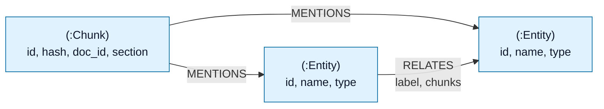

# Module 8: Graph Databases for GraphRAG

**Goal:** choose where a knowledge graph lives in production: know what the store must do, how the graph of Module 7 maps onto a property graph or onto relational tables, how Neo4j, FalkorDB, Memgraph and PostgreSQL compare, and how to start and migrate safely.
**Time:** ~25 min. **Prerequisites:** [Module 7](07-graphrag.md) (the graph, its extraction records and local search); [Module 6](06-knowledge-bases.md) (releases) helps.

How this module relates to RAG, knowledge bases and GraphRAG (Modules 5 to 7): see the [overview in the README](../README.md#how-modules-5-to-7-fit-together). This module is the production companion of Module 7: it has no new lesson to run. Its central claim, that a relational copy of the graph answers the neighbourhood query exactly like the in-memory graph of Module 7, is something you check yourself in exercise 1.

The lessons of Module 7 keep the graph in a JSON file and in Python or JavaScript dictionaries. That is the right size for a tutorial and wrong for production: one process, the whole graph in memory, no concurrent writes, no transactions, no indexes, no permissions. A real system needs a store. The good news is that the design of Module 7 makes the choice reversible: the **extraction records are the source of truth** and the graph is a derived *index*, so a database can be rebuilt from the records, swapped, or run next to the old one (the generation idea of [Module 6](06-knowledge-bases.md#5-releasing-safely-generations-and-a-validation-gate)).

## 1. What the store has to do

| Need | Why it matters here |
|---|---|
| Persistence and transactions | A sync ([Module 7, section 9](07-graphrag.md#9-keeping-the-graph-up-to-date)) must not leave a half-updated graph; concurrent readers must see a consistent one |
| Fast neighbourhood traversal | Local search walks 1 to 3 hops from several seeds for every question |
| Indexes and text search on entity names | Finding the entities named in a question |
| Vector search | Linking a question to entities (by embeddings of names or descriptions) and finding chunks, ideally in the *same* query as the traversal |
| Filters and permissions | Every fact carries its source chunk, so access control is a filter on that link |
| Graph algorithms | Communities (Leiden), PageRank and similar, without exporting the graph |
| Scale and operations | Size, backup, high availability, monitoring, a managed offering, drivers for your language |
| Ecosystem and license | Which GraphRAG libraries already support it, and what the license allows |

## 2. Two data models, three query languages

This module's graph is a **property graph**: nodes and relationships that carry properties. The main alternative is **RDF**: triples with global identifiers, queried with SPARQL, with built-in ontology languages (RDFS, OWL, SHACL; see [Module 7, section 3](07-graphrag.md#3-ontology-taxonomy-and-knowledge-graph-what-did-we-build)). Most GraphRAG tooling uses property graphs, queried with **Cypher** (the openCypher language) or **GQL**, the ISO/IEC 39075:2024 standard graph query language, published in April 2024. **SQL/PGQ**, part of SQL:2023, brings property graph queries to relational databases. In practice you will meet Cypher first, and most products below speak (a dialect of) it.

## 3. Mapping the graph of Module 7

```text
Open schema (this tutorial)                         Closed schema (an ontology, Module 7 section 3)
(:Entity {id, name, type})                          (:Pattern {id, name}) (:File {id, path}) ...      one label per class
(:Chunk  {id, hash, doc_id, section})               (:Chunk ...)
(:Chunk)-[:MENTIONS]->(:Entity)                     (:Chunk)-[:MENTIONS]->(:Pattern)
(:Entity)-[:RELATES {label, chunks}]->(:Entity)     (:File)-[:IMPLEMENTS]->(:Pattern)                 one relationship type per relation
```

The open schema as a picture (a property graph: labelled nodes and relationships that carry properties):



An open schema maps to one generic node label and one generic relationship type with the free-text label as a property. A closed schema maps to labels and relationship types, which is where an ontology pays off in a database: constraints, indexes and queries per class and relation.

## 4. The candidates

| | **Neo4j** | **FalkorDB** | **Memgraph** | **PostgreSQL** |
|---|---|---|---|---|
| What it is | A native property graph database, the best-known one | A property graph database that stores adjacency as sparse matrices (GraphBLAS); speaks the Redis protocol and Bolt | An in-memory property graph database written in C/C++ | A relational database; graphs as tables, or with the Apache AGE extension |
| Query language | Cypher | OpenCypher, with proprietary extensions | Cypher-compatible | SQL (`WITH RECURSIVE`); openCypher through Apache AGE |
| Vector search | Vector indexes in Cypher (for example cosine, 1536 dimensions) | Full-text, vector and range indexes | Built-in text and vector indexes | `pgvector` extension |
| Graph algorithms | Graph Data Science library (Leiden and more) | Some built-in procedures (check that the ones you need, such as community detection, exist) | MAGE library: 40+ algorithms, including community detection | Not built in; run them in your code, as the lessons do |
| License (check it) | Community Edition GPLv3; commercial editions and a managed service | Server Side Public License v1 (SSPL, not OSI-approved) | Business Source License 1.1 and a commercial enterprise license | PostgreSQL License; AGE is Apache-2.0; `pgvector` uses the PostgreSQL License |
| Works with GraphRAG libraries | An official GraphRAG package for Python; supported by LightRAG | GraphRAG SDK (ontology-constrained extraction) | Supported by LightRAG | LightRAG can use it as all-in-one storage |
| Good fit when | You need rich traversals, the largest ecosystem and tooling, and a mature operational story | You want a fast engine with the Redis-style protocol and a lightweight deployment | You need low-latency, in-memory graph analytics and the graph fits in RAM | You already run PostgreSQL, the graph is moderate, and one system to operate matters more than graph-specific features |
| Watch out | The license of the edition you need; operating clusters | The SSPL if you offer the database as a service to others | The graph must fit in memory; the BSL | Deep traversals and graph algorithms are yours to build and to measure |

For comparison, Microsoft's GraphRAG library stores its output as **Parquet files** and its vectors in **LanceDB** by default, with options such as blob storage, Cosmos DB and Azure AI Search: a batch-oriented design that does not need a graph database at all. Licenses and product features change, so treat the table as a starting point and read each project's current documentation. It is based on their READMEs and documentation at the time of writing, not on benchmarks: **no performance claim is made here, measure with your own queries and data.**

## 5. PostgreSQL deserves a real look

A graph of this size and shape (a few entities and relations per chunk, neighbourhoods of 1 to 3 hops) fits a relational database well. Four tables hold it, and they follow directly from the extraction records of Module 7:

```text
entity(id, name, type)                    relation(source, label, target)
mention(entity, chunk)                    fact_source(source, label, target, chunk)      -- the provenance of every fact
```

The two-hop neighbourhood of an entity, the heart of local search (Module 7, section 6), is one recursive query. This one was run on a relational copy of the graph built in Module 7 (336 entities, 405 relations, 503 mentions) and gave exactly the same entities and distances as the in-memory search of the lessons, for four different seeds at one and two hops (it ran on SQLite, and PostgreSQL uses the same `WITH RECURSIVE` form):

```sql
WITH RECURSIVE walk(entity, hops) AS (
    SELECT 'supervisor', 0
  UNION
    SELECT CASE WHEN r.source = w.entity THEN r.target ELSE r.source END, w.hops + 1
    FROM walk w JOIN relation r ON r.source = w.entity OR r.target = w.entity
    WHERE w.hops < 2
)
SELECT entity, MIN(hops) AS hops FROM walk GROUP BY entity ORDER BY hops, entity;
```

With `pgvector` the same database also answers "which entities or chunks are closest to this question" (`ORDER BY embedding <=> $1 LIMIT 5`), and joining the two gives local search in SQL. The honest limits: no built-in community detection, variable-length path semantics are clumsier than in Cypher, very deep traversals on very large graphs may favour a native engine (measure), and cycles need care in recursive queries (newer PostgreSQL versions have a `CYCLE` clause for this). The same neighbourhood in Cypher, which Neo4j, FalkorDB, Memgraph and Apache AGE read with small dialect differences (check each product's documentation):

```cypher
MATCH p = (:Entity {id: 'supervisor'})-[:RELATES*1..2]-(n:Entity)
RETURN n.name AS entity, min(length(p)) AS hops ORDER BY hops, entity;
```

## 6. How to choose, and how to start

| Your situation | Start with |
|---|---|
| A prototype, a batch job, a few thousand chunks | The files of this module, or Parquet as in Microsoft's library |
| You already run PostgreSQL, moderate size, 1 to 3 hop queries, one system to operate | PostgreSQL with `pgvector` (and AGE if you want Cypher) |
| Graph-heavy queries and algorithms, a large graph, a team that wants graph tooling | Neo4j, or an engine in the same family (FalkorDB, Memgraph) after reading their licenses |
| Low-latency analytics and the graph fits in memory | Memgraph, FalkorDB |
| You want a managed service | Check what your cloud and each vendor offer for the engine you picked |

Advice that holds for all of them:

- **Keep the extraction records as the source of truth** (for example one table or collection with the JSON of each chunk's record). The graph database is then a rebuildable index: you can change engines, rebuild after a prompt change, or run a new generation next to the live one and switch after validation.
- **Bulk-load in batches** and index the entity id, the chunk link and the entity name before you query.
- **Check equivalence, as done above:** run the neighbourhoods and the golden questions on the old and the new store and compare before you cut over.
- **Version the schema** like the extraction prompt: a changed ontology or label set means re-extraction, planned like a release (Module 6).
- **Do not add a new database too early.** The reason to leave files or PostgreSQL is a measured need: traversal speed, algorithms, scale or tooling.

## Key takeaways

- The graph is a *derived index*: keep the extraction records as the source of truth, and the database becomes replaceable and rebuildable.
- Property graphs queried with Cypher (and the new GQL standard) are the common model of GraphRAG tools; RDF brings ontology languages built in.
- Choose by a **measured need**: files or PostgreSQL first, a graph engine (Neo4j, FalkorDB, Memgraph) when traversal speed, algorithms, scale or tooling justify it, and read each license.
- Permissions are a filter on the chunk that every fact keeps; deletion must reach the facts, the derived graph and the summaries.
- Before cutting over, compare neighbourhoods and golden questions on the old and the new store, and measure with your own queries, not with vendor claims.

## Exercises

1. Export the graph of Module 7 to SQLite or PostgreSQL (the tables `entity`, `relation`, `mention` and `fact_source`) and re-implement the two-hop neighbourhood in SQL. Check it against `local_context` or the in-memory neighbours, as section 5 did.
2. Load the graph into Neo4j, FalkorDB or Memgraph (each offers a Docker image) and run the Cypher neighbourhood query of section 5. Compare the answers and the speed with the in-memory version, first on this graph and then on ten times more synthetic data.
3. Model the ontology you wrote in Module 7 (exercise 8) as node labels and relationship types, and write the uniqueness constraints and indexes your engine supports. Which of the ontology's rules can the database enforce, and which stay in your validation code?
4. Give each chunk a list of groups that may read it. Write the query that returns only the facts a given user may see (a fact is visible if at least one of its source chunks is). What happens to a fact that comes from two chunks with different permissions?
5. Plan a migration: write the steps to move from the JSON graph to a database with a validation gate and a rollback (Module 6, section 5). What do you compare before the switch?

## Further reading

- [openCypher](https://opencypher.org/) and the [GQL standard](https://www.gqlstandards.org/); PostgreSQL's [recursive queries](https://www.postgresql.org/docs/current/queries-with.html)
- Neo4j: [vector indexes](https://neo4j.com/docs/cypher-manual/current/indexes/semantic-indexes/vector-indexes/), [Graph Data Science Leiden](https://neo4j.com/docs/graph-data-science/current/algorithms/leiden/), [licensing](https://neo4j.com/licensing/) and the [GraphRAG for Python](https://neo4j.com/docs/neo4j-graphrag-python/current/) package
- FalkorDB: the [documentation](https://docs.falkordb.com/) and its [GraphRAG SDK](https://github.com/FalkorDB/GraphRAG-SDK) (ontology-constrained extraction)
- Memgraph: [vector search](https://memgraph.com/docs/querying/vector-search) and [Leiden community detection](https://memgraph.com/docs/advanced-algorithms/available-algorithms/leiden_community_detection)
- [Apache AGE](https://age.apache.org/) (graph queries inside PostgreSQL) and [pgvector](https://github.com/pgvector/pgvector) (vector search for PostgreSQL)
- How GraphRAG libraries store data: Microsoft's [output tables](https://microsoft.github.io/graphrag/index/outputs/) and [storage configuration](https://microsoft.github.io/graphrag/config/yaml/) (Parquet files and LanceDB by default), and [LightRAG](https://github.com/HKUDS/LightRAG), which can use Neo4j, Memgraph or PostgreSQL as storage

**Next:** Module 9: Memory (coming next)
