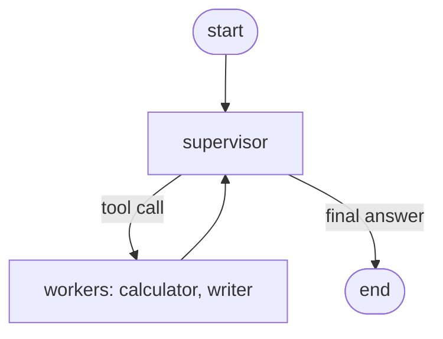

# Module 11: Frameworks: What They Add, and When to Use None

**Goal:** see what an agent framework adds to the hand-built pieces of Modules 2 to 10, by solving one task with the course's own code and with LangChain, LangGraph, the OpenAI Agents SDK and Pydantic AI (CrewAI as code to read); learn what is known about which frameworks are used in production; and get a way to choose, including choosing none.
**Time:** ~40 min. **Prerequisites:** [Module 4](04-multi-agent.md) (the supervisor, which is the task here); Modules [2](02-building-blocks.md), [9](09-memory.md) and [10](10-tools-mcp.md) are referred to.

Every module so far built its pieces by hand, in about 30 lines each: the agent loop, a supervisor, a retriever, a memory. That was deliberate: a framework is easier to judge when you know what it replaces. This module puts the same supervisor into five frameworks, compares what comes out, and then asks the question that matters more than which framework looks nicest: *what do people actually use when the application has to run for years?*

## Setup

The framework examples live in `examples/frameworks/` and use their **own** virtual environment, so that the dependencies of the frameworks never touch the rest of the course (the Python lessons need only `openai`, the JavaScript ones nothing). They reuse the model settings of your `.env` (Azure OpenAI by default) through the course's `llm_client`. The frameworks are Python-only here: the JavaScript editions of some of them exist (section 4) but are not part of the tutorial, so this module is an exception to the rule of identical Python and JavaScript files.

```powershell
python -m venv examples\frameworks\.venv
examples\frameworks\.venv\Scripts\python -m pip install -r examples\frameworks\requirements.txt
examples\frameworks\.venv\Scripts\python examples\frameworks\f01_langchain.py
```

| Example | What it shows | Install |
|---|---|---|
| `f00_plain.py` | The baseline: the supervisor of Module 4 with the course's own loop (`agent.py`) | `openai` |
| `f01_langchain.py` | LangChain's `create_agent`, workers wrapped as tools | `langchain`, `langchain-openai` |
| `f02_langgraph.py` | The supervisor as an explicit graph, with a checkpointer (memory) and the graph drawn as Mermaid | `langgraph` and the above |
| `f03_openai_agents.py` | The OpenAI Agents SDK: agents as tools, and a handoff | `openai-agents` |
| `f04_pydantic_ai.py` | Pydantic AI: agent delegation, and a validated, typed result | `pydantic-ai-slim[openai]` |
| `f05_crewai.py` | **Code to read, not run:** CrewAI's roles, tasks and crew | (not installed) |

Versions used for the runs below (Python 3.13, Windows, `gpt-5.4-nano` on Azure OpenAI through its OpenAI-compatible endpoint): `langchain` 1.5.2, `langchain-openai` 1.8.5, `langgraph` 1.2.24, `openai-agents` 0.25.0, `pydantic-ai-slim` 2.71.0, `openai` 3.57.0. Framework APIs change quickly (LangChain 1.0 replaced its agent builder and moved the old chain API into a separate `langchain-classic` package), so pin the versions you use.

## 1. What a framework is for

A framework replaces code you would otherwise write, and takes decisions you would otherwise make. (The words *framework*, *SDK*, *runtime* and *harness* overlap and vendors use them differently: see the [glossary](glossary.md#framework).) Mapped to the course:

| You built by hand | What frameworks offer instead | Where the course did it |
|---|---|---|
| The agent loop (call, run tools, repeat, stop) | `create_agent`, `Runner`, `Agent.run` | Module 2, `agent.py` |
| Tool schemas written as JSON | Schemas generated from type hints and docstrings | Module 2, `Tool` |
| Validate and retry structured output | Typed output with automatic correction | Module 2 |
| A supervisor with workers | Agents as tools, handoffs, delegation, "crews" | Module 4 |
| Saving and restoring a conversation | Checkpointers, sessions, thread ids | Module 9 |
| Pausing for a human decision | `interrupt()` and resume | Module 12 (planned) |
| Tracing, `LLM_TRACE` | Hosted or OpenTelemetry tracing | Module 2 |
| MCP client | Built-in MCP support | Module 10 |
| Integrations (vector stores, loaders, providers) | A large catalogue, above all in LangChain | Modules 5 to 8 |

What they cost: **abstractions** between you and the prompts and messages (when something goes wrong you debug through layers), **API churn** (breaking releases, renamed packages), **dependencies** (section 2), **lock-in** (your flow is shaped like the framework's), and a **bias** in how you think about the problem (roles and crews; graphs; handoffs). None of these is fatal; each is a cost to weigh against the code you do not write.

## 2. The same task, five ways

The task is Module 4's supervisor: *"A team has 4 people and each gets 3 coffees. Announce the total coffees."* A supervisor must delegate: first to a calculator (which has `add` and `multiply`), then to a writer, and return the writer's text. The prompts and the two tool functions are shared (`common.py`), so only the framework differs. `common.py` also counts the model calls by watching the HTTP library under all of them.

| | Plain (`agent.py` + supervisor) | LangChain | LangGraph | OpenAI Agents SDK | Pydantic AI | CrewAI |
|---|---|---|---|---|---|---|
| Lines of code that build and run it | 77 (30 supervisor + 47 loop) | 23 | 42 (includes a second turn and the drawing) | 24 (includes a handoff variant) | 38 (includes a typed variant) | 33 (two crews, not run) |
| Answer | "12 coffees" | "12 coffees" | "12 coffees" | "12 coffees" | "12 coffees" | not run |
| **Model calls** | **6** | **6** | **6** | **6** | **6** | n/a |
| Seconds (one run each) | 5.2 | 7.1 | 5.1 | 5.6 | 5.9 | n/a |
| Install, fresh environment: packages / disk | 15 / 58 MB (`openai` alone) | 45 / 98 MB | 44 / 97 MB | 40 / 120 MB | 27 / 93 MB (slim, OpenAI only) | not measured |

(Packages count everything `pip list` shows, pip included. Seconds are single runs on a shared network and say little; the point is that they are of the same order.)

**The first finding is that nothing changes in the model calls.** Six calls in every framework: the supervisor asks the calculator (1), the calculator calls a tool (2) and answers (3), the supervisor asks the writer (4, 5), and gives the final answer (6). A framework is the same loop, packaged. What differs is the code around it, what you get besides, and the install.

**The second is how little code the simple case needs.** The two frameworks that are closest to "a loop with tools" (LangChain and the Agents SDK) need about a third of the lines of the hand-built version, because tool schemas, the loop and message handling come ready-made. The graph version is longer because it declares what the loop did implicitly, and that is the point of LangGraph.

### What each looks like

**LangChain** (`f01_langchain.py`): an agent is a function call; a worker is an agent wrapped in a tool.

```python
calculator_agent = create_agent(model, tools=[add, multiply], system_prompt=common.CALCULATOR_SYSTEM)

@tool("calculator", description=common.CALCULATOR_DESCRIPTION)
def calculator(task: str) -> str:
    return ask(calculator_agent, task)

supervisor = create_agent(model, tools=[calculator, writer], system_prompt=common.SUPERVISOR_SYSTEM)
```

**LangGraph** (`f02_langgraph.py`): the loop becomes a declared graph with state. Its shape, drawn by `graph.get_graph().draw_mermaid()` (simplified here):



```python
builder = StateGraph(MessagesState)
builder.add_node("supervisor", supervisor)
builder.add_node("workers", ToolNode([calculator, writer]))
builder.add_edge(START, "supervisor")
builder.add_conditional_edges("supervisor", tools_condition, {"tools": "workers", END: END})
builder.add_edge("workers", "supervisor")
graph = builder.compile(checkpointer=InMemorySaver())
```

The extra lines buy three things the other versions do not have. The graph can be **drawn** and inspected. Its state is **saved after every step** under a thread id: the lesson's second question, *"Now the same for 6 people."*, on the same thread, was answered with **18**, because the checkpointer restored the conversation (Module 9's memory, built in). And a node can **pause for a human** with `interrupt()` and the run resumes later, even in another process when the checkpointer is a database (the in-memory one of the lesson is lost on restart).

**OpenAI Agents SDK** (`f03_openai_agents.py`): small objects; a specialist is either a tool of the supervisor or a handoff target.

```python
supervisor = Agent(name="supervisor", instructions=common.SUPERVISOR_SYSTEM, model=model,
                   tools=[calculator.as_tool(tool_name="calculator", tool_description=...),
                          writer.as_tool(tool_name="writer", tool_description=...)])
triage = Agent(name="triage", instructions="Pass each request to the right specialist ...", model=model,
               handoffs=[calculator, writer])
```

The handoff variant answered *"What is 17 times 23?"* with 391, in 3 model calls, and `result.last_agent.name` says who answered (`calculator`): control moved to the specialist (Module 4's swarm), where `as_tool` keeps the supervisor in charge. Two practical notes from the setup: the SDK defaults to OpenAI's Responses API and to sending **traces to OpenAI's servers**, so the example selects the Chat Completions model class for the compatible endpoint and switches tracing off; and its documentation lists limits for non-OpenAI endpoints (some features need the Responses API).

**Pydantic AI** (`f04_pydantic_ai.py`): typed, with delegation as an ordinary tool.

```python
class Announcement(BaseModel):
    total_coffees: int
    message: str

supervisor = Agent(model, instructions=..., output_type=Announcement)

@supervisor.tool
async def calculator(ctx: RunContext, task: str) -> str:
    return (await calculator_agent.run(task, usage=ctx.usage)).output
```

The typed run returned `Announcement(total_coffees=12, message='...')`: a validated object whose `total_coffees` is an `int`, with correction of invalid answers built in. That is the parse-validate-retry of Module 2 as a feature. On start the library printed a banner advertising its Logfire tracing service; the example switches it off with `PYDANTIC_AI_NO_BANNER`.

**CrewAI** (`f05_crewai.py`, code only): the model is a **team of roles**.

```python
calculator = Agent(role="Calculator", goal="Do arithmetic exactly", backstory="You always use the tools ...", tools=[add, multiply], llm=llm)
announce = Task(description="A team has {people} people and each gets {coffees} coffees. Announce the total coffees.",
                expected_output="One short, friendly sentence that states the total number of coffees.")
crew = Crew(agents=[calculator, writer], tasks=[announce], process=Process.hierarchical, manager_llm=llm)
print(crew.kickoff(inputs={"people": 4, "coffees": 3}).raw)
```

The role, goal and backstory *are* the prompt; a **hierarchical** process adds a manager that plans and delegates (our supervisor), a **sequential** one runs tasks in order. It was not installed or run for this tutorial, because its dependency tree is large; the file states this at the top and follows the documentation of 2026-11-20 (version 1.15.x).

## 3. The frameworks in a sentence each

| Framework | Core idea | Good fit | Watch out |
|---|---|---|---|
| **LangChain** | Integrations and a quick agent (`create_agent`), built on LangGraph since version 1.0; the old chain API moved to `langchain-classic` | Many providers, vector stores and loaders; a fast start | A big surface and a history of breaking changes; the high-level agent hides the loop |
| **LangGraph** | An explicit graph with state, checkpoints, human-in-the-loop, streaming | Long-running or resumable flows, approvals, anything where you must control the sequence | More code for simple agents; a graph is a design you must maintain |
| **OpenAI Agents SDK** | Few primitives: agent, tools, handoffs, guardrails, tracing | OpenAI-centred applications; handoff-style routing | Best experience on OpenAI's own API; traces go to OpenAI unless disabled |
| **Pydantic AI** | Type-safe agents: typed outputs, dependency injection, tools from type hints; optional Logfire, evals and durable-execution integrations | Applications where validated, typed results matter; teams that already use Pydantic | Python only; a newer framework than LangChain, so read the release notes before upgrading |
| **CrewAI** | Role-playing agents in crews, a commercial platform and "Flows" for explicit control | Quick multi-role prototypes; business-process style tasks | Roles and backstories steer through prompt text, which is harder to test than code; anonymous telemetry is on by default (`CREWAI_DISABLE_TELEMETRY=true` switches it off); large install |

CrewAI deserves a fair word: it is a production-oriented project (it has a commercial platform and a Flows layer for deterministic control), not only a research toy. Its role-based abstraction, though, is the one that moves furthest from "a loop you can read", and Module 3 argued that explicit workflows are often more reliable than free-form agents; the lesson above showed that in the end the number of model calls is the same.

## 4. The rest of the landscape

Listed for orientation, from the projects' own pages on 2026-11-20; none of them is in the examples.

| Framework | What the pages say | Note |
|---|---|---|
| [Microsoft Agent Framework](https://learn.microsoft.com/en-us/agent-framework/) | The successor to AutoGen and Semantic Kernel, which both announce it in their READMEs | AutoGen's repository is marked archived; Semantic Kernel points to the new framework |
| [Google Agent Development Kit (ADK)](https://github.com/google/adk-python) | Google's open agent toolkit; Python, with TypeScript, Go and Java editions | Close to Google Cloud and Vertex AI |
| [LlamaIndex](https://github.com/run-llama/llama_index) | Data and retrieval framework with agents and workflows | The company's focus has moved to its parsing product; the open-source framework remains |
| [Claude Agent SDK](https://github.com/anthropics/claude-agent-sdk-python) | Anthropic's agent loop and tools as a library (Python and TypeScript) | A vendor SDK under commercial terms, not open source |
| [smolagents](https://github.com/huggingface/smolagents) | Hugging Face's minimal agent library (Apache-2.0); agents that act by writing code | Small and readable |
| [Vercel AI SDK](https://ai-sdk.dev) and [Mastra](https://mastra.ai) | TypeScript toolkits for AI applications and agents | The JavaScript counterparts of the Python frameworks |
| [LangGraph.js](https://github.com/langchain-ai/langgraphjs), [OpenAI Agents SDK for JS](https://github.com/openai/openai-agents-js) | The JavaScript editions of two frameworks above | MIT licensed |

## 5. What is actually used in production?

There is no single, trustworthy answer, and the honest first step is to say how weak each kind of evidence is. Numbers were read on **2026-11-20**.

**Downloads from PyPI** (last 30 days, from pypistats.org; the weakness: a download is not a user, a CI run counts as many, and a package that other packages depend on is counted without anyone choosing it):

| Package | Downloads, last 30 days |
|---|---|
| `langchain` | 157.3 million |
| `langgraph` | 61.4 million |
| `claude-agent-sdk` | 38.3 million |
| `pydantic-ai-slim` / `pydantic-ai` | 37.1 million / 7.0 million |
| `openai-agents` | 20.5 million |
| `google-adk` | 11.1 million |
| `crewai` | 2.6 million |
| `llama-index` | 1.8 million |
| `smolagents` | 0.74 million |
| `autogen-agentchat` | 0.43 million |
| `semantic-kernel` | 0.35 million |

The two Pydantic AI figures differ five-fold, which shows the problem: the likely reason is that the full package depends on the slim one, so installing the first also counts as installing the second.

**GitHub stars** (interest, accumulated over time; an archived repository keeps its stars): LangChain 150k, AutoGen 62.0k (archived), CrewAI 61.1k, LlamaIndex 53.0k, LangGraph 45.2k, OpenAI Agents SDK (Python) 30.8k, smolagents 30.5k, Semantic Kernel 28.8k, Google ADK (Python) 22.3k, Pydantic AI 21.3k.

**Surveys.**

| Survey | What it found | Weakness |
|---|---|---|
| [Stack Overflow Developer Survey 2025](https://survey.stackoverflow.co/2025/ai), AI agents section: "tools for agent orchestration or agent frameworks used in the past year", asked of developers who use or build agents (3,758 responses, 7.7% of all respondents) | Ollama 51.1%, **LangChain 32.9%**, **LangGraph 16.2%**, Vertex AI 15.1%, Amazon Bedrock Agents 14.5%, LlamaIndex 13.3%, AutoGen 12%, **CrewAI 7.5%**, Semantic Kernel 6%, smolagents 3.7% | "Used in the past year" is not "in production"; the list mixes frameworks with runtimes and cloud services; self-selected respondents. The OpenAI Agents SDK and Pydantic AI are not in the list |
| LangChain, [*State of Agent Engineering*](https://www.langchain.com/state-of-agent-engineering) (survey of 1,340 people, 18 November to 2 December 2025; page dated 12 June 2026) | 57.3% say they have agents in production; quality is the main barrier; 89% have some observability. No framework shares are given: write-in answers mention custom agents built on LangChain and LangGraph | Run by LangChain, an open public survey (not a representative sample), weighted to technology companies and small teams |

**What the builders say.** Anthropic's [*Building effective agents*](https://www.anthropic.com/engineering/building-effective-agents) (December 2024, and updated with a note that the tooling has changed since) recommends starting with direct calls to the model API, notes that frameworks can obscure the prompts and responses, and says that anyone who uses one should understand what it does underneath. The author's company also sells a framework, so this is advice with an interest, not data. No company engineering report about adopting or leaving a framework was found for this module.

**What can be said.**

- **LangChain and LangGraph are the most used by the measures that exist** (downloads, stars, and the one survey that names frameworks, where LangChain is first and LangGraph second among the frameworks). The caveats are that this is one survey, and the dependency effect in the downloads.
- **The vendor SDKs have large download counts for their age** (the Claude Agent SDK 38.3 million and the OpenAI Agents SDK 20.5 million in the last 30 days, Google ADK 11.1 million), but the counts cannot tell tutorials, automated installs and real applications apart.
- **The Microsoft frameworks are in transition**: AutoGen is archived, Semantic Kernel points to a successor. A choice made two years ago may already have moved.
- **Nothing here measures production use or satisfaction.** The most reliable statement is therefore not "X is the standard" but: the field changes within months, the larger frameworks have the larger communities and the more examples, and the builders' own advice is to keep the abstraction thin.

## 6. How to choose, including choosing none

Questions to ask before picking, in the order that usually matters:

| Question | If yes |
|---|---|
| Is a loop with a handful of tools enough, and do you know the model API? | **No framework** (Module 2's 30 lines), or the thinnest SDK of your provider. Add a framework when a real need appears |
| Must a run **pause for approval, survive restarts, or resume** days later? | LangGraph, or a durable-execution engine; this is hard to hand-build |
| Do you need **validated, typed** results and tools? | Pydantic AI (or add schema validation to your own loop) |
| Are you tied to one provider's platform? | Its SDK (OpenAI Agents SDK, Claude Agent SDK, Google ADK, Microsoft Agent Framework) gives the best integration and the most lock-in |
| Do you need **many integrations** (stores, loaders, providers) quickly? | LangChain's catalogue |
| Is it a **prototype with several roles**, or a process that business people must read? | CrewAI-style roles can be the quickest way to a demo |
| How often can you afford a breaking change? | Pin versions, keep an upgrade routine, and prefer frameworks with a stable core |

**Keep the exit open.** Whatever you choose, keep the parts that are yours outside the framework: the business logic and the tool functions (plain functions, or MCP servers as in Module 10), the prompts as text files, the golden questions and evaluations (Modules 5 and 12), and the memory in your own store (Module 9). Then replacing the framework means rewriting the thin wiring, as the five examples here show: the same two tool functions and the same prompts served every one of them.

## 7. From tutorial to production

| Area | In this tutorial | What to look for in production |
|---|---|---|
| Versions | Pinned ranges, one run | Exact versions in a lock file, an upgrade policy, tests that fail when behaviour changes (the same golden questions after every upgrade) |
| Dependencies | Separate environment, 27 to 45 packages per framework | Review and scan the dependency tree, watch licenses, keep the image small, mind the transitive packages |
| State | In-memory checkpointer, notes in a process | A database-backed checkpointer or store, with retention and deletion rules (Module 9) |
| Observability | Printed counts and traces | Tracing to a backend you control (OpenTelemetry is supported by most), with the prompts and tool calls recorded; decide what the framework sends to a vendor by default (OpenAI Agents SDK traces, CrewAI telemetry, Pydantic AI's Logfire banner) |
| Control | The model decides the flow | Fixed flow where possible (Module 3), approvals for side effects (Module 10), limits on steps, tokens and cost |
| Testing | One task, one answer | Evaluate whole runs and tool choices on a golden set, in CI, with a tolerance for the model's variance |
| Lock-in | The same functions in five frameworks | Keep tools, prompts, evaluations and data outside the framework |

## Key takeaways

- A framework is the loop you already know, packaged: the same supervisor made the same six model calls in the hand-built version and in all four frameworks that were run.
- What a framework adds is concrete: less code for the simple case, generated tool schemas, and, in the larger ones, persistence, human-in-the-loop, typed outputs, handoffs, tracing and integrations. What it costs is abstraction, dependencies, API churn and lock-in.
- LangChain and LangGraph are the most used by the available measures; no measure says how many of those users are in production or satisfied, and the builders' advice is to start simple.
- Choose by need: resumable and approval-driven flows (LangGraph), typed results (Pydantic AI), a provider's platform (its SDK), many integrations (LangChain), and no framework when a loop with tools is enough.
- Keep tools, prompts, evaluations and memory outside the framework, and the choice stays reversible.

## Exercises

1. Add a third worker, a `translator` that translates the announcement into Hungarian, to the plain version and to two frameworks. Count the lines you change in each.
2. In `f02_langgraph.py` add an `interrupt()` before the writer runs ("approve this text?") and resume it with `Command(resume=...)`. What survives between the pause and the resume, and what happens if the process restarts with `InMemorySaver`?
3. Make the plain supervisor return the typed `Announcement` of `f04_pydantic_ai.py` by validating the final answer yourself with Pydantic, and retry on failure (Module 2). How many lines is it compared with Pydantic AI's `output_type`?
4. Print the request bodies that each framework sends (extend the counter in `common.py` to record them). Which framework adds system text or tool descriptions of its own, and how many tokens does that cost?
5. Install CrewAI in a *separate* environment, make `f05_crewai.py` run against your endpoint, and compare model calls and tokens with the other frameworks. Does the hierarchical process make more than six calls?
6. Run the examples against LM Studio (`LLM_PROVIDER=lmstudio`). Which framework features still work with a small local model, and which fail?
7. Write your own decision for a project you know: answer the questions of section 6 and name what you would keep outside the framework.

## Further reading

- Framework documentation: [LangChain](https://docs.langchain.com/oss/python/langchain/quickstart) and [LangGraph](https://docs.langchain.com/oss/python/langgraph/quickstart); [OpenAI Agents SDK](https://openai.github.io/openai-agents-python/); [Pydantic AI](https://pydantic.dev/docs/ai/overview/); [CrewAI](https://docs.crewai.com)
- Choosing: Anthropic, [*Building effective agents*](https://www.anthropic.com/engineering/building-effective-agents)
- Evidence: [Stack Overflow Developer Survey 2025, AI section](https://survey.stackoverflow.co/2025/ai); LangChain, [*State of Agent Engineering*](https://www.langchain.com/state-of-agent-engineering); download statistics at [pypistats.org](https://pypistats.org)

**Next:** [Module 12: Best practices](12-best-practices.md)
