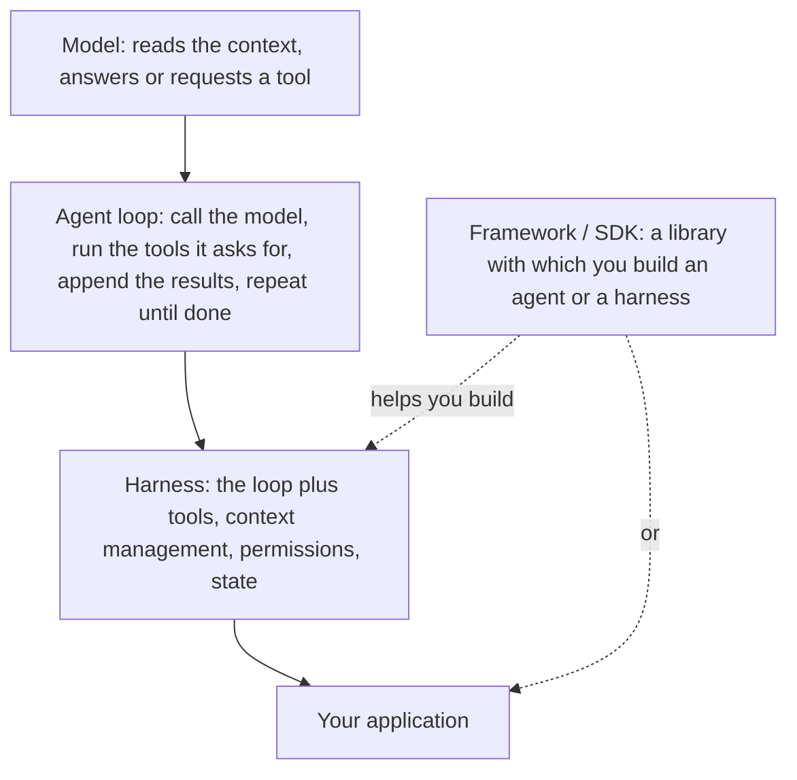

# Glossary

The words around LLM agents are used loosely, and vendors use the same word for different things. This glossary defines the terms that matter most for this course, says how the course uses each one, and marks the terms that are **used differently elsewhere**, so that you can tell what a source means when you read it. Sources for those contested terms were read on **2026-11-20** and are linked in the entries; the field changes quickly, so check the date.

## Two questions, two sets of words

Most confusion comes from mixing two separate questions:

| Question | The words |
|---|---|
| **Who decides what happens next?** Your code or the model? | [workflow](#workflow) (code decides) and [agent](#agent) (the model decides), connected by the [agent loop](#agent-loop) |
| **What do you build on, and what do you write yourself?** | [framework](#framework) and [SDK](#sdk) (libraries to build with), [runtime](#runtime) (what runs agents in production), [harness](#harness) (the layer around the model that runs a session) |

## Index

- **Core:** [agent](#agent), [agentic](#agentic), [workflow](#workflow), [agent loop](#agent-loop), [orchestration](#orchestration)
- **Building blocks:** [tool calling](#tool-calling), [structured output](#structured-output), [system prompt and instructions files](#system-prompt-and-instructions-files), [context window](#context-window), [context engineering and compaction](#context-engineering-and-compaction), [memory](#memory)
- **Patterns:** [ReAct](#react), [plan-and-execute](#plan-and-execute), [reflection and evaluator-optimizer](#reflection-and-evaluator-optimizer), [routing](#routing), [supervisor](#supervisor), [subagent](#subagent), [handoff](#handoff)
- **Packaging:** [framework](#framework), [SDK](#sdk), [runtime](#runtime), [harness](#harness)
- **Knowledge:** [embedding](#embedding), [RAG](#rag), [knowledge graph and GraphRAG](#knowledge-graph-and-graphrag), [ontology and taxonomy](#ontology-and-taxonomy)
- **MCP:** [MCP](#mcp), [host, client and server](#host-client-and-server)
- **Safety and operations:** [guardrail](#guardrail), [human-in-the-loop](#human-in-the-loop), [permission and approval modes](#permission-and-approval-modes), [sandbox](#sandbox), [prompt injection](#prompt-injection), [trace and observability](#trace-and-observability), [eval](#eval)

## Core

### Agent

A system in which the **model decides**, step by step, which tool to call next and when to stop, inside a [loop](#agent-loop). In this course: a model, instructions, tools and the loop, usually with some [memory](#memory) ([Module 1](01-foundations.md), [Module 2](02-building-blocks.md)).

**Used differently elsewhere.** Anthropic's [*Building effective agents*](https://www.anthropic.com/engineering/building-effective-agents) defines an agent as a system in which the model directs its own process and tool use, and notes that some people also use the word for more prescriptive, predefined flows. Simon Willison's short form is that an agent runs tools in a loop to achieve a goal ([source](https://simonwillison.net/2025/Sep/18/agents/)). When a product calls itself an agent, ask who decides the next step.

### Agentic

An adjective for behaviour in which the model chooses actions. The course prefers "agent" (model-directed) and "workflow" (code-directed), and uses "agentic" rarely.

**Used differently elsewhere.** Anthropic uses "agentic systems" as an **umbrella** that includes both workflows and agents. LangChain's [workflows and agents](https://docs.langchain.com/oss/python/langgraph/workflows-agents) page lists "workflows" and "agentic systems" side by side. Microsoft's and Google's pages use it mostly as a general descriptor. A phrase such as "agentic workflow" therefore needs a look at what the author means.

### Workflow

An application in which **code decides the sequence** of model calls and tool uses (prompt chaining, routing, parallelization, orchestrator-workers, evaluator-optimizer). Predictable and easier to test ([Module 3](03-patterns.md)).

**Used differently elsewhere.** Anthropic and LangChain use the same split as the course (predefined code paths against model-directed control). Microsoft's Agent Framework and Google's ADK also use "workflow" for graphs and sequential or parallel templates that **contain agents**. Check whether a "workflow" in a source is fixed or contains model-directed steps.

### Agent loop

The cycle at the centre of every agent (also called the agentic loop): send the messages and tool definitions to the model; if the reply asks for tools, run them, append the results and call the model again; if it contains a final answer, stop. A **stopping condition** such as a maximum number of steps keeps the loop finite ([Module 2](02-building-blocks.md): `run_agent`). In [Module 11](11-frameworks.md) the same supervisor made exactly six model calls in the hand-built loop and in four frameworks: the loop is the same everywhere.

**Details differ.** The OpenAI Agents SDK also handles [handoffs](#handoff) inside its loop, and can be configured so that the first tool's output ends the run ([running agents](https://openai.github.io/openai-agents-python/running_agents/)).

### Orchestration

Coordinating model calls, tools and agents so that a task gets done. The word has several meanings, so the course avoids the bare word:

| Meaning | Where it is used | The course says |
|---|---|---|
| Code fixes the order of steps | Anthropic's "orchestrated through predefined code paths" | [workflow](#workflow) |
| A manager model splits the task and delegates | Anthropic's and LangChain's "orchestrator-workers" | [supervisor](#supervisor) |
| Patterns for several agents (sequential, concurrent, handoff, group chat) | Microsoft's [orchestrations](https://learn.microsoft.com/en-us/agent-framework/workflows/orchestrations/) | multi-agent pattern |
| Where the loop runs | OpenAI's agent guides | [runtime](#runtime) |

## Building blocks

### Tool calling

The mechanism that lets a model act: the model returns a structured **tool call** (the name of a tool and JSON arguments), the application runs the function and sends back the **tool result**, and the model continues. The model never executes anything itself ([Module 2](02-building-blocks.md)).

**Same idea, different names.** OpenAI says "function calling" and "tool call"; Anthropic's API says "tool use" and a "tool use block"; some authors use "tool use" for the whole capability, including plugins and search.

### Structured output

A reply that follows a schema (usually JSON), so that code can use it. Validate it and ask the model to correct a bad answer ([Module 2](02-building-blocks.md)); some libraries do this for you ([Pydantic AI in Module 11](11-frameworks.md)).

### System prompt and instructions files

The **system prompt** is the developer's standing instruction at the start of the conversation. **Instructions files** are project files that a coding tool puts into the context for you, such as `AGENTS.md` (an open convention, "a README for agents") or `CLAUDE.md`. They are not the same layer: a system prompt is set through the API; an instructions file is loaded by the harness.

**Used differently elsewhere.** Claude Code's documentation calls `CLAUDE.md` a kind of memory; Codex reads `AGENTS.md` files from the project root down to the current folder. Instructions in these files steer the model but do not override permission rules.

### Context window

The tokens the model sees in one request: instructions, tools, history, retrieved text and tool results. It is limited, it costs money and time with every request, and a model can use long contexts less well than short ones ([Module 2](02-building-blocks.md), [Module 9](09-memory.md)). Anthropic's article on context engineering describes context as the set of tokens included when sampling from the model.

### Context engineering and compaction

**Context engineering** is deciding what goes into the context window and what stays out: instructions, tools, retrieved data, message history. Anthropic presents it as the natural successor of prompt engineering ([source](https://www.anthropic.com/engineering/effective-context-engineering-for-ai-agents)); Simon Willison reports the term gaining traction as a better alternative to "prompt engineering". **Compaction** is one technique: when a conversation nears the limit, summarize it and continue with the summary ([Module 9](09-memory.md): `compact`). Others are trimming, clearing old tool results, retrieving only what is needed, and writing notes outside the window.

### Memory

Information that an agent keeps beyond the current request. **Short-term**: the message list of one conversation, trimmed or summarized. **Long-term**: a store that outlives the session (facts, preferences, history), reconciled on write and searched or injected when needed ([Module 9](09-memory.md)).

**Used differently elsewhere.** Some tools call instruction files "memory" (Claude Code's `CLAUDE.md`); in this course memory means information the agent writes and later reads.

## Patterns

### ReAct

*Reason and act*: the model alternates a reasoning step, an action (a tool call) and an observation (the result), repeated until it can answer. Introduced by Yao et al. ([arXiv:2210.03629](https://arxiv.org/abs/2210.03629)); the basis of most tool-using agents ([Module 3](03-patterns.md)).

### Plan-and-execute

A planner model first writes a plan of steps; an executor works through them, optionally with re-planning when a step fails ([Module 3](03-patterns.md)). This is the course's definition; no single primary source defines the term, and implementations vary.

### Reflection and evaluator-optimizer

Two forms of "generate, critique, improve". **Reflection**: the same agent critiques and revises its own output. **Evaluator-optimizer**: a separate evaluator judges the output against criteria and an optimizer revises it in a loop ([Module 3](03-patterns.md)).

### Routing

A classifier (often a model call) assigns the input to a category, and code sends it to a specialist path. A [workflow](#workflow) pattern ([Module 3](03-patterns.md)).

### Supervisor

An agent that delegates parts of a task to workers and combines their results, never doing the specialist work itself ([Module 4](04-multi-agent.md)). In this course the workers are exposed to the supervisor as tools. Anthropic calls the workflow version "orchestrator-workers"; Microsoft's frameworks speak of a manager agent.

### Subagent

An agent that another agent calls to do part of a job, usually with its own instructions, tools and context.

**Used differently elsewhere.** The OpenAI Agents SDK uses "sub-agent" both for [handoff](#handoff) targets and for agents used as tools; Anthropic's article avoids the word and says "worker LLMs". When a source says "subagent", check whether the caller keeps control or hands it over.

### Handoff

Control of the conversation **passes to another agent**, which takes over from there (the OpenAI Agents SDK and Microsoft's frameworks agree on this meaning). Contrast with an agent used as a tool, where the caller keeps control and receives a result ([Module 4](04-multi-agent.md), and the handoff example in [Module 11](11-frameworks.md)).

## Packaging

### Framework

A library of abstractions with which you **build your own** agent application: LangChain, LangGraph, CrewAI, Pydantic AI, Google ADK, LlamaIndex and others ([Module 11](11-frameworks.md)). You write the application; the framework supplies the loop, tool schemas, state, tracing and integrations.

### SDK

A vendor's software development kit for its platform. It ranges from a thin client for the API, where **you write the loop** yourself, to an agent SDK that **runs the loop for you** (Anthropic's documentation draws this contrast between its Client SDK and its Agent SDK). The OpenAI Agents SDK and the Claude Agent SDK are agent SDKs; "framework" and "agent SDK" overlap heavily.

### Runtime

What **runs agents in production**: durable execution, streaming, persistence, pausing and resuming, human-in-the-loop. LangChain uses it as one of three categories (framework, runtime, harness) and lists LangGraph and Temporal as runtimes ([source](https://docs.langchain.com/oss/python/concepts/products)).

**Used differently elsewhere.** VS Code speaks of the "Copilot runtime" for the part that runs a session; in everyday speech "runtime" can mean any process that executes code.

### Harness

The **software layer that runs an agent session**: it connects the model to context and tools, runs the [agent loop](#agent-loop), applies permissions and approvals, manages context and keeps the conversation state. VS Code's documentation defines it this way ([agent harnesses](https://code.visualstudio.com/docs/agents/concepts/agent-harnesses)) and says that the model decides what to request while the harness coordinates the system that carries it out. In this course's terms, the tiny `agent.py` loop plus the approval gate of [Module 10](10-tools-mcp.md) is a harness in miniature; coding assistants such as the Copilot agent in VS Code and Claude Code are full ones.

**Used differently elsewhere.** The word is newer and less settled than "framework":

- **Anthropic** calls the Claude Agent SDK an "agent harness" (in its post on [long-running agents](https://www.anthropic.com/engineering/effective-harnesses-for-long-running-agents)), and the SDK's own documentation says it provides the same tools, agent loop and context management as Claude Code. A harness can therefore be a library you program.
- **LangChain** treats a harness as an opinionated, batteries-included kind of framework (built-in planning, subagents, file system, context management), and names its Deep Agents and the Claude Agent SDK as examples.
- **VS Code** separates the harness from the sandbox and the host: its documentation says the environment is not the harness, and lists several harnesses (Copilot, Claude, Codex) that it can run.
- OpenAI's usage could not be checked for this glossary.

A workable rule: a **framework** is what you build with; a **harness** is what runs the session. A harness can be built with a framework, or be a ready-made product you extend (with [MCP](#mcp) servers, instructions files and hooks) instead of writing the loop yourself.

## Knowledge

### Embedding

A vector of numbers that represents the meaning of a text, so that similar texts have nearby vectors; the basis of semantic search ([Module 5](05-rag.md)).

### RAG

*Retrieval-augmented generation*: before the model answers, relevant passages are retrieved from a knowledge source and put into the prompt, with citations. Typical retrieval combines embeddings and keyword search (**hybrid search**) and is measured with a golden set of questions ([Module 5](05-rag.md), [Module 6](06-knowledge-bases.md) for keeping the index current).

### Knowledge graph and GraphRAG

A **knowledge graph** stores facts as entities and relations. **GraphRAG** extracts such a graph from documents with an LLM and uses it to retrieve connected facts (local search) or summaries of whole communities of entities (global search) ([Module 7](07-graphrag.md); where the graph lives in production: [Module 8](08-graph-databases.md)).

### Ontology and taxonomy

A **taxonomy** is a hierarchy of categories (a WorkflowPattern is a kind of Pattern). An **ontology** adds relations with rules about what may connect to what (domain and range). A graph built without a fixed schema is **open**; one built to an ontology is **guided** and can be validated ([Module 7](07-graphrag.md), section 3).

## MCP

### MCP

The *Model Context Protocol*: an open protocol by which an application connects to servers that offer **tools**, **resources** (data) and **prompts** (templates). Messages are JSON-RPC 2.0, carried by **stdio** (the client starts the server as a subprocess) or **Streamable HTTP** (a remote server). The specification has dated revisions, and the handshake changed between them ([Module 10](10-tools-mcp.md); using it in real applications: [Module 10a](10a-mcp-in-practice.md)).

### Host, client and server

In MCP the **host** is the application that contains the model (Claude Desktop, VS Code); it creates one **client** (a connector) per **server**; a **server** is a program or service that exposes tools, resources and prompts. Not to be confused with a "host" in the harness sense, which VS Code uses for the process that runs a harness and its sessions.

## Safety and operations

### Guardrail

A check on what goes into or comes out of an agent, or on a tool call, that can block or change it. The OpenAI Agents SDK defines input and output guardrails that run checks in parallel with the agent. In this course the strongest guardrails are plain code outside the model, such as the approval gate and the schema validation of [Module 10](10-tools-mcp.md).

**Used differently elsewhere.** Some authors mean a second model that screens requests; others mean rule-based checks. The more the check depends on a model's judgement, the less it is a guarantee.

### Human-in-the-loop

A point where a person approves, corrects or supplies input before the run continues. It ranges from approving a single tool call to reviewing a result at a checkpoint. Frameworks support it by pausing a run and resuming it later (LangGraph's `interrupt`, [Module 11](11-frameworks.md)); coding tools support it as approvals.

### Permission and approval modes

Policies that decide which tool actions run automatically and which need a person's approval: Claude Code's permission modes, Codex's approval policy, and the approvals of VS Code and the Copilot CLI ([Module 10a](10a-mcp-in-practice.md)). A permission policy says *when to ask*; a [sandbox](#sandbox) limits *what is possible at all*. They are separate controls.

### Sandbox

A technical boundary that limits what code run by an agent can reach: files, network, processes.

**Used differently elsewhere.** The word means a container with no network (Anthropic's API skills), an operating-system boundary (Claude Code's sandboxing), or preset modes such as read-only and workspace-write (Codex). VS Code separates the sandbox from the harness and notes that a Git worktree is isolation of code, not a security boundary.

### Prompt injection

Text from an untrusted source (a web page, an e-mail, an issue, a document, a tool description or result) that the model treats as an instruction. For agents it is the central security problem, because tools turn a persuaded model into actions. Related terms: **tool poisoning** (instructions hidden in a tool's description or result), **rug pull** (a tool definition that changes after approval), and the **lethal trifecta** named by Simon Willison: private data, untrusted content and a way to communicate externally in the same agent ([Module 10](10-tools-mcp.md), section 4).

### Trace and observability

A record of every model call and tool call of a run (inputs, outputs, timing, cost), kept so that behaviour can be inspected, debugged and audited. The course's `LLM_TRACE` is the smallest form; frameworks offer hosted tracing and OpenTelemetry export ([Module 11](11-frameworks.md)).

### Eval

A repeatable test of agent behaviour: a **golden set** of questions with the expected outcome, and a measure such as **recall@k** for retrieval ([Module 5](05-rag.md)) or "was the right tool called first" for tool choice ([Module 10](10-tools-mcp.md)). Because model behaviour varies from run to run, evals count results over a set instead of trusting one run.

## Sources

Sources read on 2026-11-20 for the contested terms: Anthropic, [*Building effective agents*](https://www.anthropic.com/engineering/building-effective-agents), [*Effective context engineering for AI agents*](https://www.anthropic.com/engineering/effective-context-engineering-for-ai-agents) and [*Effective harnesses for long-running agents*](https://www.anthropic.com/engineering/effective-harnesses-for-long-running-agents); the [Claude Agent SDK overview](https://code.claude.com/docs/en/agent-sdk/overview); VS Code, [agent harnesses](https://code.visualstudio.com/docs/agents/concepts/agent-harnesses); LangChain, [frameworks, runtimes and harnesses](https://docs.langchain.com/oss/python/concepts/products) and [workflows and agents](https://docs.langchain.com/oss/python/langgraph/workflows-agents); the OpenAI Agents SDK documentation on [running agents](https://openai.github.io/openai-agents-python/running_agents/); Microsoft, [Agent Framework orchestrations](https://learn.microsoft.com/en-us/agent-framework/workflows/orchestrations/); Simon Willison on defining agents ([2025-09-18](https://simonwillison.net/2025/Sep/18/agents/)); [AGENTS.md](https://agents.md/); Yao et al., [ReAct](https://arxiv.org/abs/2210.03629).

[Back to the course outline](../README.md)
